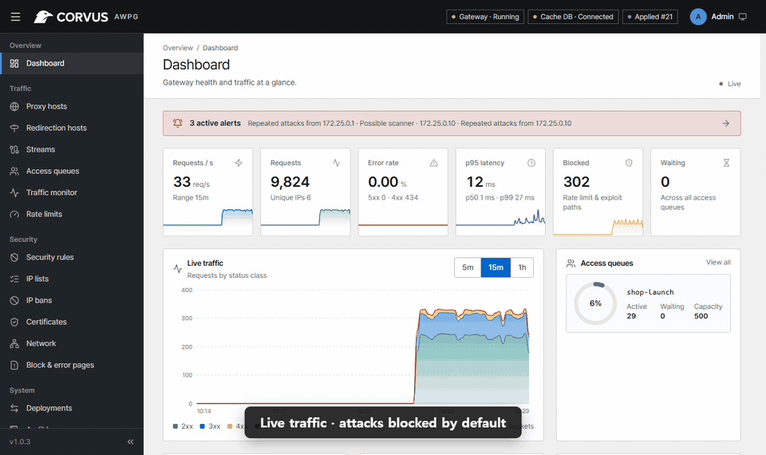
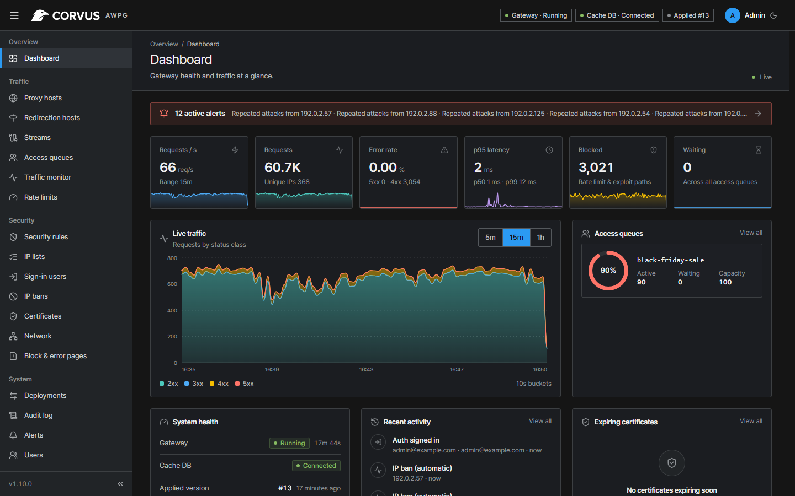
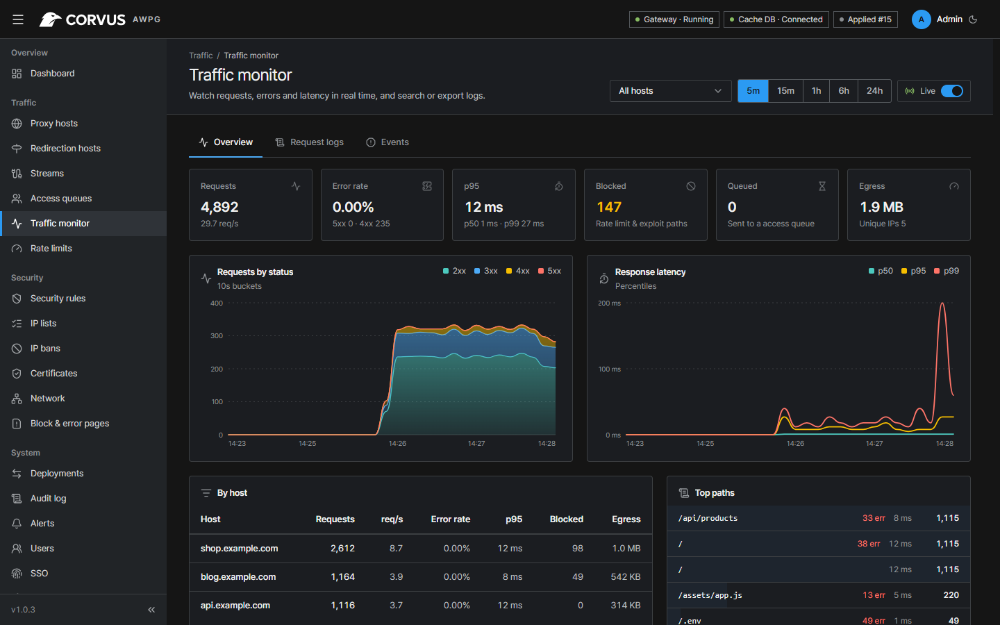
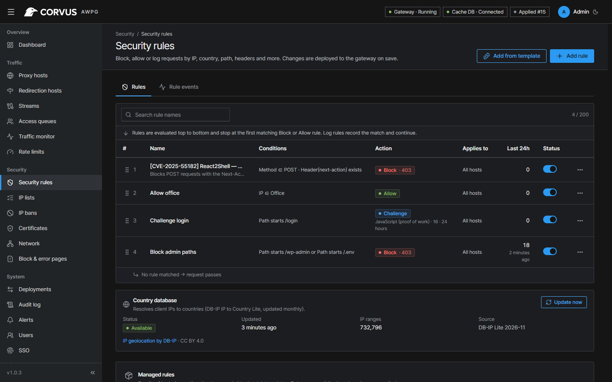
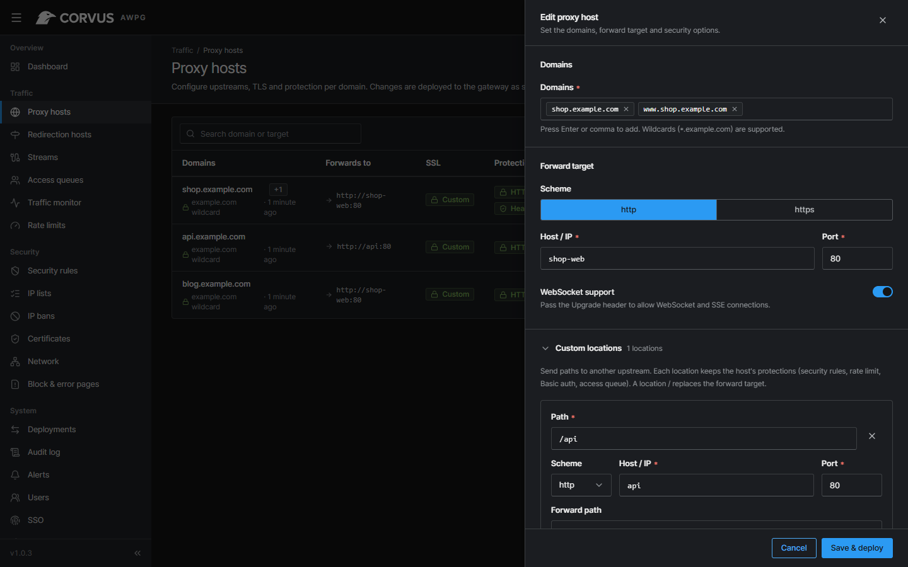
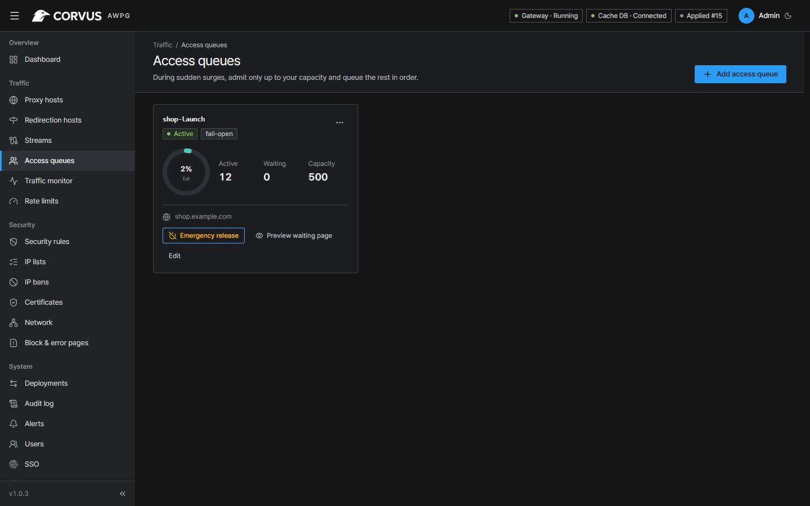

<div align="center">

**English** · [한국어](docs/readme/README_ko.md) · [简体中文](docs/readme/README_zh.md) · [日本語](docs/readme/README_ja.md) · [Русский](docs/readme/README_ru.md) · [Français](docs/readme/README_fr.md) · [Deutsch](docs/readme/README_de.md) · [Español](docs/readme/README_es.md)

<br>

<picture>
  <source media="(prefers-color-scheme: dark)" srcset="assets/brand/corvus-logo-dark.svg">
  
</picture>

### Active Web Protection Gateway

<a href="https://github.com/corvus-gateway/corvus/releases/latest"></a>
<a href="LICENSE"></a>
<a href="https://github.com/corvus-gateway/corvus/pkgs/container/gateway"></a>
<a href="https://github.com/corvus-gateway/corvus/actions/workflows/ci.yml"></a>


<a href="https://scorecard.dev/viewer/?uri=github.com/corvus-gateway/corvus"></a>
<a href="https://www.bestpractices.dev/projects/16315"></a>
<a href="https://www.bestpractices.dev/projects/16315/baseline-1"></a>

</div>

Corvus is a free, open-source (Apache-2.0), self-hosted **reverse proxy with a built-in web
application firewall (WAF)**. It is as easy to run as Nginx Proxy Manager (domains, forwarding
and free Let's Encrypt SSL in a few clicks in a web console), and it also **watches, protects and
controls** the traffic that passes through it: attack blocking on by default, automatic IP bans,
rate limits, a bot challenge, live monitoring and an access queue (waiting room) for traffic
spikes. One Docker container, every feature free, and no traffic is sent to a third-party cloud.
[How it compares](https://corvusgateway.org/compare/) with Nginx Proxy Manager, Caddy, Traefik,
BunkerWeb, SafeLine and others.

<p align="center"></p>

- [Quick Setup](#quick-setup)
- [Documentation](https://corvusgateway.org/)
- [Screenshots](#screenshots)

## Project Goal

Small teams usually end up with a reverse proxy for TLS, a separate WAF they never tune, and no
idea what is happening when a launch or an attack hits. Corvus puts these in one box with safe
defaults: basic attack detection works the moment a host is added, without writing a single rule,
and every advanced option stays optional. The goal is a gateway you can install in five minutes
and still trust on the day your traffic goes ten times higher.

Corvus is not a fork of Nginx Proxy Manager. It is a new implementation (OpenResty data plane,
Go control plane, React console) that can **import an existing NPM setup**.

## Features

**Proxy & TLS**
- Proxy hosts with wildcards, WebSocket, HTTP/2, forced HTTPS and custom Nginx snippets
- Several backends per proxy host: requests spread round-robin, a failing backend skipped for 30 seconds (passive failover)
- Pages without a backend: a proxy host can serve a coming soon, maintenance or parked page (or your own HTML) with the status you choose, protections included; custom locations keep forwarding (e.g. `/api` during maintenance)
- Notes on hosts and streams, to remember what each one is for (searchable)
- Check connection: test a host's target from the gateway before saving (DNS, port, firewall, TLS), and see in the host list why visitors got a 502/504
- Custom locations: route paths (e.g. `/api`) to their own upstream, with the host's protections
- Redirection hosts: send domains to another domain (301/302/303/307/308, optionally keeping the path), with the same TLS and protection
- Free Let's Encrypt certificates (HTTP-01, or DNS-01 via Cloudflare, DigitalOcean, DuckDNS, Gandi, GoDaddy, Hetzner, Namecheap, with saved, reusable provider credentials) with automatic renewal, or upload your own (and replace it in place when it is renewed)
- Streams: forward TCP/UDP ports (databases, SSH, MQTT, game servers) to another host, with optional TLS termination and PROXY protocol (in and out) for TCP
- Unknown host names get a 404 page, a closed connection or a redirect: your choice
- Real client IP behind Cloudflare, trusted proxies or the PROXY protocol (FRP, HAProxy, load balancers); optional password protection per host
- Security header presets per host (basic / strict: nosniff, frame and referrer policy, report-only CSP, HttpOnly/SameSite/Secure cookie flags), never overriding what the app already sends
- Gzip compression of text responses (on by default), and per-host upload size limit and upstream timeout
- Every change is validated with `openresty -t`, applied atomically and can be rolled back
- The console shows when a new Corvus release is out, with a link to its release notes (can be turned off)

**Corvus Sentinel — security engine**
- Security rules: match IP, IP list, country, path, query, method, header or User-Agent list → block, allow, log or challenge, globally or per host
- IP and User-Agent lists kept up to date from a URL (e.g. Tor exit nodes, bad-bot lists; presets included), refreshed in the background and redeployed only when they change
- Large IP blocklists from a URL, with millions of entries (e.g. community lists of ~4 million addresses): merged into address ranges and kept in a compact file that all gateway workers share, so memory stays low even on small devices
- Browser challenge without third-party services: a JavaScript proof of work (adjustable difficulty) or a lightweight cookie check, with a signed, IP-bound pass cookie
- "Under attack" mode per host: challenge every visitor — switched on by hand, or automatically while requests per second or the share of blocked requests exceed a threshold (with alerts when it turns on and off)
- Request body inspection for JSON, form and multipart bodies (log or block)
- One-click **virtual patches** for recent CVEs (React2Shell, wp2shell, PHP-CGI, Vite, n8n …)
- Managed signature updates, accepted only when signed and newer (no tampering, no downgrade)
- Automatic IP bans for repeat offenders, with escalation and exemptions; optional immediate bans on bad behaviour (too many 4xx responses per IP and site)
- Rate limits with a dry-run mode; exploit-path blocking out of the box

**Access Queue**
- Admit visitors up to a capacity and queue the rest fairly during spikes
- Admission rate, fail-open / fail-closed policy, live active/waiting counts, emergency release
- Waiting page localized in 8 languages

**Monitoring & alerts**
- Live requests/s, status codes, p50/p95/p99 latency, per-host and per-path breakdown
- Request log search and CSV/JSON export, security events, persistent history with retention and log rotation
- Traffic sources in the request log without leaking secrets (referrer origin and UTM values only) and nginx combined export for GoAccess visitor statistics
- Alerts to Slack, Mattermost, Discord, Teams, Telegram or signed webhooks
- Prometheus `/metrics`

**Administration**
- Roles, MFA (TOTP + recovery codes), OIDC single sign-on, API tokens, admin recovery from the command line (`reset-admin`)
- Admin-console IP allowlist, audit log, deployment history
- SQLite by default or PostgreSQL; admin console in 8 languages with light and dark themes

**Hardened by default**
- Non-root containers with a read-only root filesystem and no Linux capabilities
- Redis protected by a generated password and a minimal ACL
- OpenResty built from signature-verified sources

## Screenshots

<p align="center">
  
</p>

| Traffic monitor | Security rules |
|:---:|:---:|
|  |  |
| **Proxy host** | **Access queues** |
|  |  |

## Quick Setup

1. [Install Docker](https://docs.docker.com/engine/install/) with the Compose plugin.
2. Create a `docker-compose.yml` file like this:

```yml
services:
  corvus:
    image: 'ghcr.io/corvus-gateway/gateway:latest'
    restart: unless-stopped
    ports:
      - '80:80'
      - '443:443'
      - '9443:9443'
    volumes:
      - ./data:/data
```

This is the whole installation: gateway, admin console and access-queue store run in this one
container. See the [documentation](https://corvusgateway.org/) for options.

3. Bring up your stack by running

```bash
docker compose up -d
```

4. Read the one-time setup token

```bash
docker compose logs corvus | grep setup_token
```

5. Log in to the admin console at `https://<your-server>:9443`, enter the token and create the
   first administrator. The console uses a self-signed certificate until you configure your own.

> [!TIP]
> Point your domain's DNS at the server, add a proxy host, and request a Let's Encrypt
> certificate in the same form.

### Upgrading

```bash
docker compose pull
docker compose up -d
```

Settings, certificates and history in `./data` are kept; database changes are applied
automatically on start.

## Documentation

Configuration, the hardened install, forward hosts, streams, backups, migrating from Nginx Proxy
Manager, security rules, the access queue and troubleshooting are covered in the
**[documentation](https://corvusgateway.org/)** (English · [한국어](https://corvusgateway.org/ko/)).

A step-by-step tutorial book in Korean is on [WikiDocs](https://wikidocs.net/book/22096).

## Performance

Measured with the [benchmark workflow](docs/benchmark.md) on a GitHub-hosted `ubuntu-24.04`
runner (4 vCPU AMD EPYC 9V45): Corvus pinned to **2 vCPU**, wrk and the backend on the other two,
64 keep-alive connections, `GET /` with a 3-byte response.

| Scenario | req/s | p50 | p99 | Memory |
|---|---:|---:|---:|---:|
| nginx 1.28 reverse proxy (baseline) | 107,688 | 0.58 ms | 1.04 ms | 18 MB |
| Corvus, default host | 79,370 | 0.76 ms | 1.98 ms | 77 MB |
| Corvus, 30 rules + 1,000-CIDR list + exploit blocking + headers + rate limit | 55,304 | 1.09 ms | 2.93 ms | 81 MB |
| Corvus, HTTPS (ECDSA P-256), keep-alive | 63,506 | 0.95 ms | 2.19 ms | 85 MB |
| Corvus, HTTPS, new TLS handshake per request | 4,847 handshakes/s | 5.32 ms | 10.35 ms | 93 MB |
| Corvus, access queue (admitted visitors) | 56,695 | 1.09 ms | 2.17 ms | 90 MB |
| Corvus, challenge rule (visitors with a pass) | 59,174 | 1.03 ms | 2.39 ms | 89 MB |
| Nginx Proxy Manager 2.17, default host | 14,364 | 2.53 ms | 93.82 ms | 132 MB |
| Nginx Proxy Manager 2.17, Block Common Exploits on | 14,384 | 2.41 ms | 83.40 ms | 134 MB |

Nginx Proxy Manager 2.17, measured in the same run on the same 2 vCPU (its workers set to 2 as well), opens a new connection to the backend for every request instead of reusing a keep-alive pool. Corvus serves about 5.5 times as many requests with default settings, and about 3.9 times with the full protection set, at lower latency and with less memory.

On the base request path Corvus reaches about three quarters of plain nginx's throughput
(keep-alive upstream pools, access log batched per worker); the full protection set — 30 rules
with a 1,000-CIDR list, exploit blocking, security headers and a rate limit — costs about 30 %
on top of that. **Caveat:** a shared CI runner with the load generator on the same machine
and tiny responses — the numbers are conservative and meant for comparing scenarios and
versions, not as capacity guarantees. Memory includes the control plane and embedded Valkey.

## Development

```bash
npm --prefix web ci && npm --prefix web run build      # admin UI → embedded into the Go binary
go test ./control/...                                   # unit tests
go build -o bin/corvus-control ./control/cmd/corvus-control
CORVUS_GATEWAY=0 CORVUS_ADMIN_TLS=0 CORVUS_DATA_DIR=./tmp bin/corvus-control   # console only, no OpenResty
```

| Path | Contents |
|---|---|
| `gateway/` | Data plane: OpenResty + Lua (rules, body inspection, access queue) |
| `control/` | Control plane (Go): settings DB, config generation, deploy/rollback, API |
| `web/` | Admin console (React + Vite + TypeScript) |
| `deploy/` | Dockerfile, verified OpenResty build, Compose files, integration tests |
| `tools/` | Load-test and rule-bundle signing tools |

## Security

Please report vulnerabilities privately — see [SECURITY.md](SECURITY.md).

## License

[Apache License 2.0](LICENSE) © 2026 Jikwang Moon.
IP-to-country data by [DB-IP](https://db-ip.com) (CC BY 4.0). See [NOTICE](NOTICE).
