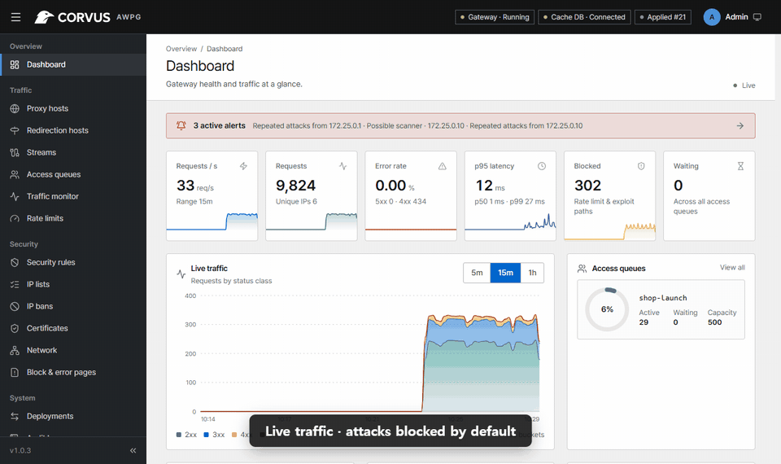
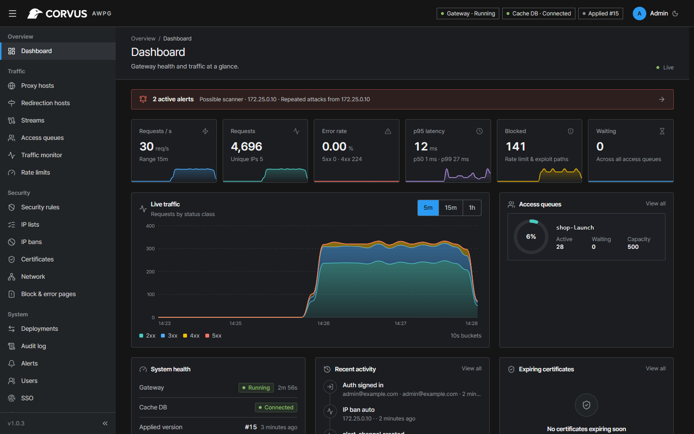
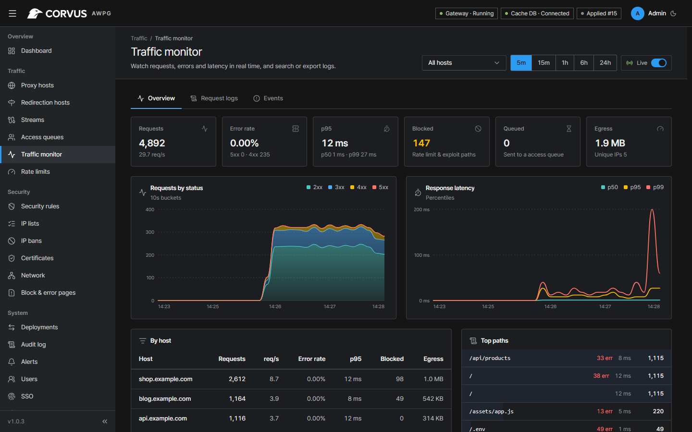
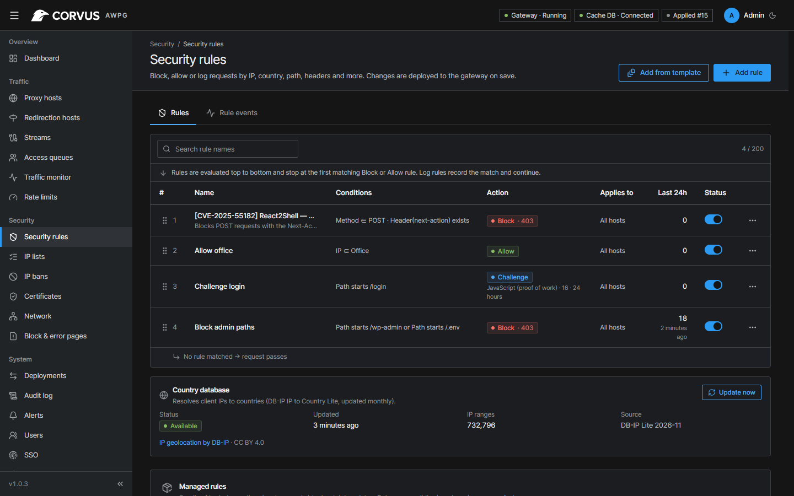
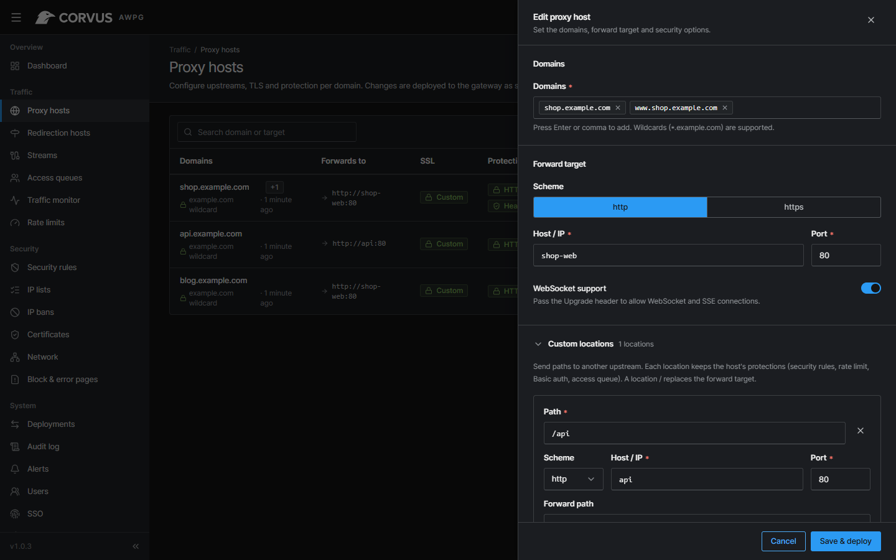
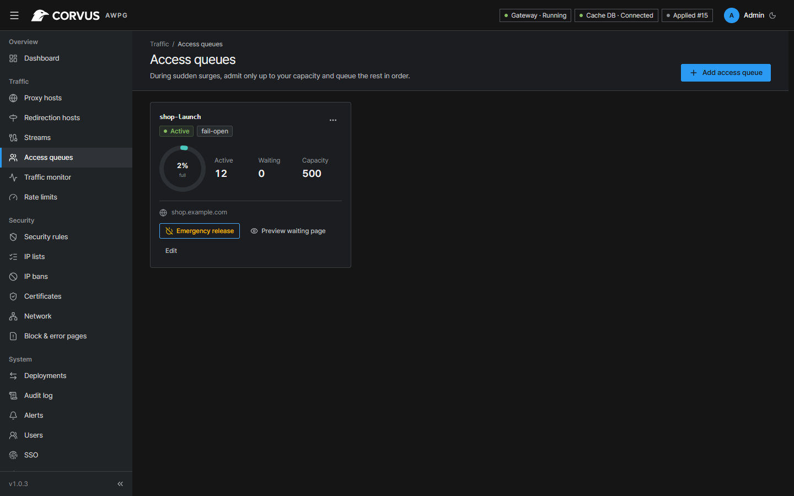

<div align="center">

[English](../../README.md) · [한국어](README_ko.md) · [简体中文](README_zh.md) · [日本語](README_ja.md) · [Русский](README_ru.md) · [Français](README_fr.md) · **Deutsch** · [Español](README_es.md)

<br>

<picture>
  <source media="(prefers-color-scheme: dark)" srcset="../../assets/brand/corvus-logo-dark.svg">
  
</picture>

### Active Web Protection Gateway

<a href="https://github.com/corvus-gateway/corvus/releases/latest"></a>
<a href="../../LICENSE"></a>
<a href="https://github.com/corvus-gateway/corvus/pkgs/container/gateway"></a>
<a href="https://github.com/corvus-gateway/corvus/actions/workflows/ci.yml"></a>


<a href="https://scorecard.dev/viewer/?uri=github.com/corvus-gateway/corvus"></a>
<a href="https://www.bestpractices.dev/projects/16315"></a>
<a href="https://www.bestpractices.dev/projects/16315/baseline-1"></a>

</div>

Corvus ist ein selbst gehostetes Gateway, das vor Ihren Webdiensten sitzt. Es ist so einfach zu
betreiben wie Nginx Proxy Manager — Domains, Weiterleitung und kostenloses SSL mit wenigen Klicks —
und **überwacht, schützt und steuert** zusätzlich den durchlaufenden Datenverkehr: Live-Monitoring,
Angriffsabwehr, Ratenbegrenzung und eine Zugriffswarteschlange für Lastspitzen. Alles läuft auf
Ihrem eigenen Server; es wird kein Traffic an eine Drittanbieter-Cloud gesendet.

<p align="center"></p>

- [Schnellstart](#schnellstart)
- [Dokumentation](https://corvusgateway.org/)
- [Screenshots](#screenshots)

## Projektziel

Kleine Teams landen meist bei einem Reverse-Proxy für TLS, einer separaten WAF, die nie
abgestimmt wird, und keiner Ahnung, was passiert, wenn ein Launch oder ein Angriff eintrifft.
Corvus vereint das in einer Lösung mit sicheren Standardeinstellungen: Die grundlegende
Angriffserkennung funktioniert, sobald ein Host hinzugefügt wird – ohne eine einzige Regel zu
schreiben –, und jede erweiterte Option bleibt optional. Das Ziel ist ein Gateway, das sich in fünf
Minuten installieren lässt und dem man auch dann noch vertraut, wenn der Traffic auf das Zehnfache steigt.

Corvus ist kein Fork von Nginx Proxy Manager. Es ist eine Neuentwicklung (OpenResty-Datenebene,
Go-Steuerungsebene, React-Konsole), die ein **bestehendes NPM-Setup importieren** kann.

## Funktionen

**Proxy & TLS**
- Proxy-Hosts mit Wildcards, WebSocket, HTTP/2, erzwungenem HTTPS und benutzerdefinierten Nginx-Snippets
- Notizen zu Hosts und Streams, damit klar bleibt, wofür jeder da ist (durchsuchbar)
- Eigene Locations: Pfade (z. B. `/api`) an einen eigenen Upstream weiterleiten, mit dem Schutz des Hosts
- Weiterleitungs-Hosts: Domains auf eine andere Domain umleiten (301/302/303/307/308, optional mit Beibehaltung des Pfads), mit demselben TLS und Schutz
- Kostenlose Let's-Encrypt-Zertifikate (HTTP-01 oder DNS-01 über Cloudflare, DigitalOcean, DuckDNS, Gandi, GoDaddy, Hetzner, Namecheap, mit gespeicherten, wiederverwendbaren Anbieter-Zugangsdaten) mit automatischer Erneuerung oder eigene Zertifikate per Upload (bei Erneuerung direkt ersetzbar)
- Streams: TCP/UDP-Ports (Datenbanken, SSH, MQTT, Spieleserver) an einen anderen Host weiterleiten, für TCP optional mit TLS-Terminierung
- Unbekannte Hostnamen erhalten wahlweise eine 404-Seite, eine geschlossene Verbindung oder eine Weiterleitung
- Echte Client-IP hinter Cloudflare oder vertrauenswürdigen Proxys; optionaler Passwortschutz pro Host
- Voreinstellungen für Sicherheits-Header pro Host (Basis / Streng: nosniff, Frame- und Referrer-Policy, CSP im Report-Only-Modus, Cookie-Flags HttpOnly/SameSite/Secure), ohne zu überschreiben, was die Anwendung bereits sendet
- Gzip-Komprimierung von Textantworten (standardmäßig an) sowie Upload-Größenlimit und Upstream-Timeout pro Host
- Jede Änderung wird mit `openresty -t` geprüft, atomar angewendet und kann zurückgerollt werden
- Die Konsole zeigt an, wenn eine neue Corvus-Version erschienen ist, mit Link zu den Versionshinweisen (abschaltbar)

**Corvus Sentinel — Sicherheits-Engine**
- Sicherheitsregeln: Abgleich nach IP, IP-Liste, Land, Pfad, Query, Methode, Header oder User-Agent-Liste → blockieren, erlauben, protokollieren oder eine Challenge verlangen, global oder pro Host
- IP- und User-Agent-Listen, die über eine URL aktuell gehalten werden (z. B. Tor-Exit-Nodes, Listen bösartiger Bots; Voreinstellungen enthalten), im Hintergrund aktualisiert und nur bei Änderungen neu ausgerollt
- Browser-Challenge ohne Drittanbieterdienste: ein JavaScript-Proof-of-Work (einstellbare Schwierigkeit) oder eine leichtgewichtige Cookie-Prüfung, mit einem signierten, an die IP gebundenen Pass-Cookie
- „Angriffsmodus“ pro Host: jeder Besucher muss die Challenge bestehen — manuell eingeschaltet oder automatisch, solange die Anfragen pro Sekunde oder der Anteil blockierter Anfragen einen Schwellenwert überschreiten (mit Benachrichtigungen beim Ein- und Ausschalten)
- Prüfung des Request-Bodys für JSON-, Formular- und Multipart-Inhalte (protokollieren oder blockieren)
- **Virtuelle Patches** per Klick für aktuelle CVEs (React2Shell, wp2shell, PHP-CGI, Vite, n8n …)
- Verwaltete Signatur-Updates, die nur akzeptiert werden, wenn sie signiert und neuer sind (keine Manipulation, kein Downgrade)
- Automatische IP-Sperren für Wiederholungstäter, mit Eskalation und Ausnahmen; optional sofortige Sperren bei auffälligem Verhalten (zu viele 4xx-Antworten pro IP und Website)
- Ratenbegrenzungen mit Dry-Run-Modus; Blockierung von Exploit-Pfaden ab Werk

**Zugriffswarteschlange**
- Besucher bis zu einer festgelegten Kapazität zulassen und den Rest bei Lastspitzen fair in die Warteschlange stellen
- Zulassungsrate, Fail-open-/Fail-closed-Richtlinie, Live-Zähler für aktive/wartende Besucher, Notfall-Freigabe
- Warteseite in 8 Sprachen lokalisiert

**Monitoring & Alarme**
- Live-Anfragen/s, Statuscodes, p50/p95/p99-Latenz, Aufschlüsselung nach Host und Pfad
- Suche im Request-Log und CSV/JSON-Export, Sicherheitsereignisse, persistente Historie mit Aufbewahrung und Log-Rotation
- Alarme an Slack, Mattermost, Discord, Teams, Telegram oder signierte Webhooks
- Prometheus-`/metrics`

**Administration**
- Rollen, MFA (TOTP + Wiederherstellungscodes), OIDC-Single-Sign-On, API-Tokens
- IP-Allowlist für die Admin-Konsole, Audit-Log, Deployment-Historie
- Standardmäßig SQLite oder PostgreSQL; Admin-Konsole in 8 Sprachen mit hellem und dunklem Design

**Standardmäßig gehärtet**
- Container ohne Root-Rechte, mit schreibgeschütztem Root-Dateisystem und ohne Linux-Capabilities
- Redis ist durch ein generiertes Passwort und eine minimale ACL geschützt
- OpenResty wird aus signaturgeprüften Quellen gebaut

## Screenshots

<p align="center">
  
</p>

| Traffic-Monitor | Sicherheitsregeln |
|:---:|:---:|
|  |  |
| **Proxy-Host** | **Zugriffswarteschlangen** |
|  |  |

## Schnellstart

1. [Installieren Sie Docker](https://docs.docker.com/engine/install/) mit dem Compose-Plugin.
2. Erstellen Sie eine Datei `docker-compose.yml` wie diese:

```yml
services:
  corvus:
    image: 'ghcr.io/corvus-gateway/gateway:latest'
    restart: unless-stopped
    ports:
      - '80:80'
      - '443:443'
      - '9443:9443'
    volumes:
      - ./data:/data
```

Das ist die gesamte Installation: Gateway, Admin-Konsole und Speicher für die Zugriffswarteschlange laufen in
diesem einen Container. Optionen finden Sie in der [Dokumentation](https://corvusgateway.org/).

3. Starten Sie Ihren Stack mit

```bash
docker compose up -d
```

4. Lesen Sie das einmalige Einrichtungs-Token aus

```bash
docker compose logs corvus | grep setup_token
```

5. Melden Sie sich unter `https://<your-server>:9443` an der Admin-Konsole an, geben Sie das Token ein und legen
   Sie den ersten Administrator an. Die Konsole verwendet ein selbstsigniertes Zertifikat, bis Sie ein eigenes
   einrichten.

> [!TIP]
> Richten Sie den DNS-Eintrag Ihrer Domain auf den Server, fügen Sie einen Proxy-Host hinzu und fordern Sie im
> selben Formular ein Let's-Encrypt-Zertifikat an.

### Aktualisieren

```bash
docker compose pull
docker compose up -d
```

Einstellungen, Zertifikate und der Verlauf in `./data` bleiben erhalten; Datenbankänderungen werden beim
Start automatisch angewendet.

## Dokumentation

Konfiguration, gehärtete Installation, Ziel-Hosts, Streams, Backups, Migration von Nginx Proxy Manager,
Sicherheitsregeln, Zugriffswarteschlange und Fehlerbehebung beschreibt die **[Dokumentation](https://corvusgateway.org/)**
(auf Englisch und Koreanisch).

## Leistung

Gemessen mit dem [Benchmark-Workflow](../benchmark.md) auf einem von GitHub gehosteten `ubuntu-24.04`-Runner
(4 vCPU AMD EPYC 9V45): Corvus auf **2 vCPU** festgelegt, wrk und das Backend auf den anderen beiden,
64 Keep-Alive-Verbindungen, `GET /` mit einer 3-Byte-Antwort.

| Szenario | req/s | p50 | p99 | Speicher |
|---|---:|---:|---:|---:|
| nginx 1.28 als Reverse Proxy (Vergleichswert) | 97,227 | 0.63 ms | 1.16 ms | 17 MB |
| Corvus, Standard-Host | 75,473 | 0.79 ms | 1.83 ms | 72 MB |
| Corvus, 30 Regeln + Liste mit 1,000 CIDRs + Exploit-Blockierung + Header + Ratenbegrenzung | 54,585 | 1.12 ms | 2.29 ms | 77 MB |
| Corvus, HTTPS (ECDSA P-256), Keep-Alive | 59,697 | 1.00 ms | 2.18 ms | 80 MB |
| Corvus, HTTPS, neuer TLS-Handshake pro Anfrage | 4,348 handshakes/s | 5.88 ms | 11.62 ms | 88 MB |
| Corvus, Zugriffswarteschlange (eingelassene Besucher) | 57,954 | 1.05 ms | 2.22 ms | 84 MB |
| Corvus, Challenge-Regel (Besucher mit Pass) | 62,901 | 0.96 ms | 1.94 ms | 88 MB |

Auf dem grundlegenden Anfragepfad erreicht Corvus etwa drei Viertel des Durchsatzes von reinem nginx
(Keep-Alive-Pools zum Upstream, Access-Log pro Worker gebündelt); der vollständige Schutz — 30 Regeln mit
einer Liste von 1,000 CIDRs, Exploit-Blockierung, Sicherheits-Header und Ratenbegrenzung — kostet zusätzlich
etwa 28 %. **Einschränkung:** ein geteilter CI-Runner, auf dem auch der
Lastgenerator läuft, und winzige Antworten — die Zahlen sind konservativ und zum Vergleich von Szenarien und
Versionen gedacht, nicht als Kapazitätsgarantie. Der Speicher umfasst die Steuerungsebene und das eingebettete
Valkey.

## Entwicklung

```bash
npm --prefix web ci && npm --prefix web run build      # admin UI → embedded into the Go binary
go test ./control/...                                   # unit tests
go build -o bin/corvus-control ./control/cmd/corvus-control
CORVUS_GATEWAY=0 CORVUS_ADMIN_TLS=0 CORVUS_DATA_DIR=./tmp bin/corvus-control   # console only, no OpenResty
```

| Pfad | Inhalt |
|---|---|
| `gateway/` | Datenebene: OpenResty + Lua (Regeln, Body-Prüfung, Zugriffswarteschlange) |
| `control/` | Steuerungsebene (Go): Einstellungs-DB, Konfigurationsgenerierung, Deploy/Rollback, API |
| `web/` | Admin-Konsole (React + Vite + TypeScript) |
| `deploy/` | Dockerfile, verifizierter OpenResty-Build, Compose-Dateien, Integrationstests |
| `tools/` | Lasttest- und Regel-Bundle-Signierwerkzeuge |

## Sicherheit

Bitte melden Sie Sicherheitslücken vertraulich — siehe [SECURITY.md](../../SECURITY.md).

## Lizenz

[Apache License 2.0](../../LICENSE) © 2026 Jikwang Moon.
IP-zu-Land-Daten von [DB-IP](https://db-ip.com) (CC BY 4.0). Siehe [NOTICE](../../NOTICE).
