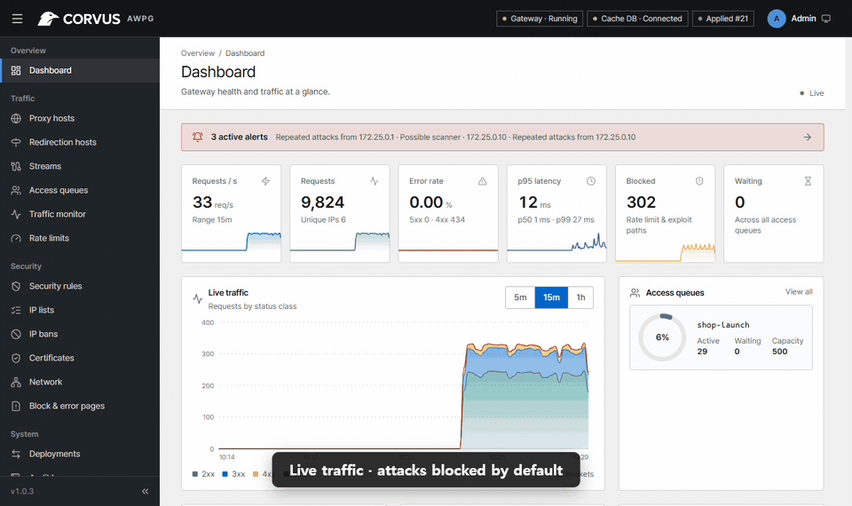
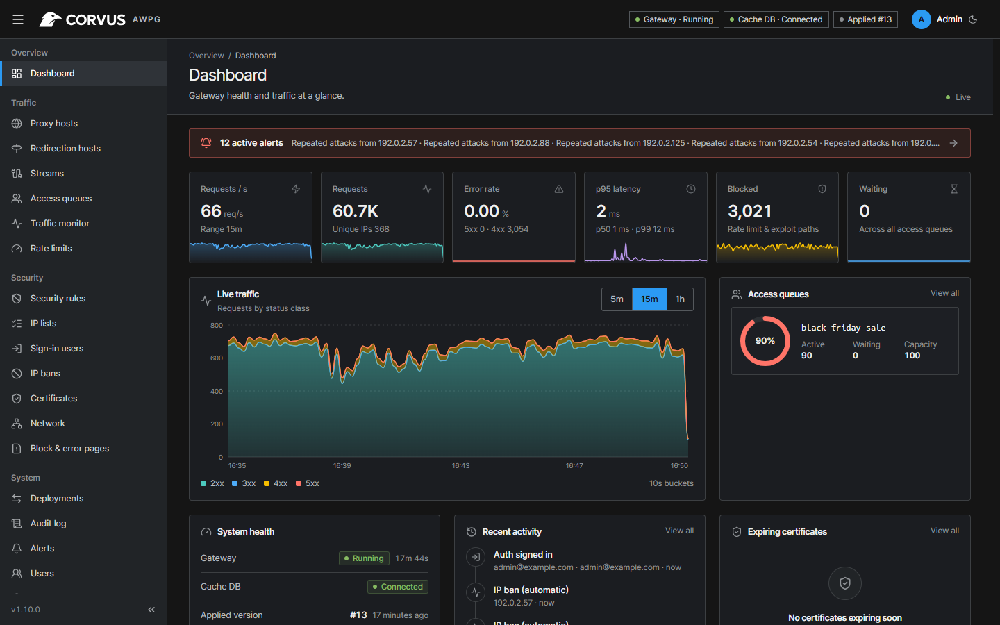
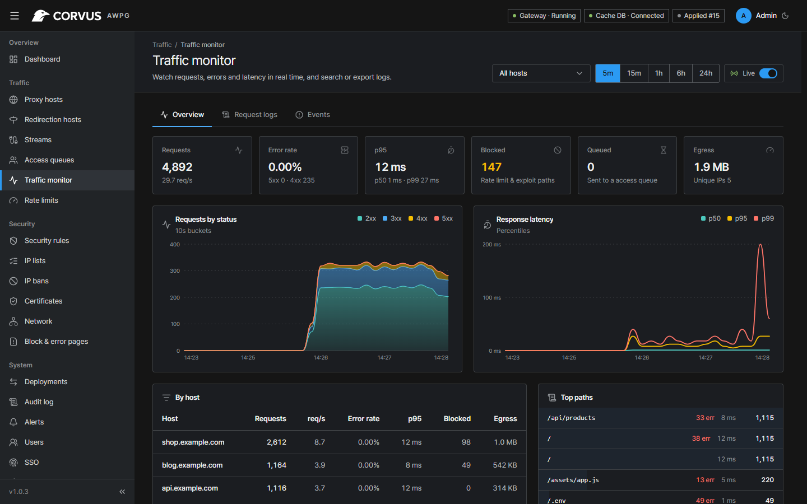
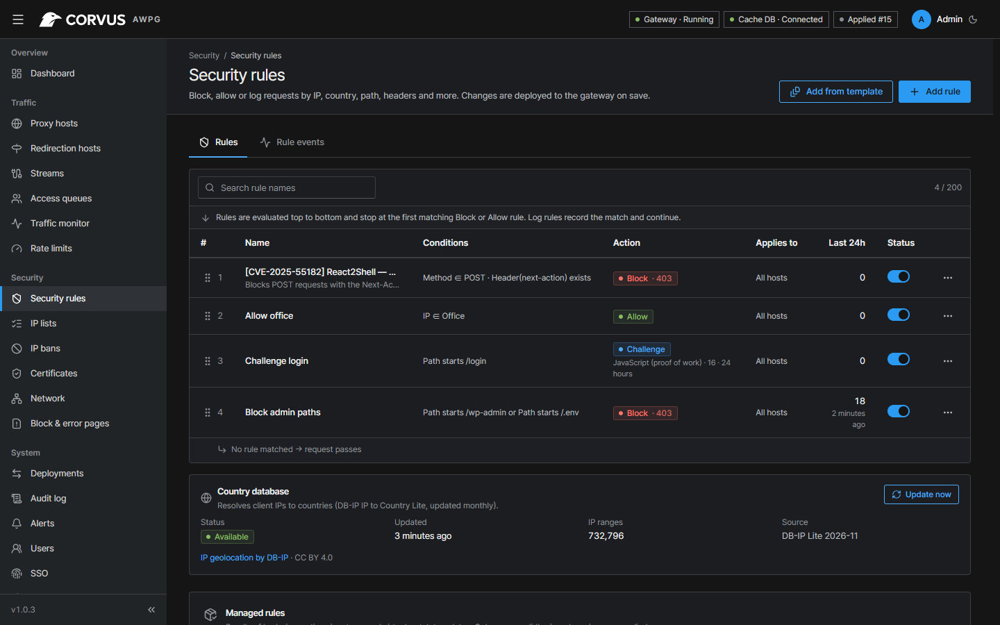
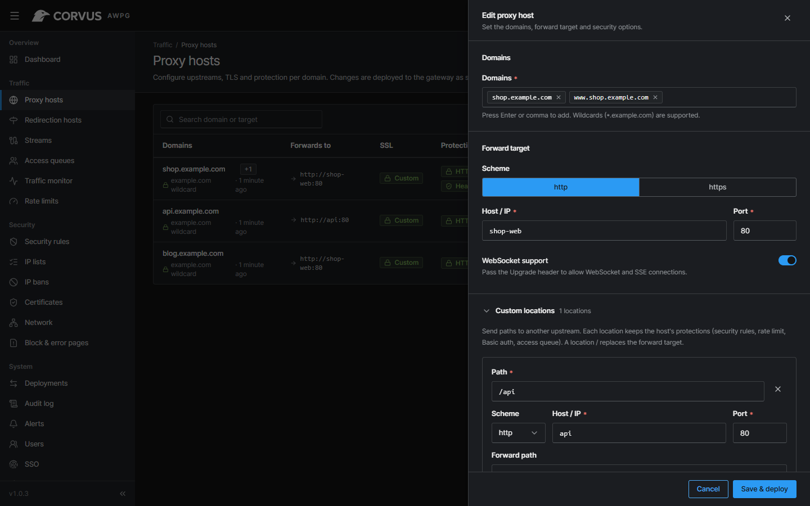
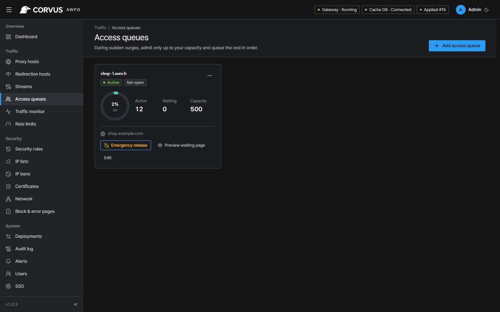

<div align="center">

[English](../../README.md) · [한국어](README_ko.md) · [简体中文](README_zh.md) · **日本語** · [Русский](README_ru.md) · [Français](README_fr.md) · [Deutsch](README_de.md) · [Español](README_es.md)

<br>

<picture>
  <source media="(prefers-color-scheme: dark)" srcset="../../assets/brand/corvus-logo-dark.svg">
  
</picture>

### Active Web Protection Gateway

<a href="https://github.com/corvus-gateway/corvus/releases/latest"></a>
<a href="../../LICENSE"></a>
<a href="https://github.com/corvus-gateway/corvus/pkgs/container/gateway"></a>
<a href="https://github.com/corvus-gateway/corvus/actions/workflows/ci.yml"></a>


<a href="https://scorecard.dev/viewer/?uri=github.com/corvus-gateway/corvus"></a>
<a href="https://www.bestpractices.dev/projects/16315"></a>
<a href="https://corvusgateway.org/docs/reference/hardened/"></a>
<a href="https://www.bestpractices.dev/projects/16315/baseline-1"></a>

</div>

Corvus は、**Web アプリケーションファイアウォール（WAF）を内蔵した**、無料でオープンソース（Apache-2.0）の
セルフホスト型**リバースプロキシ**です。Nginx Proxy Manager と同じくらい手軽に運用でき、Web コンソールで
ドメイン、フォワーディング、無料の Let's Encrypt SSL を数クリックで設定できます。さらに、通過する
トラフィックを**監視し、保護し、制御**します。既定で有効な攻撃ブロック、IP の自動 BAN、レート制限、
ボットチャレンジ、リアルタイム監視、アクセス集中に備えたアクセスキューを備えています。Docker コンテナ
1 つで動作し、すべての機能が無料で、トラフィックがサードパーティのクラウドに送信されることはありません。
Nginx Proxy Manager、Caddy、Traefik、BunkerWeb、SafeLine などとの[比較](https://corvusgateway.org/docs/compare/)もご覧ください。

<p align="center"></p>
<p align="center"><a href="https://youtu.be/wtd2yBssBUk"></a> <a href="https://youtu.be/wtd2yBssBUk"><b>2 分の紹介動画を見る（英語）</b></a></p>

- [クイックセットアップ](#クイックセットアップ)
- [ドキュメント](https://corvusgateway.org/docs/)
- [スクリーンショット](#スクリーンショット)

## プロジェクトの目標

小規模なチームでは、TLS 用のリバースプロキシと、チューニングされないままの WAF を別々に運用し、
ローンチや攻撃の際に何が起きているのかも把握できない、という状況によく陥ります。Corvus はこれらを
安全なデフォルト設定とともに 1 つにまとめました。ホストを追加した時点で、ルールを 1 行も書かなくても
基本的な攻撃検知が動作し、高度なオプションはすべて任意です。5 分でインストールでき、トラフィックが
10 倍に膨らんだ日にも信頼できるゲートウェイを目指しています。

Corvus は Nginx Proxy Manager のフォークではありません。既存の NPM 設定を**インポートできる**、
新規実装(OpenResty のデータプレーン、Go のコントロールプレーン、React のコンソール)です。

## 主な機能

**プロキシと TLS**
- ワイルドカード、WebSocket、HTTP/2、HTTPS 強制、カスタム Nginx スニペットに対応したプロキシホスト
- プロキシホストごとに複数のバックエンド：リクエストをラウンドロビンで分散し、失敗したバックエンドは 30 秒間スキップ（パッシブフェイルオーバー）
- バックエンド不要のページ：プロキシホストで近日公開・メンテナンス・パーキングのページ（または独自の HTML）を任意のステータスで返せます。保護機能はそのまま適用され、カスタムロケーションは転送を続けます（例：メンテナンス中も `/api` は転送）
- ホストとストリームごとに用途を書いておけるメモ（検索可能）
- 接続の確認：保存する前にゲートウェイからホストの転送先をテスト（DNS、ポート、ファイアウォール、TLS）。訪問者が 502/504 を受けた理由もホスト一覧に表示
- カスタムロケーション: パス（例: `/api`）ごとに別のアップストリームへ転送し、ホストの保護をそのまま適用
- リダイレクトホスト: ドメインを別のドメインへ転送(301/302/303/307/308、パスの維持も可能)。TLS と保護機能も同じように適用
- 自動更新される無料の Let's Encrypt 証明書(HTTP-01、または DNS-01: Cloudflare, DigitalOcean, DuckDNS, Gandi, GoDaddy, Hetzner, Namecheap、プロバイダーの認証情報は保存して再利用可能)、または独自証明書のアップロード(更新時はそのまま置き換え可能)
- ストリーム: TCP/UDP ポート(データベース、SSH、MQTT、ゲームサーバー)を別のホストへ転送。TCP では TLS 終端と PROXY protocol(受信・送信)も可能
- 未登録のホスト名への応答を選択: 404 ページ、接続の切断、リダイレクト
- Cloudflare、信頼できるプロキシ、PROXY protocol(FRP、HAProxy、ロードバランサー)の背後でも実際のクライアント IP を取得、ホストごとのパスワード保護(任意)
- ホストごとのセキュリティヘッダーのプリセット(基本 / 厳格: nosniff、フレーム・リファラーポリシー、レポート専用 CSP、HttpOnly/SameSite/Secure Cookie フラグ)。アプリがすでに送っているヘッダーは上書きしません
- テキスト応答の Gzip 圧縮(既定で有効)、ホストごとのアップロードサイズ上限とアップストリームのタイムアウト
- すべての変更は `openresty -t` で検証され、アトミックに適用され、ロールバックも可能
- 新しい Corvus のリリースが出るとコンソールに表示され、リリースノートを開けます（無効化可能）

**Corvus Sentinel — セキュリティエンジン**
- セキュリティルール: IP、IP リスト、国、パス、クエリ、メソッド、ヘッダー、User-Agent リストで照合し、ブロック・許可・ログ記録・チャレンジ。グローバルまたはホスト単位で適用
- URL から最新の状態に保たれる IP リストと User-Agent リスト(例: Tor の出口ノード、悪質なボットのリスト。プリセット付き)。バックグラウンドで更新され、内容が変わったときだけ再デプロイ
- URL から取得する数百万件規模の大きな IP ブロックリスト(例: 約 400 万アドレスのコミュニティリスト)。アドレス範囲にまとめたコンパクトなファイルをすべてのゲートウェイワーカーで共有するため、小型機器でもメモリ使用量を抑えられます
- 外部サービスを使わないブラウザチャレンジ: JavaScript のプルーフ・オブ・ワーク(難易度を調整可能)または軽量な Cookie チェック。署名付きで IP に紐づいた通過 Cookie を発行
- ホストごとの「攻撃対応モード」: すべての訪問者にチャレンジを課します。手動でオンにするか、1 秒あたりのリクエスト数またはブロックされたリクエストの割合がしきい値を超えている間は自動でオン(オン・オフ時に通知)
- JSON、フォーム、multipart のリクエストボディ検査(ログ記録またはブロック)
- 最新の CVE(React2Shell、wp2shell、PHP-CGI、Vite、n8n …)に対応するワンクリックの**仮想パッチ**
- 署名済みで、かつより新しい場合のみ受け入れるマネージド署名アップデート(改ざん・ダウングレードを防止)
- 繰り返し違反する IP の自動 BAN(段階的な厳格化と除外設定に対応)。不正な振る舞いに対する即時 BAN も可能(IP とサイトごとの 4xx 応答が多すぎる場合)
- ドライランモード付きのレート制限、標準で有効なエクスプロイトパスのブロック
- プロキシホストの前にログインページ: 共有の PIN ひとつ、またはグループ単位のサインインユーザーと任意の 2 段階認証 ([ドキュメント](https://corvusgateway.org/docs/security/login-page/))

**アクセスキュー(Access Queue)**
- 収容上限まで訪問者を入場させ、アクセスが集中した際は残りを公平に待機させます
- 入場レート、fail-open / fail-closed ポリシー、リアルタイムの入場中/待機中の人数、緊急解放
- 8 言語にローカライズされた待機ページ

**監視とアラート**
- リアルタイムのリクエスト数/秒、ステータスコード、p50/p95/p99 レイテンシ、ホスト別・パス別の内訳
- リクエストログの検索と CSV/JSON エクスポート、セキュリティイベント、保持期間とログローテーションを備えた永続的な履歴
- 秘密情報を残さない流入元の記録（リファラーのオリジンと UTM 値のみ）と、GoAccess で訪問者統計を出せる nginx combined 形式のエクスポート
- Slack、Mattermost、Discord、Teams、Telegram、または署名付き Webhook へのアラート通知
- Prometheus `/metrics`

**管理**
- ロール、MFA(TOTP + リカバリーコード)、OIDC シングルサインオン、API トークン、コマンドラインでの管理者復旧(`reset-admin`)
- 管理コンソールの IP 許可リスト、監査ログ、デプロイ履歴
- 標準は SQLite、PostgreSQL にも対応。ライト/ダークテーマ対応の 8 言語管理コンソール

**デフォルトから堅牢**
- 読み取り専用のルートファイルシステムで Linux ケーパビリティなし、非 root で動作するコンテナ
- 自動生成されたパスワードと最小限の ACL で保護された Redis
- 署名検証済みのソースからビルドした OpenResty

## スクリーンショット

<p align="center">
  
</p>

| トラフィック監視 | セキュリティルール |
|:---:|:---:|
|  |  |
| **プロキシホスト** | **アクセスキュー** |
|  |  |

## クイックセットアップ

1. Compose プラグイン付きで [Docker をインストール](https://docs.docker.com/engine/install/)します。
2. 次のような `docker-compose.yml` ファイルを作成します。

```yml
services:
  corvus:
    image: 'ghcr.io/corvus-gateway/gateway:latest'
    restart: unless-stopped
    ports:
      - '80:80'
      - '443:443'
      - '9443:9443'
    volumes:
      - ./data:/data
```

これでインストールは完了です。ゲートウェイ、管理コンソール、アクセス待機列ストアは、この 1 つの
コンテナ内で動作します。オプションについては[ドキュメント](https://corvusgateway.org/docs/)を参照してください。

3. 次のコマンドでスタックを起動します。

```bash
docker compose up -d
```

4. 一度だけ使用するセットアップトークンを確認します。

```bash
docker compose logs corvus | grep setup_token
```

5. `https://<your-server>:9443` で管理コンソールにログインし、トークンを入力して最初の管理者を作成します。
   独自の証明書を設定するまで、コンソールは自己署名証明書を使用します。

> [!TIP]
> ドメインの DNS をサーバーに向け、プロキシホストを追加して、同じフォームで Let's Encrypt 証明書を
> 取得してください。

### アップグレード

```bash
docker compose pull
docker compose up -d
```

`./data` 内の設定、証明書、履歴は保持されます。データベースの変更は起動時に自動的に適用されます。

## ドキュメント

設定、ハードニング済みインストール、転送先ホスト、ストリーム、バックアップ、Nginx Proxy Manager からの移行、
セキュリティルール、アクセス待機列、トラブルシューティングは **[ドキュメント](https://corvusgateway.org/docs/)**(英語・韓国語)で説明しています。

手順を追って学べる韓国語のチュートリアル本が [WikiDocs](https://wikidocs.net/book/22096) にあります。

## パフォーマンス

GitHub ホストの `ubuntu-24.04` ランナー(4 vCPU AMD EPYC 9V45)で [ベンチマークワークフロー](../benchmark.md)
を使って測定しました。Corvus は **2 vCPU** に固定し、wrk とバックエンドは残りの 2 つで実行、keep-alive 接続
64 本で、3 バイトの応答を返す `GET /` を送っています。

| シナリオ | req/s | p50 | p99 | メモリ |
|---|---:|---:|---:|---:|
| nginx 1.28 リバースプロキシ(ベースライン) | 107,688 | 0.58 ms | 1.04 ms | 18 MB |
| Corvus、デフォルトのホスト | 79,370 | 0.76 ms | 1.98 ms | 77 MB |
| Corvus、ルール 30 件 + 1,000 CIDR のリスト + エクスプロイトブロック + ヘッダー + レート制限 | 55,304 | 1.09 ms | 2.93 ms | 81 MB |
| Corvus、HTTPS(ECDSA P-256)、keep-alive | 63,506 | 0.95 ms | 2.19 ms | 85 MB |
| Corvus、HTTPS、リクエストごとに新しい TLS ハンドシェイク | 4,847 handshakes/s | 5.32 ms | 10.35 ms | 93 MB |
| Corvus、アクセスキュー(入場済みの訪問者) | 56,695 | 1.09 ms | 2.17 ms | 90 MB |
| Corvus、チャレンジルール(通過 Cookie を持つ訪問者) | 59,174 | 1.03 ms | 2.39 ms | 89 MB |
| Nginx Proxy Manager 2.17、デフォルトのホスト | 14,364 | 2.53 ms | 93.82 ms | 132 MB |
| Nginx Proxy Manager 2.17、Block Common Exploits 有効 | 14,384 | 2.41 ms | 83.40 ms | 134 MB |

同じ実行・同じ 2 vCPU で測定した Nginx Proxy Manager 2.17(ワーカー数も 2 に合わせています)は、バックエンドへの接続を再利用せず、リクエストごとに新しく開きます。Corvus はデフォルト設定で約 5.5 倍、保護機能一式を有効にしても約 3.9 倍のリクエストを、より低いレイテンシと少ないメモリで処理します。

基本のリクエスト処理では、Corvus は素の nginx のおよそ 4 分の 3 のスループットを出します(アップストリーム
への keep-alive 接続プール、ワーカーごとにまとめて送るアクセスログ)。保護機能一式(1,000 CIDR のリストを
含むルール 30 件、エクスプロイトブロック、セキュリティヘッダー、レート制限)を有効にすると、そこから約 30 %
下がります。**注意:** 負荷生成ツールが同じマシン上で動く共有 CI ランナーで、応答もごく小さいため、数値は
控えめなものです。シナリオやバージョンの比較を目的としたもので、処理能力を保証するものではありません。
メモリにはコントロールプレーンと内蔵の Valkey が含まれます。

## 開発

```bash
npm --prefix web ci && npm --prefix web run build      # admin UI → embedded into the Go binary
go test ./control/...                                   # unit tests
go build -o bin/corvus-control ./control/cmd/corvus-control
CORVUS_GATEWAY=0 CORVUS_ADMIN_TLS=0 CORVUS_DATA_DIR=./tmp bin/corvus-control   # console only, no OpenResty
```

| パス | 内容 |
|---|---|
| `gateway/` | データプレーン: OpenResty + Lua(ルール、ボディ検査、アクセスキュー) |
| `control/` | コントロールプレーン(Go): 設定 DB、設定生成、デプロイ/ロールバック、API |
| `web/` | 管理コンソール(React + Vite + TypeScript) |
| `deploy/` | Dockerfile、検証済み OpenResty ビルド、Compose ファイル、結合テスト |
| `tools/` | 負荷テストおよびルールバンドル署名ツール |

## セキュリティ

脆弱性は非公開でご報告ください。詳細は [SECURITY.md](../../SECURITY.md) をご覧ください。

## AI の利用

Corvus は AI コーディングアシスタントの助けを借りて開発しています。どこにどの程度使っているか、すべての変更をどう検証しているかは [AI-DECLARATION.md](../../AI-DECLARATION.md)（英語）にまとめています。

## ライセンス

[Apache License 2.0](../../LICENSE) © 2026 Jikwang Moon.
IP から国への対応データは [DB-IP](https://db-ip.com)(CC BY 4.0)によるものです。[NOTICE](../../NOTICE) を参照してください。
