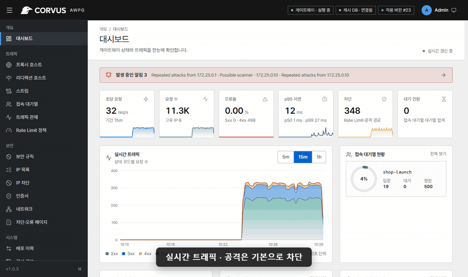

<div align="center">

[English](../../README.md) · **한국어** · [简体中文](README_zh.md) · [日本語](README_ja.md) · [Русский](README_ru.md) · [Français](README_fr.md) · [Deutsch](README_de.md) · [Español](README_es.md)

<br>

<picture>
  <source media="(prefers-color-scheme: dark)" srcset="../../assets/brand/corvus-logo-dark.svg">
  
</picture>

### Active Web Protection Gateway

<a href="https://github.com/corvus-gateway/corvus/releases/latest"></a>
<a href="../../LICENSE"></a>
<a href="https://github.com/corvus-gateway/corvus/pkgs/container/gateway"></a>
<a href="https://github.com/corvus-gateway/corvus/actions/workflows/ci.yml"></a>


<a href="https://scorecard.dev/viewer/?uri=github.com/corvus-gateway/corvus"></a>
<a href="https://www.bestpractices.dev/projects/16315"></a>
<a href="https://www.bestpractices.dev/projects/16315/baseline-1"></a>

</div>

Corvus는 웹 서비스 앞단에 두는 셀프 호스팅 게이트웨이입니다. Nginx Proxy Manager만큼 운영이
쉬워서 도메인, 포워딩, 무료 SSL을 몇 번의 클릭으로 설정할 수 있으며, 여기에 더해 통과하는
트래픽을 **감시하고, 보호하고, 제어**합니다. 실시간 모니터링, 공격 차단, 속도 제한(Rate Limit),
트래픽 급증에 대비한 접속 대기열까지 제공합니다. 모든 것이 여러분의 서버에서 동작하며, 트래픽이
외부 클라우드로 전송되지 않습니다.

<p align="center"></p>

- [빠른 설정](#빠른-설정)
- [문서](https://corvus-gateway.github.io/corvus/ko/)
- [스크린샷](#스크린샷)

## 프로젝트 목표

작은 팀은 대개 TLS용 리버스 프록시 하나, 제대로 튜닝해 본 적 없는 별도의 WAF 하나를 두고, 서비스
오픈이나 공격이 닥쳤을 때 무슨 일이 벌어지는지는 알지 못한 채 지냅니다. Corvus는 이 모든 것을
안전한 기본값과 함께 하나의 상자에 담았습니다. 호스트를 추가하는 순간 규칙을 한 줄도 쓰지 않아도
기본적인 공격 탐지가 동작하고, 고급 옵션은 모두 선택 사항으로 남아 있습니다. 5분 만에 설치할 수
있고, 트래픽이 열 배로 늘어나는 날에도 믿고 맡길 수 있는 게이트웨이를 목표로 합니다.

Corvus는 Nginx Proxy Manager의 포크가 아닙니다. 기존 NPM 설정을 **가져올 수 있는** 새로운
구현체(OpenResty 데이터 플레인, Go 컨트롤 플레인, React 콘솔)입니다.

## 주요 기능

**프록시 및 TLS**
- 와일드카드, WebSocket, HTTP/2, HTTPS 강제 전환, 사용자 정의 Nginx 스니펫을 지원하는 프록시 호스트
- 사용자 지정 위치: 경로(예: `/api`)별로 다른 업스트림으로 전달하며 호스트의 보호가 그대로 적용됩니다
- 리디렉션 호스트: 도메인을 다른 도메인으로 보냅니다(301/302/303/307/308, 경로 유지 선택). TLS와 보호 기능도 똑같이 적용됩니다
- 자동 갱신되는 무료 Let's Encrypt 인증서(HTTP-01, 또는 DNS-01: Cloudflare, DigitalOcean, DuckDNS, Gandi, GoDaddy, Hetzner, Namecheap) 또는 직접 업로드한 인증서(갱신 시 그 자리에서 교체 가능)
- 스트림: TCP/UDP 포트(데이터베이스, SSH, MQTT, 게임 서버)를 다른 호스트로 전달하고, TCP는 TLS 종료도 선택할 수 있습니다
- 등록되지 않은 호스트 이름에 404 페이지, 연결 끊기, 리디렉션 중 원하는 방식으로 응답
- Cloudflare 또는 신뢰할 수 있는 프록시 뒤에서도 실제 클라이언트 IP 확인, 호스트별 비밀번호 보호(선택)
- 호스트별 보안 헤더 프리셋(기본 / 엄격: nosniff, 프레임 및 리퍼러 정책, 보고 전용 CSP, HttpOnly/SameSite/Secure 쿠키 플래그). 애플리케이션이 이미 보내는 헤더는 덮어쓰지 않습니다
- 텍스트 응답 Gzip 압축(기본 켜짐), 호스트별 업로드 크기 제한과 업스트림 타임아웃
- 모든 변경은 `openresty -t`로 검증하고, 원자적으로 적용하며, 롤백할 수 있습니다

**Corvus Sentinel — 보안 엔진**
- 보안 규칙: IP, IP 목록, 국가, 경로, 쿼리, 메서드, 헤더, User-Agent 목록을 매칭하여 차단·허용·기록·챌린지, 전역 또는 호스트별 적용
- URL에서 최신 상태로 유지되는 IP 및 User-Agent 목록(예: Tor 출구 노드, 악성 봇 목록, 프리셋 포함). 백그라운드에서 갱신되며 내용이 바뀔 때만 다시 배포합니다
- 외부 서비스 없이 동작하는 브라우저 챌린지: JavaScript 작업 증명(난이도 조절 가능) 또는 가벼운 쿠키 확인, 서명되고 IP에 묶인 통과 쿠키 발급
- 호스트별 "공격 대응 모드": 모든 방문자에게 챌린지를 요구합니다. 직접 켜거나, 초당 요청 수 또는 차단된 요청 비율이 기준을 넘는 동안 자동으로 켜집니다(켜지고 꺼질 때 알림)
- JSON, 폼, multipart 요청 본문 검사(기록 또는 차단)
- 최신 CVE(React2Shell, wp2shell, PHP-CGI, Vite, n8n …)에 대한 원클릭 **가상 패치**
- 서명되어 있고 더 최신인 경우에만 적용하는 관리형 시그니처 업데이트(변조 및 다운그레이드 방지)
- 반복 위반자에 대한 자동 IP 차단(단계적 가중 및 예외 지정 지원), 이상 행동 시 즉시 차단(선택: IP·사이트별 4xx 응답이 너무 많은 경우)
- 드라이런 모드를 갖춘 속도 제한, 기본으로 제공되는 익스플로잇 경로 차단

**접속 대기열(Access Queue)**
- 수용 한도까지만 방문자를 입장시키고, 트래픽이 몰리면 나머지는 공정하게 대기열에 세웁니다
- 입장 속도, fail-open / fail-closed 정책, 실시간 입장/대기 인원, 긴급 해제
- 8개 언어로 현지화된 대기 페이지

**모니터링 및 알림**
- 실시간 초당 요청 수, 상태 코드, p50/p95/p99 지연 시간, 호스트별·경로별 분석
- 요청 로그 검색과 CSV/JSON 내보내기, 보안 이벤트, 보존 기간과 로그 로테이션을 갖춘 영구 이력
- Slack, Mattermost, Discord, Teams, Telegram 또는 서명된 웹훅으로 알림 전송
- Prometheus `/metrics`

**관리**
- 역할, MFA(TOTP + 복구 코드), OIDC 싱글 사인온, API 토큰
- 관리 콘솔 IP 허용 목록, 감사 로그, 배포 이력
- 기본 SQLite 또는 PostgreSQL, 라이트/다크 테마를 지원하는 8개 언어 관리 콘솔

**기본값부터 견고하게**
- 읽기 전용 루트 파일시스템과 Linux capability 없이 비루트로 실행되는 컨테이너
- 자동 생성된 비밀번호와 최소 ACL로 보호되는 Redis
- 서명 검증을 거친 소스로 빌드한 OpenResty

## 스크린샷

<p align="center">
  
</p>

| 트래픽 관제 | 보안 규칙 |
|:---:|:---:|
|  |  |
| **프록시 호스트** | **접속 대기열** |
|  |  |

## 빠른 설정

1. Compose 플러그인이 포함된 [Docker를 설치](https://docs.docker.com/engine/install/)합니다.
2. 다음과 같은 `docker-compose.yml` 파일을 만듭니다.

```yml
services:
  corvus:
    image: 'ghcr.io/corvus-gateway/gateway:latest'
    restart: unless-stopped
    ports:
      - '80:80'
      - '443:443'
      - '9443:9443'
    volumes:
      - ./data:/data
```

이것이 설치의 전부입니다. 게이트웨이, 관리 콘솔, 접속 대기열 저장소가 이 컨테이너 하나에서
실행됩니다. 옵션은 [문서](https://corvus-gateway.github.io/corvus/ko/)를 참고하세요.

3. 스택을 시작합니다.

```bash
docker compose up -d
```

4. 일회용 설정 토큰을 확인합니다.

```bash
docker compose logs corvus | grep setup_token
```

5. `https://<your-server>:9443`에서 관리 콘솔에 로그인하고, 토큰을 입력한 뒤 첫 번째 관리자를
   만듭니다. 직접 인증서를 설정하기 전까지 콘솔은 자체 서명 인증서를 사용합니다.

> [!TIP]
> 도메인의 DNS를 서버로 향하게 한 뒤 프록시 호스트를 추가하고, 같은 폼에서 Let's Encrypt
> 인증서를 발급받으세요.

### 업그레이드

```bash
docker compose pull
docker compose up -d
```

`./data`에 있는 설정, 인증서, 이력은 그대로 유지되며, 데이터베이스 변경 사항은 시작할 때
자동으로 적용됩니다.

## 문서

구성, 강화된 설치, 포워드 호스트, 스트림, 백업, Nginx Proxy Manager에서 마이그레이션, 보안 규칙,
접속 대기열, 문제 해결은 **[문서 사이트](https://corvus-gateway.github.io/corvus/ko/)**에서 화면과 함께 설명합니다 (한국어 · [English](https://corvus-gateway.github.io/corvus/)).

## 성능

GitHub 호스팅 `ubuntu-24.04` 러너(4 vCPU AMD EPYC 9V45)에서 [벤치마크 워크플로](../benchmark.md)로
측정했습니다. Corvus는 **2 vCPU**에 고정하고 wrk와 백엔드는 나머지 두 개에서 실행했으며, keep-alive
연결 64개로 3바이트 응답을 돌려주는 `GET /`를 요청했습니다.

| 시나리오 | req/s | p50 | p99 | 메모리 |
|---|---:|---:|---:|---:|
| nginx 1.28 리버스 프록시(기준) | 97,227 | 0.63 ms | 1.16 ms | 17 MB |
| Corvus, 기본 호스트 | 75,473 | 0.79 ms | 1.83 ms | 72 MB |
| Corvus, 규칙 30개 + CIDR 1,000개 목록 + 익스플로잇 차단 + 헤더 + 속도 제한 | 54,585 | 1.12 ms | 2.29 ms | 77 MB |
| Corvus, HTTPS(ECDSA P-256), keep-alive | 59,697 | 1.00 ms | 2.18 ms | 80 MB |
| Corvus, HTTPS, 요청마다 새 TLS 핸드셰이크 | 4,348 handshakes/s | 5.88 ms | 11.62 ms | 88 MB |
| Corvus, 접속 대기열(입장한 방문자) | 57,954 | 1.05 ms | 2.22 ms | 84 MB |
| Corvus, 챌린지 규칙(통과 쿠키가 있는 방문자) | 62,901 | 0.96 ms | 1.94 ms | 88 MB |

기본 요청 경로에서 Corvus는 일반 nginx 처리량의 약 4분의 3을 냅니다(업스트림 keep-alive 연결 풀,
워커별로 묶어 보내는 접근 로그). 전체 보호 기능(CIDR 1,000개 목록을 포함한 규칙 30개, 익스플로잇 차단,
보안 헤더, 속도 제한)을 켜면 여기서 약 28 %가 더 듭니다.
**주의:** 부하 생성기가 같은 머신에서 돌아가는 공유 CI 러너이고 응답도 아주 작습니다. 수치는
보수적이며 시나리오와 버전을 비교하기 위한 것이지 처리 용량을 보장하는 값이 아닙니다. 메모리에는
컨트롤 플레인과 내장 Valkey가 포함됩니다.

## 개발

```bash
npm --prefix web ci && npm --prefix web run build      # admin UI → embedded into the Go binary
go test ./control/...                                   # unit tests
go build -o bin/corvus-control ./control/cmd/corvus-control
CORVUS_GATEWAY=0 CORVUS_ADMIN_TLS=0 CORVUS_DATA_DIR=./tmp bin/corvus-control   # console only, no OpenResty
```

| 경로 | 내용 |
|---|---|
| `gateway/` | 데이터 플레인: OpenResty + Lua (규칙, 본문 검사, 접속 대기열) |
| `control/` | 컨트롤 플레인(Go): 설정 DB, 설정 생성, 배포/롤백, API |
| `web/` | 관리 콘솔(React + Vite + TypeScript) |
| `deploy/` | Dockerfile, 검증된 OpenResty 빌드, Compose 파일, 통합 테스트 |
| `tools/` | 부하 테스트 및 규칙 번들 서명 도구 |

## 보안

취약점은 비공개로 제보해 주세요. 자세한 내용은 [SECURITY.md](../../SECURITY.md)를 참고하세요.

## 라이선스

[Apache License 2.0](../../LICENSE) © 2026 Jikwang Moon.
IP-국가 매핑 데이터는 [DB-IP](https://db-ip.com)(CC BY 4.0)에서 제공합니다. [NOTICE](../../NOTICE)를 참고하세요.
