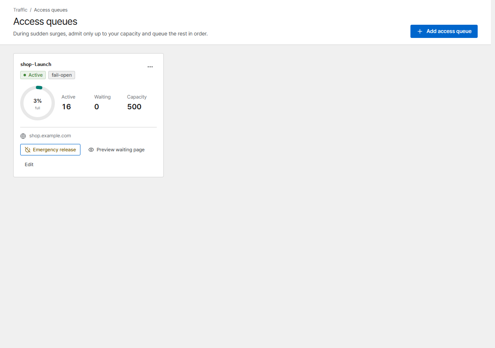
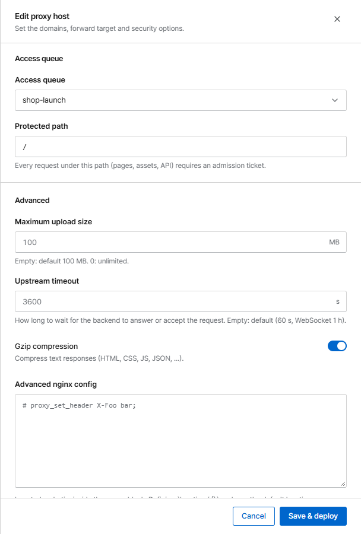
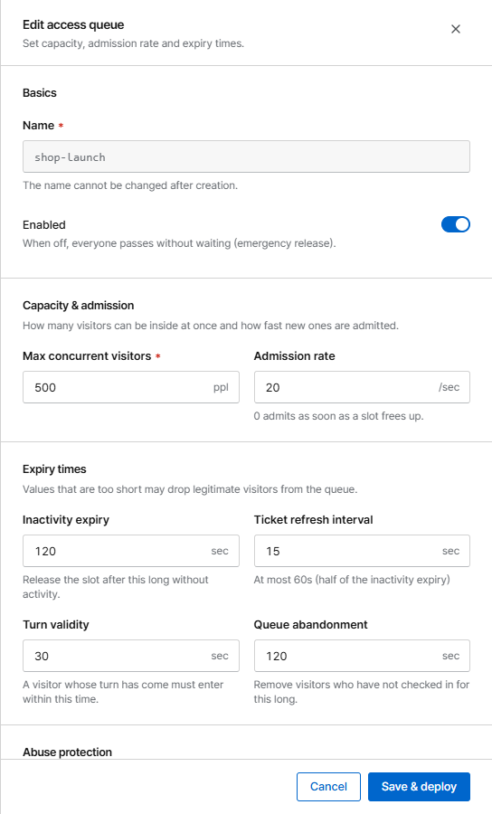

# Access queue

An access queue (waiting room) keeps your site up during a launch, a ticket sale or a sudden spike:
Corvus lets in only as many visitors as your service can handle and queues the rest **in order**.
Waiting visitors see a page with their position, localized in 8 languages, that refreshes by itself.

{ .shot }

## Set it up

1. Open **Access queues** and click **Add access queue**.
2. Set the capacity (see below) and save.
3. Open the proxy host and choose the queue under **Access queue**. **Protected path** `/` protects
   the whole site; `/event` only that part.

{ .shot .panel }

## Settings

{ .shot .panel }

| Setting | Meaning |
|---|---|
| **Max concurrent visitors** | How many visitors can be inside at once |
| **Admission rate** | How many new visitors per second are let in (0 = as soon as a slot frees up) |
| **Inactivity expiry** | A visitor's slot is released after this long without requests |
| **Turn validity** | A visitor whose turn has come must enter within this time. If they miss it (e.g. a background tab) and check in again within the queue abandonment time, they go back to the front of the line |
| **Queue abandonment** | Waiting visitors who stop checking in are removed |
| **When the cache DB is down** | **Let everyone in** (fail-open, favours availability) or **Block access** (fail-closed, protects capacity) |
| **Max queue length** | Beyond this, new visitors are asked to come back later (0 = unlimited) |
| **Queue joins per IP** | New queue entries one IP may create per minute |
| **Bind admission to the client network** | Admission only works from the same network, so it can't be shared. Visitors who change networks queue again |

!!! tip "Choosing the capacity"
    Start with the number of simultaneous users your service handled comfortably in a load test, and
    watch **Active** and **Waiting** on the dashboard during the event.

## During the event

- The dashboard and the **Access queues** page show active and waiting visitors live.
- **Emergency release** lets everyone straight through, for example when the spike is over.
  Visitors still on the waiting page go in automatically. **Turn back on** restores the queue.
- If the cache DB restarts (for example when Corvus is upgraded), visitors who are already inside
  stay inside, and the line starts again from the visitors who check in first.
- An [alert](operations/alerts.md) can notify you when the backlog grows.

## APIs and apps

Pages, images and API calls under the protected path all need an admission. A browser gets it
automatically (a cookie) while it waits on the queue page. Requests that can't show the waiting page,
such as `fetch`/XHR calls or apps, get **`429 Too Many Requests`** with a `Retry-After` header and a
small JSON body while they wait. They don't count as server errors.

!!! warning "Cross-site clients"
    Over HTTPS the queue cookies are `SameSite=None`, so visitors who come back from another site
    (for example a payment provider's 3-D Secure step) keep their place. Over plain HTTP they are
    `SameSite=Lax` and such returns are queued again. A web app on **another site** (for example
    `app.example.org` calling `api.example.com`) must send credentials (`credentials: "include"`);
    otherwise protect only the paths people open in a browser, or put the API on a host without a
    queue.
