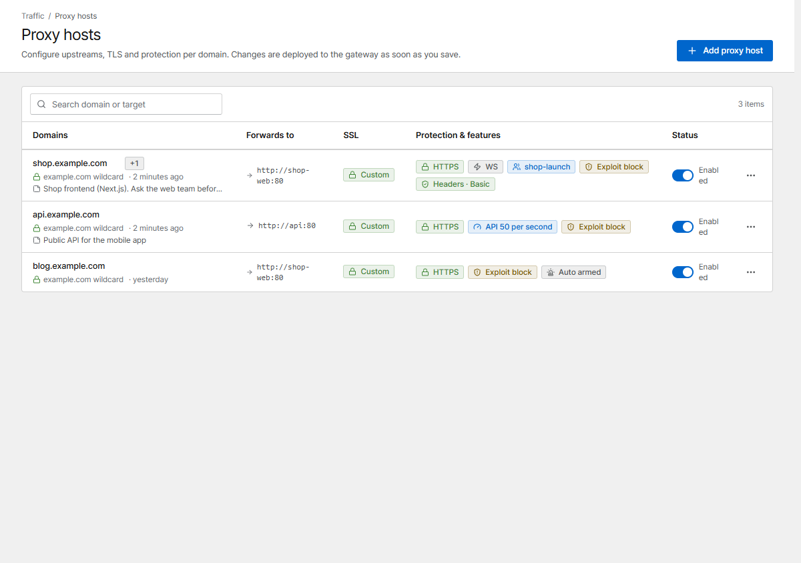
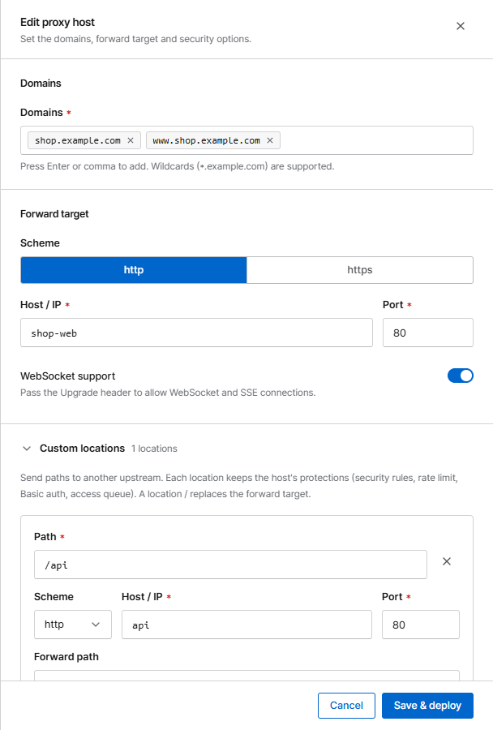
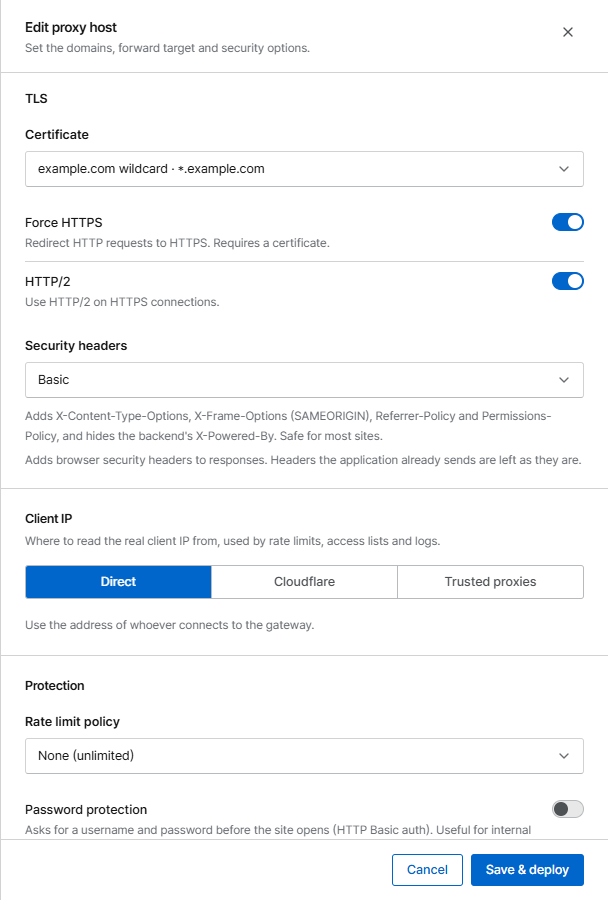

# Your first proxy host

A **proxy host** sends requests for a domain (e.g. `shop.example.com`) to a service behind Corvus
(e.g. the container `shop-web` on port 80).

## Before you start

- The domain's DNS (`A`/`AAAA` record) points at the Corvus server.
- Corvus can reach the service. For another container, both must share a Docker network
  (see [Forward targets](../proxy/proxy-hosts.md#forward-targets)).

??? example "Connect Corvus to your other containers"
    Create a shared network once:

    ```bash
    docker network create proxy
    ```

    Add it to Corvus (and the same `networks:` lines to your app's service, or start the app
    with `--network proxy`):

    ```yaml
    services:
      corvus:
        image: 'ghcr.io/corvus-gateway/gateway:latest'
        restart: unless-stopped
        ports:
          - '80:80'
          - '443:443'
          - '9443:9443'
        volumes:
          - ./data:/data
        networks:
          - default
          - proxy

    networks:
      proxy:
        external: true
    ```

    Run `docker compose up -d` again. In the proxy host, use the **container name** as **Host / IP**
    (e.g. `shop-web`) and the port the app listens on **inside** its container (not the published
    one).

## 1. Add the host

Open **Proxy hosts** and click **Add proxy host**.

{ .shot }

Fill in:

1. **Domains**: type a domain and press ++enter++. Add as many as you need.
2. **Forward target**: scheme (`http` in most cases), **Host / IP** and **Port** of your service.
3. Turn on **WebSocket support** if your app uses WebSockets or server-sent events.

{ .shot .panel }

## 2. Turn on HTTPS

In the **TLS** section choose **Certificate → Request a new certificate (Let's Encrypt)**, enter
your e-mail and agree to the terms. Turn on **Force HTTPS** so visitors are always redirected to
HTTPS.

{ .shot .panel }

The host starts serving HTTP right away; HTTPS turns on by itself once the certificate is issued
(usually within a minute). Wildcard domains need a [DNS challenge](../proxy/certificates.md#dns-01).

## 3. Save & deploy

Click **Save & deploy**. Corvus writes a new configuration version, tests it and applies it without
dropping connections. If anything is wrong, the error is shown and the previous configuration keeps
running.

Open your domain in a browser. That's it: the host is already protected against known attack
patterns (**Block known exploit paths** is on by default) and appears in the
[Traffic monitor](../operations/traffic.md).

## What next?

- Route `/api` to a different service: [Custom locations](../proxy/locations.md)
- Restrict the admin area to your office: [Security rules](../security/rules.md)
- Prepare for a launch: [Access queue](../access-queue.md)
- Get notified when something goes wrong: [Alerts](../operations/alerts.md)
