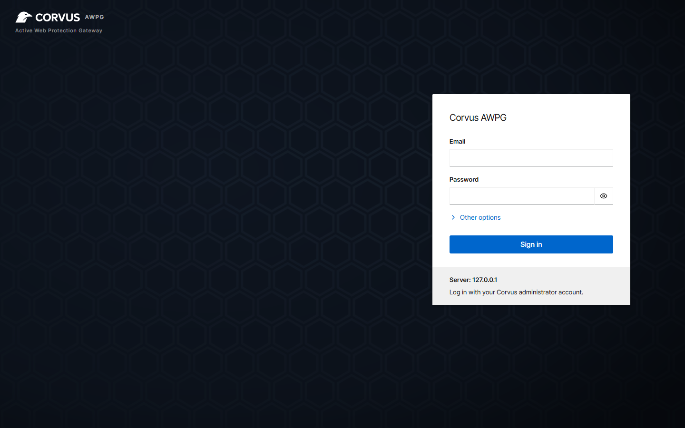

# Install

Corvus runs as **one container**: the gateway, the admin console and the access-queue store are all
inside it.

## Requirements

- A Linux server (amd64 or arm64) with [Docker and the Compose plugin](https://docs.docker.com/engine/install/)
- Ports **80** and **443** free (the gateway), and **9443** for the admin console
- For Let's Encrypt certificates: your domain's DNS pointing at the server

## 1. Create `docker-compose.yml`

```yaml
services:
  corvus:
    image: 'ghcr.io/corvus-gateway/gateway:latest'
    restart: unless-stopped
    ports:
      - '80:80'
      - '443:443'
      - '9443:9443'
    volumes:
      - ./data:/data
```

| Port | Purpose |
|---|---|
| 80 / 443 | Gateway: the traffic you proxy |
| 9443 | Admin console and API. Allow only trusted networks (firewall, or *Network → Admin console allowed networks*) |

All settings, certificates and history are stored in `./data`.

## 2. Start it

```bash
docker compose up -d
```

## 3. Read the setup token

The first start prints a one-time token that proves you own the server:

```bash
docker compose logs corvus | grep setup_token
```

To choose the token yourself instead, set `CORVUS_SETUP_TOKEN` (at least 12 characters, see
[Configuration](../reference/configuration.md)).

## 4. Create the administrator

Open `https://<your-server>:9443` in a browser. The console uses a self-signed certificate at first,
so your browser shows a warning. Continue to the page, enter the **setup token**, your e-mail and a
password (at least 10 characters).

{ .shot }

!!! tip "Next step"
    [Add your first proxy host](first-host.md). It takes about a minute.

## Run it with host networking (optional)

If the services you want to proxy listen only on the server's `127.0.0.1`, or your previous NPM
setup used `network_mode: host`, replace `ports:` with host networking:

```yaml
services:
  corvus:
    image: 'ghcr.io/corvus-gateway/gateway:latest'
    restart: unless-stopped
    network_mode: host
    volumes:
      - ./data:/data
```

If port 6379 is already used on the host, also set `CORVUS_REDIS_PORT` (see
[Configuration](../reference/configuration.md)).

## Related

- [Install on a NAS](nas.md): TrueNAS SCALE and Unraid apps, ports and tips for other NAS systems
- [Configuration](../reference/configuration.md): environment variables
- [Hardened install](../reference/hardened.md): read-only root filesystem, no capabilities
- [Upgrade](upgrade.md)
