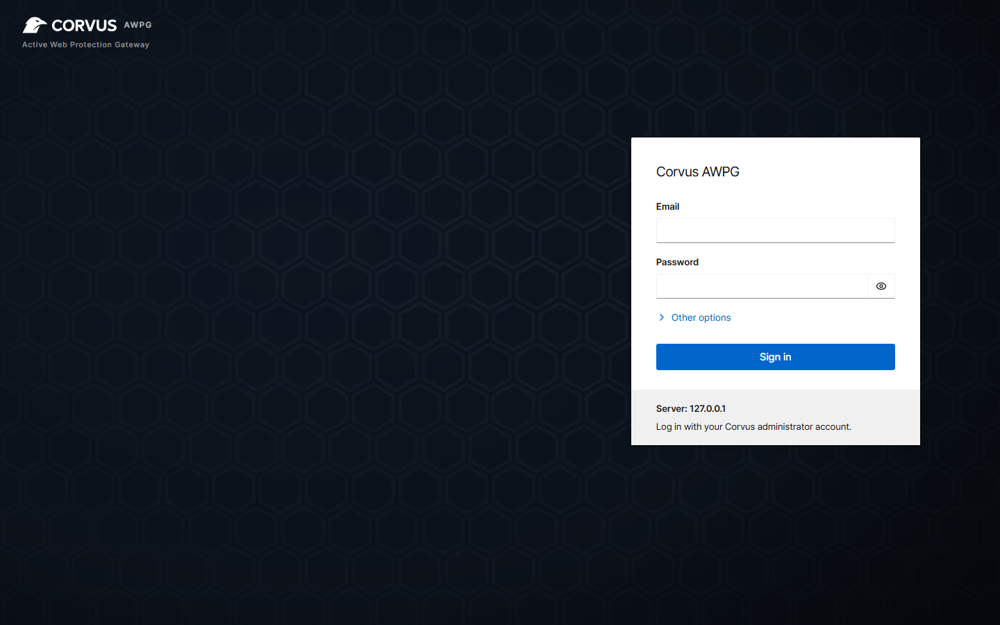

# Install

Corvus runs as **one container**: the gateway, the admin console and the access-queue store are all
inside it.

## Requirements

- A Linux server (amd64 or arm64) with [Docker and the Compose plugin](https://docs.docker.com/engine/install/)
- Ports **80** and **443** free (the gateway), and **9443** for the admin console. Already running a
  web server on 80 and 443? Move it to another port first: see
  [I already have a web server](how-it-works.md#i-already-have-a-web-server-on-ports-80-and-443).
- For Let's Encrypt certificates: your domain's DNS pointing at the server

## 1. Create `docker-compose.yml`

```yaml
services:
  corvus:
    image: 'ghcr.io/corvus-gateway/gateway:latest'
    restart: unless-stopped
    logging:
      driver: json-file
      options:
        max-size: '10m'
        max-file: '3'
    ports:
      - '80:80'
      - '443:443'
      - '9443:9443'
    volumes:
      - ./data:/data
```

| Port | Purpose |
|---|---|
| 80 / 443 | Gateway: the traffic you proxy |
| 9443 | Admin console and API. Allow only trusted networks (firewall, or *Network → Admin console allowed networks*) |

!!! warning "ufw and firewalld do not filter ports published by Docker"
    Docker adds its own NAT rules for `ports:`, so connections to a published port never pass
    through ufw's (or firewalld's) input rules: a port that `ufw status` shows as closed can still be
    reachable from the internet. To keep the console private, use one of these:

    - **Admin console allowed networks** on the *Network* page (enforced by Corvus itself).
    - Publish the console only on an address that isn't public, e.g. `'127.0.0.1:9443:9443'` (then use
      an SSH tunnel) or `'10.0.0.5:9443:9443'` (a LAN or VPN address).
    - Filter in the `DOCKER-USER` iptables chain, which Docker leaves alone.

    With [host networking](#run-it-with-host-networking-optional) there is no Docker NAT, and your
    host firewall applies as usual.

All settings, certificates and history are stored in `./data`.

## 2. Start it

```bash
docker compose up -d
```

??? note "Without Compose: `docker run`"
    The same container with a plain `docker run`, for systems or NAS interfaces without Compose.
    Run it in the folder that should hold `./data`:

    ```bash
    docker run -d --name corvus --restart unless-stopped \
      -p 80:80 -p 443:443 -p 9443:9443 \
      -v "$PWD/data:/data" \
      --log-opt max-size=10m --log-opt max-file=3 \
      ghcr.io/corvus-gateway/gateway:latest
    ```

    Read the setup token with `docker logs corvus 2>&1 | grep setup_token`. To upgrade, pull the new
    image, then remove and start the container again with the same command; everything in `./data`
    is kept:

    ```bash
    docker pull ghcr.io/corvus-gateway/gateway:latest
    docker rm -f corvus
    # run the docker run command above again
    ```

## 3. Read the setup token

The first start prints a one-time token that proves you own the server:

```bash
docker compose logs corvus | grep setup_token
```

To choose the token yourself instead, set `CORVUS_SETUP_TOKEN` (at least 12 characters, see
[Configuration](../reference/configuration.md)).

## 4. Create the administrator

Open `https://<your-server>:9443` in a browser. The console uses a self-signed certificate at first,
so your browser shows a warning. Continue to the page, enter the **setup token**, your e-mail and a
password (at least 10 characters).

{ .shot }

!!! tip "Next step"
    [Add your first proxy host](first-host.md). It takes about a minute.

## Run it with host networking (optional)

If the services you want to proxy listen only on the server's `127.0.0.1`, or your previous NPM
setup used `network_mode: host`, replace `ports:` with host networking:

```yaml
services:
  corvus:
    image: 'ghcr.io/corvus-gateway/gateway:latest'
    restart: unless-stopped
    network_mode: host
    volumes:
      - ./data:/data
```

If port 6379 is already used on the host, also set `CORVUS_REDIS_PORT` (see
[Configuration](../reference/configuration.md)).

## Related

- [Install on a NAS](nas.md): TrueNAS SCALE and Unraid apps, Synology Container Manager, ports and tips for other NAS systems
- [Configuration](../reference/configuration.md): environment variables
- [Hardened install](../reference/hardened.md): read-only root filesystem, no capabilities
- [Upgrade](upgrade.md)
