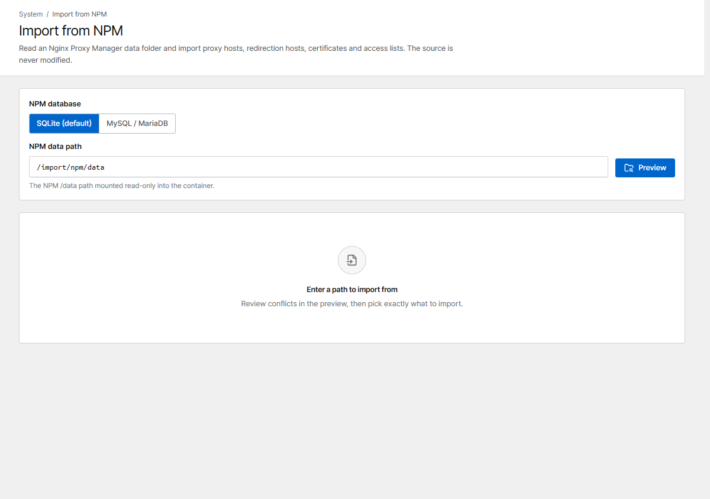

# Migrate from Nginx Proxy Manager

**Import from NPM** copies your NPM setup into Corvus:

- proxy hosts (including custom locations), redirection hosts and streams
- certificates: Let's Encrypt and custom ones, including Cloudflare DNS tokens
- access lists: users and IP rules

It only **reads** NPM's files and database. NPM is not changed, so you can go back at any time.

Not imported: 404 hosts, and advanced configuration that uses NPM-specific variables. The preview
lists everything that will be skipped.

{ .shot }

## 1. Check which database NPM uses

Open NPM's `docker-compose.yml`:

| You see | NPM uses |
|---|---|
| no `DB_MYSQL_*` / `DB_POSTGRES_*` variables, and `data/database.sqlite` exists | **SQLite** (NPM's default) |
| `DB_MYSQL_HOST`, `DB_MYSQL_USER`, … and usually a separate `db` service | **MySQL / MariaDB** |
| `DB_POSTGRES_*` | PostgreSQL: not supported by the import; recreate the hosts in the console |

## 2. Mount NPM's folders into Corvus

Corvus reads certificate files from NPM's `data` and `letsencrypt` folders. Mount them read-only and
set `CORVUS_IMPORT_DIR`:

```yaml hl_lines="10 11 14 15"
services:
  corvus:
    image: 'ghcr.io/corvus-gateway/gateway:latest'
    restart: unless-stopped
    ports:
      - '80:80'
      - '443:443'
      - '9443:9443'
    environment:
      CORVUS_IMPORT_DIR: /import
    volumes:
      - ./data:/data
      - /path/to/npm/data:/import/npm/data:ro
      - /path/to/npm/letsencrypt:/import/npm/letsencrypt:ro
```

Use the host paths of NPM's `./data` and `./letsencrypt` volumes. NPM and Corvus both need ports
80/443, so they can't run at the same time.

## 3. Import

=== "NPM with SQLite"

    ```bash
    cd /path/to/npm && docker compose down        # stop NPM (frees 80/443)
    cd /path/to/corvus && docker compose up -d     # start Corvus with the mounts above
    ```

    In the console open **Import from NPM**, keep **SQLite**, click **Preview**, choose what to
    import and click **Import selected**.

    If the preview reports `permission denied`, make the files readable for Corvus (it runs as uid
    10001):

    ```bash
    sudo chmod o+rx /path/to/npm/data && sudo chmod o+r /path/to/npm/data/database.sqlite
    ```

=== "NPM with MySQL / MariaDB"

    Corvus has to reach NPM's database during the import, so stop only NPM's proxy service and keep
    its database running:

    ```bash
    cd /path/to/npm && docker compose stop app     # the NPM service that owns 80/443 (often "app")
    cd /path/to/corvus && docker compose up -d

    # connect Corvus to NPM's Docker network for the import
    docker network ls | grep -i npm                # e.g. npm_default
    docker network connect npm_default $(docker compose ps -q corvus)
    ```

    In **Import from NPM** choose **MySQL / MariaDB** and enter NPM's database settings: host = the
    database service name (usually `db`), port `3306`, and the values of `DB_MYSQL_NAME`,
    `DB_MYSQL_USER` and `DB_MYSQL_PASSWORD`. The connection is read-only and the password is not
    stored. Then **Preview** → **Import selected**.

    When the import is done:

    ```bash
    docker network disconnect npm_default $(docker compose ps -q corvus)
    cd /path/to/npm && docker compose down         # stop NPM's database too
    ```

Imported items are deployed right away.

## 4. After the import

- Check the imported hosts, then remove `CORVUS_IMPORT_DIR` and the two `/import` mounts and run
  `docker compose up -d` again.
- Certificates keep renewing in Corvus. Hosts that used an unsupported DNS provider are imported
  without automatic renewal; the preview warns about them.
- **Streams:** on a bridge network, publish each stream port in `docker-compose.yml`
  (see [Streams](../proxy/streams.md)).
- **Going back:** `docker compose down` in Corvus, then `docker compose up -d` in NPM.

## NPM terms in Corvus

| NPM | Corvus |
|---|---|
| Proxy Hosts | **Proxy hosts** |
| Custom Locations | **Custom locations** in the proxy host form |
| Redirection Hosts | **Redirection hosts** |
| Streams | **Streams** |
| SSL Certificates | **Certificates** |
| Access Lists | Imported with their users and IP rules and attached to the same hosts. For new hosts use **Password protection** in the proxy host form, and [security rules](../security/rules.md) for IP restrictions |
| Advanced (custom Nginx configuration) | **Advanced → Advanced nginx config** |
