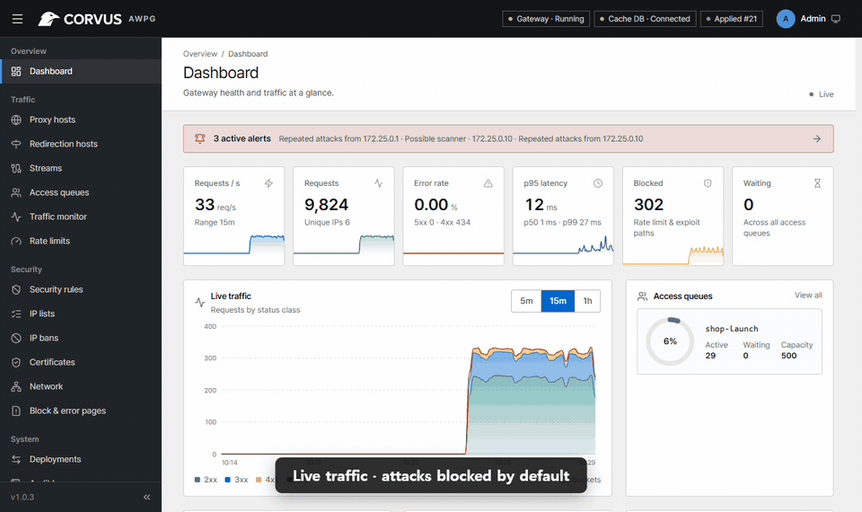

# Corvus AWPG

**Corvus is a free, open-source, self-hosted reverse proxy with a built-in web application firewall
(WAF).** It is as easy to run as Nginx Proxy Manager (domains, forwarding and free SSL in a few
clicks), and it also **watches, protects and controls** the traffic that passes through it.
Everything runs on your own server; no traffic goes to a third-party cloud. Apache-2.0, one Docker
container, every feature free.

Corvus takes ports 80 and 443 and passes each request on to the right app or web server behind it,
so you can run several sites on one server with HTTPS and protection in front of all of them.
[How it works](getting-started/how-it-works.md), including how to put Corvus in front of a web
server you already run.

{ .shot }

:fontawesome-brands-youtube:{ style="color:#ff0000" } **[Watch the 2-minute intro video](https://youtu.be/wtd2yBssBUk)** on YouTube.

- :material-rocket-launch: **[Install in 5 minutes](getting-started/install.md)**

    One container, one `docker-compose.yml`, and a browser.

- :material-swap-horizontal: **[Coming from NPM?](getting-started/migrate-npm.md)**

    See [how Corvus compares](getting-started/compare-npm.md), then import proxy hosts, certificates,
    streams and access lists. NPM itself is not changed.

- :material-shield-check: **[Protection](security/index.md)**

    Attack blocking works the moment you add a host. Rules, bans and challenges are there when you need them.

- :material-account-clock: **[Access queue](access-queue.md)**

    Admit visitors up to your capacity during a launch or a flash sale and queue the rest fairly.

## What you get

| | |
|---|---|
| **Proxy & TLS** | Proxy hosts with [several backends](proxy/proxy-hosts.md#several-backends-round-robin) (round-robin with failover), [notes](proxy/proxy-hosts.md#notes), a [connection check](proxy/proxy-hosts.md#check-connection) and [upstream error warnings](proxy/proxy-hosts.md#upstream-errors-in-the-list), [custom locations](proxy/locations.md), [pages without a backend](proxy/proxy-hosts.md#serve-a-page-instead-of-a-backend) (coming soon, maintenance, parked or your own HTML), [redirections](proxy/redirection-hosts.md), [TCP/UDP streams](proxy/streams.md) (with the [PROXY protocol](proxy/streams.md#proxy-protocol) for TCP), [Let's Encrypt certificates](proxy/certificates.md) with automatic renewal and saved DNS credentials, [real client IP](proxy/proxy-hosts.md#client-ip) behind Cloudflare, proxies or a TCP tunnel ([PROXY protocol](proxy/proxy-hosts.md#behind-a-tcp-tunnel-or-load-balancer-proxy-protocol)), what [unknown hosts](operations/pages.md#unknown-hosts) get: 404, closed connection or a redirect |
| **Security** | Known attack patterns blocked by default, [security rules](security/rules.md), [IP and User-Agent lists](security/ip-lists.md) (also [large blocklists](security/ip-lists.md#large-blocklists) with millions of entries), [browser challenge and "under attack" mode](security/challenge.md), [automatic bans](security/bans.md) |
| **Access queue** | [Capacity-based waiting room](access-queue.md) for traffic spikes |
| **Monitoring** | [Live traffic, request logs and security events](operations/traffic.md), [visitor statistics](operations/traffic.md#visitor-statistics) with referrer origins, UTM values and GoAccess-ready exports, [alerts](operations/alerts.md) to Slack, Discord, Teams, Telegram and more |
| **Operations** | Every change is tested and versioned, [backup & restore](operations/backup.md), [roles, MFA and SSO](operations/users.md), [update notices](reference/configuration.md) |

## Learn more

- **Guides:** [Securing self-hosted services exposed to the internet](guides/secure-self-hosted.md) ·
  [Blocking bots and scanners](guides/block-bots.md) · [Traffic floods and DDoS](guides/ddos.md) ·
  [A WAF for Nginx Proxy Manager](guides/waf-for-npm.md)
- **Compare:** [Corvus and other reverse proxies and WAFs](compare/index.md): Nginx Proxy Manager,
  NPMplus, Caddy, Traefik, Zoraxy, BunkerWeb, SafeLine, CrowdSec, Pangolin, and when Corvus is the
  wrong choice
- **[FAQ](faq.md):** license, requirements, what Corvus does and does not do

!!! tip "Safe defaults"
    You don't need to write a single rule to get started. Basic attack detection is on for every new
    host, and every advanced option stays optional.
