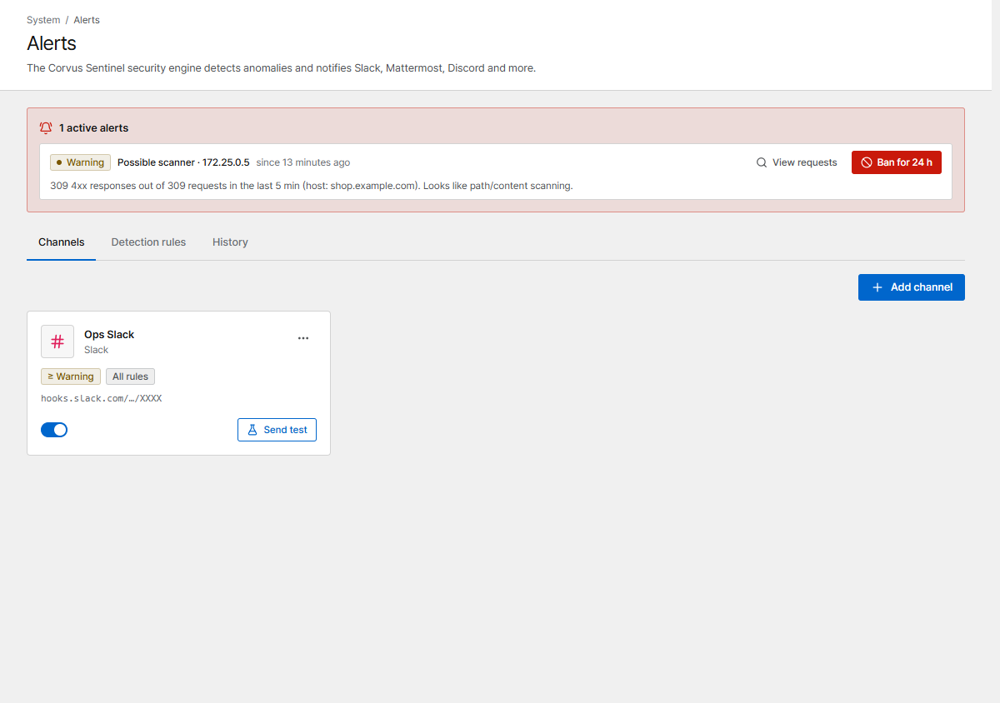

# Alerts

Corvus watches for problems and attacks and notifies your team chat.

{ .shot }

## 1. Add a channel

Open **Alerts → Channels → Add channel** and pick the type:

| Type | What you need |
|---|---|
| Slack | Slack app → enable *Incoming Webhooks* → pick a channel → copy the Webhook URL |
| Mattermost | *Integrations* → add an *Incoming Webhook* → copy the URL |
| Discord | Channel settings → *Integrations* → *Webhooks* → *New Webhook* → copy the URL |
| Microsoft Teams | Channel → *Workflows* → "Post to a channel when a webhook request is received" → copy the URL |
| Telegram | Bot token from @BotFather, and the `chat_id` of the chat you invited the bot to |
| Webhook | Any URL that accepts JSON `POST`. With a secret, requests carry an HMAC signature (`X-Corvus-Signature`) |

Choose the **Minimum severity** and, if you like, only some rules. Click **Send test** to check the
connection.

## 2. Detection rules

**Detection rules** lists what Corvus watches. Each rule can be turned off and has its own
threshold.

| Rule | Fires when |
|---|---|
| 5xx error rate | A host's share of 5xx responses exceeds the threshold |
| Latency (p95) | A host's p95 response time exceeds the threshold |
| Traffic spike | Requests per second jump to a multiple of the 1-hour average |
| Rate-limit surge | Many requests of a host are rate-limited |
| Exploit attempts | Many attack patterns are detected or blocked on a host |
| Security events | Many security-rule and body-inspection detections on a host |
| Repeated attack source | One IP triggers detections again and again (the alert shows the IP; **Ban for 24 h** is one click) |
| Possible scanner | One IP gets many 4xx responses in a short time |
| Access queue backlog | The number of waiting visitors reaches the threshold |
| Cache DB disconnected | The access-queue store can't be reached |
| Certificate expiring / issuance failed | A certificate expires soon or its renewal failed |
| Deployment failed | The gateway rejected a configuration |
| Admin login failures | Many failed sign-ins to the console |
| Under attack | [Under attack mode](../security/challenge.md) turned on or off automatically |

**Global settings**: how often to repeat while a problem persists, whether to send a message when it
clears, the alert language, and the **Console URL** used for links in messages.

## History

**History** keeps every alert with its state (*Firing*, *Resolved*) and delivery result. Active
alerts are also shown at the top of the dashboard.
