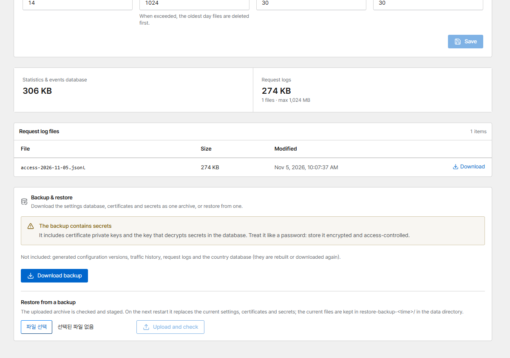

# Backup & restore

Everything Corvus needs lives in `./data`. **The most important part is `secrets/`**: it holds the
keys that decrypt MFA secrets and DNS tokens in the database.

## Download a backup

Open **Data retention → Backup & restore** and click **Download backup** (administrators, signed in
with a browser; API tokens can't download backups).

{ .shot }

The file `corvus-backup-<version>-<time>.tar.gz` contains:

- `corvus.db`: a consistent copy of the settings database, taken while Corvus keeps running
- `secrets/`, `certs/` and `rules/`
- `manifest.json`: versions and a SHA-256 checksum for every file

Not included, because they are rebuilt or downloaded again: generated configuration versions,
traffic history, request logs and the country database.

!!! danger "The backup contains private keys"
    It includes certificate private keys and the data key. Store it encrypted and access-controlled.
    Every download is recorded in the audit log.

With PostgreSQL (`CORVUS_DB_URL`) the archive holds no database. Back the database up with
`pg_dump` and keep the dump together with the archive.

## Restore from the console

1. **Restore from a backup → Choose backup file → Upload and check** (at most 200 MB). The archive is
   verified (checksums, paths, database type) and a summary is shown.
2. **Restore on next restart** stages it. Nothing changes yet.
3. Restart the container:

    ```bash
    docker compose restart
    ```

On start, Corvus moves the current files to `./data/restore-backup-<time>/` and puts the backup in
their place. To roll back, stop the container and move those files back. If the staged files fail
their checks, the current state is kept and the files are moved to `./data/restore-failed-<time>/`
(see `docker compose logs`).

## Restore by hand

The archive layout is the data directory layout. On a new server, before the first start:

```bash
mkdir data && tar -xzf corvus-backup-….tar.gz -C data
docker compose up -d
```
