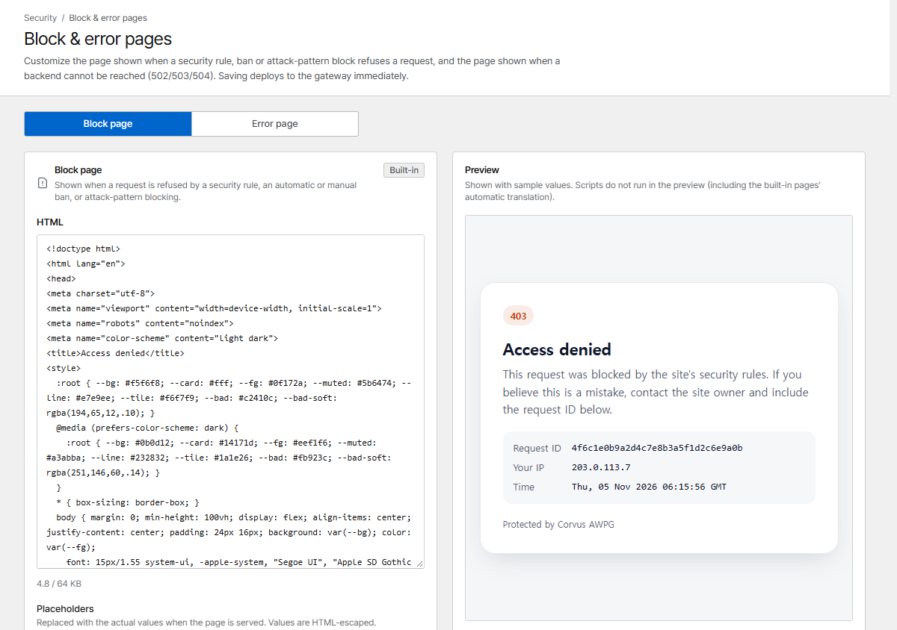

# Block & error pages

Corvus shows its own page when it refuses a request or when your service can't be reached. Both can
be replaced with your own HTML under **Block & error pages**.

{ .shot }

| Page | Shown when |
|---|---|
| **Block page** | A security rule, a ban or exploit blocking refuses a request |
| **Error page** | The host's service doesn't answer (connection refused, timeout) or sends an invalid response: `502`, `503`, `504`. Error pages your service sends itself are passed through unchanged |

The built-in pages are translated into the visitor's language automatically.

## Placeholders

These are replaced (HTML-escaped) when the page is served:

| Placeholder | Value |
|---|---|
| `{{STATUS}}` | Status code |
| `{{RID}}` | Request ID |
| `{{HOST}}` | Requested site |
| `{{IP}}` | Visitor IP: search for it in the [request logs](traffic.md#request-logs) when a visitor reports a problem |
| `{{TIME}}` | Time |

Pages can be up to 64 KB. Saving deploys immediately; **Reset to default** brings back the built-in
page.

## Unknown hosts { #unknown-hosts }

A request for a host name that no proxy or redirection host serves (a mistyped name, a bare IP
address, a scanner) is answered according to **Unknown hosts** at the bottom of the page:

| Option | Answer |
|---|---|
| **Not found page (404)** | A short `404` page (default) |
| **Close the connection** | No response at all: the connection is closed (nginx `444`) |
| **Redirect to a URL** | `302` to the URL you enter, e.g. `https://www.example.com/`. The requested path is not appended |

This applies to plain HTTP. HTTPS connections for unknown names are always refused during the TLS
handshake, so no certificate is revealed. Let's Encrypt HTTP challenges keep working in every mode.
