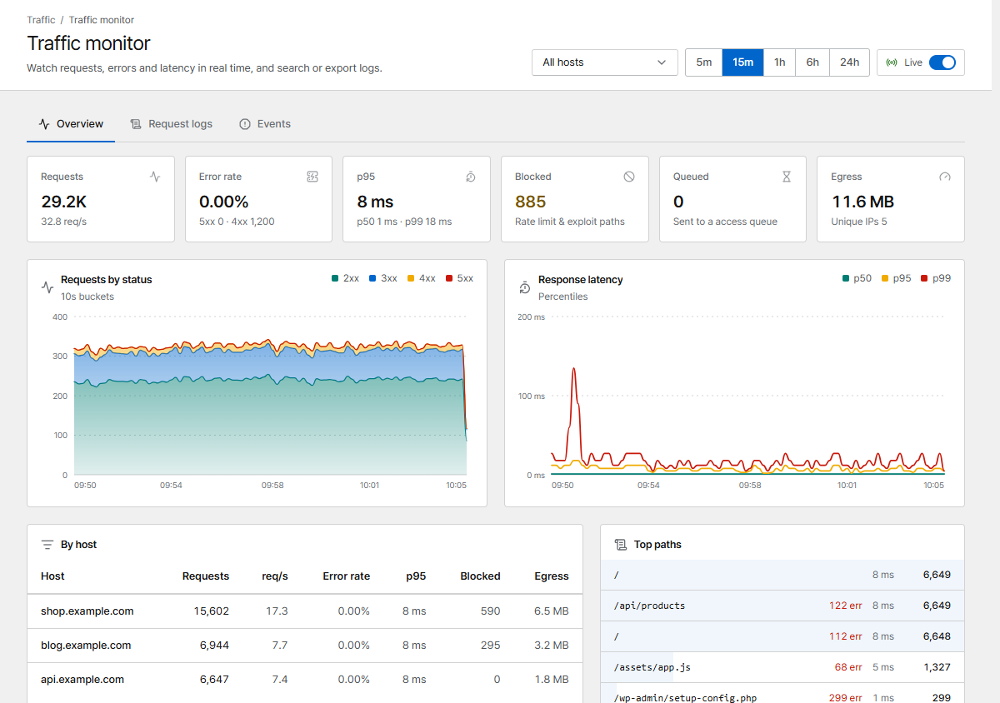
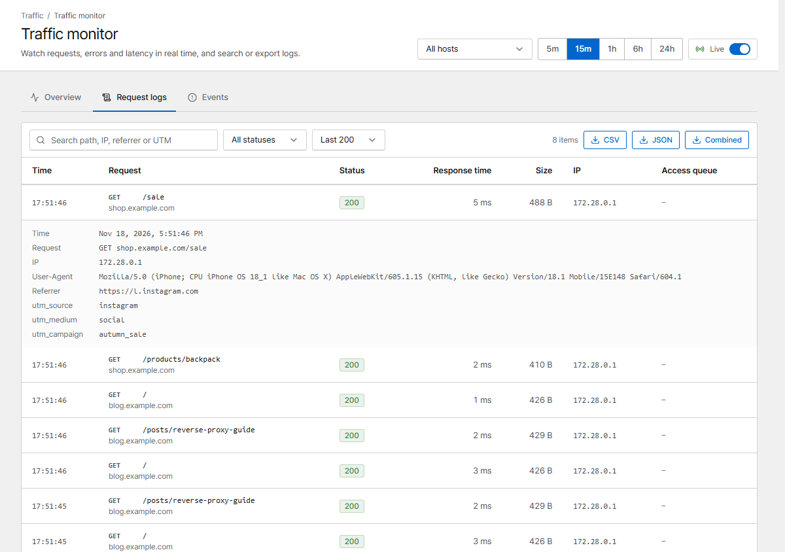
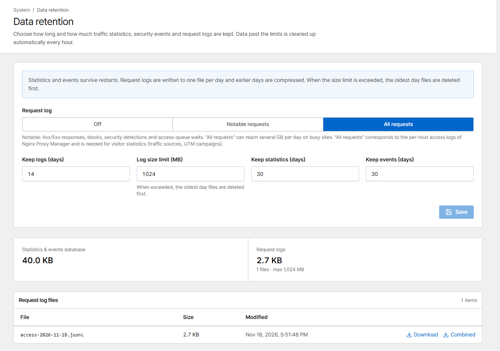

# Traffic monitor

The **Traffic monitor** shows requests, errors and latency in real time, per host and per path.

{ .shot }

Choose a host (or **All hosts**) and a time range at the top. **Live** updates the page every few
seconds.

## Overview

- **Requests**, **Error rate**, **p95** latency, **Blocked** (rate limits and exploit paths),
  **Queued** (visitors who joined an access queue; reloads while waiting are not counted
  again) and **Egress**
- **Requests by status** and **Response latency** (p50 / p95 / p99) over time
- **By host** and **Top paths**: where the traffic and the errors are

## Request logs

Search requests by path, IP, referrer or UTM value, filter by status, and export them as **CSV**,
**JSON** or **Combined** (nginx's standard access log format, see
[Visitor statistics](#visitor-statistics)). Click a row to see the details: time, full request, IP,
User-Agent, referrer, UTM values, the security rule that matched and the access-queue decision.

{ .shot }

Which requests are logged is set under **Data retention → Request log**:

{ .shot }

| Mode | Logged |
|---|---|
| **Notable requests** | 4xx/5xx responses, blocks, security detections, access-queue waits |
| **All requests** | Everything (can be several GB per day on busy sites) |
| **Off** | Nothing |

Logs are written to one file per day and older days are compressed. When the size limit is reached
the oldest days are deleted first. Statistics and events are kept separately (see **Data
retention**).

!!! tip "Privacy"
    **Network → Mask IPs in logs** hides the last part of client IPs in logs and exports.

### Traffic sources: referrer and UTM

Where visitors come from is logged without the parts of URLs that can hold secrets (password reset
tokens, OAuth codes, API keys, search terms):

| Field | What is logged | Example |
|---|---|---|
| **Referrer** | Only the origin of the `Referer` header: `scheme://host[:port]`, lowercased. Never its path, query, fragment or user name | `https://www.google.com/search?q=…` → `https://www.google.com` |
| **UTM** | Only `utm_source`, `utm_medium` and `utm_campaign` from the query string (decoded, at most 100 characters each, control and invisible formatting characters removed) | `?utm_source=newsletter&token=…` → `utm_source = newsletter` |

The rest of the query string is never logged. The gateway reduces both before anything leaves nginx,
so the full Referer and the other query parameters never reach the request log, its exports or the
statistics. Request log lines written before Corvus 1.6 have no referrer or UTM values.

!!! warning "Container logs"
    This applies to the request log only. nginx's own error and warning messages, which go to the
    container log (`docker logs`), describe the request that caused them, for example a rate-limit
    rejection or an unreachable upstream: they can contain the **full request line including the
    query string** and the **full Referer**. Treat the container log as sensitive: limit who can
    read it and how long your Docker logging driver keeps it.

## Visitor statistics { #visitor-statistics }

For visitor numbers, top pages and traffic sources from the request log:

1. Under **Data retention → Request log** choose **All requests**. (Notable requests only keeps
   errors and blocks, which is not enough for statistics.)
2. Export the log in nginx's **combined** format:
    - **Traffic monitor → Request logs → Combined**: the most recent requests (up to 1000) with the
      current filters.
    - **Data retention → Request log files → Combined**: a whole day, converted while it downloads.
3. Analyse it with a log analyser such as [GoAccess](https://goaccess.io/):

    ```bash
    goaccess access-2026-11-18.log --log-format=COMBINED -o report.html
    ```

The export uses the standard format
`IP - - [time] "METHOD /path?utm_source=… HTTP/1.1" status bytes "referrer" "user-agent"`.
As Corvus does not keep the query string or the protocol version, the query contains only the
recorded UTM values (none when there are none) and the protocol is always `HTTP/1.1`; the referrer is
the recorded origin (`-` when absent). With **Mask IPs in logs** on, the export from the traffic
monitor contains masked IPs.

!!! note "Full web analytics"
    Access logs count requests, not people: they don't see visits served from a browser cache or a
    CDN, can't tell bots from browsers reliably, and have no screen sizes or conversions. For full web
    analytics run a tool such as [Umami](https://umami.is/), [Plausible](https://plausible.io/) or
    Google Analytics 4 alongside Corvus; the request log then remains the server-side view.

## Events

Blocks, rate limits, challenges, server errors, access-queue waits and sign-ins on
[login pages](../security/login-page.md) in time order. Security rule
matches are also listed under **Security rules → Rule events**.

## Prometheus

`/metrics` on the admin port exports Prometheus metrics. Create an [API token](users.md#api-tokens)
with the *Viewer* role and scrape with `Authorization: Bearer <token>`.
