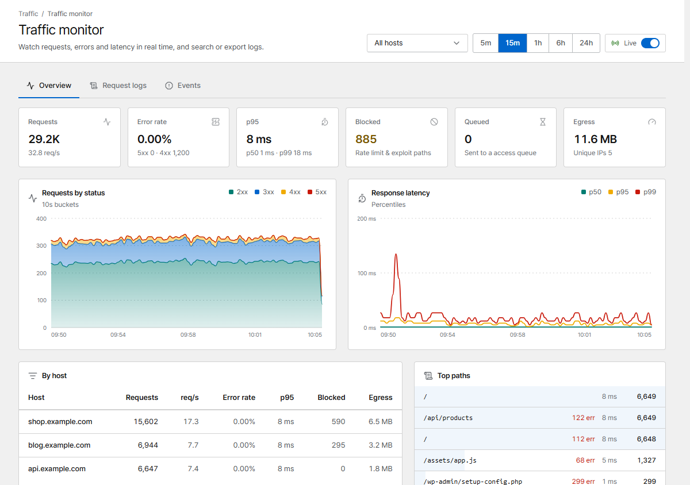
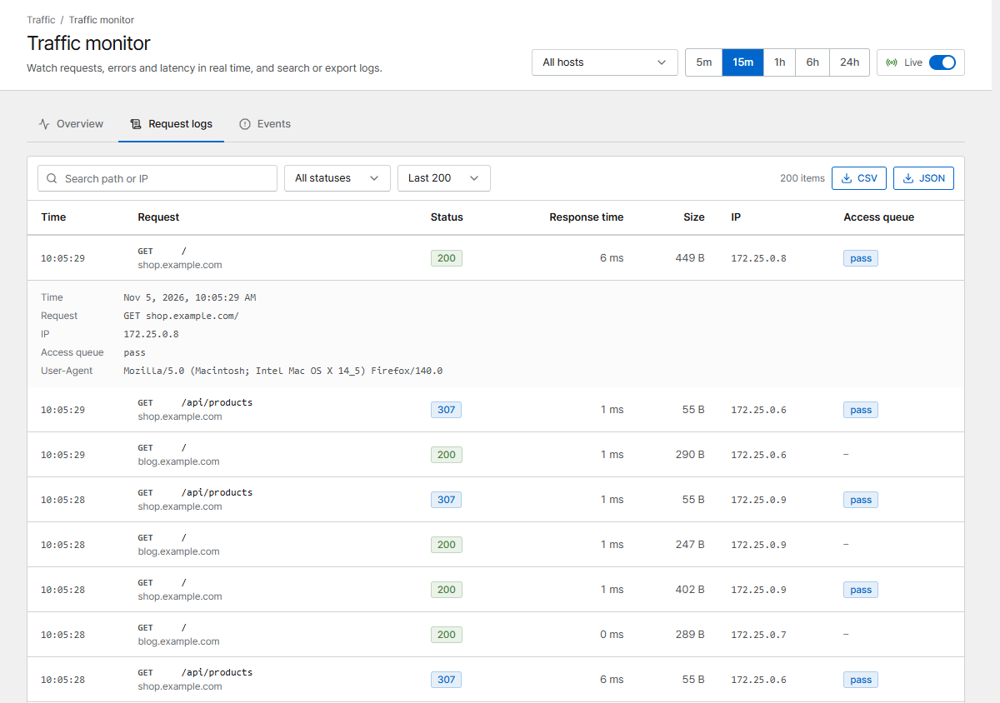
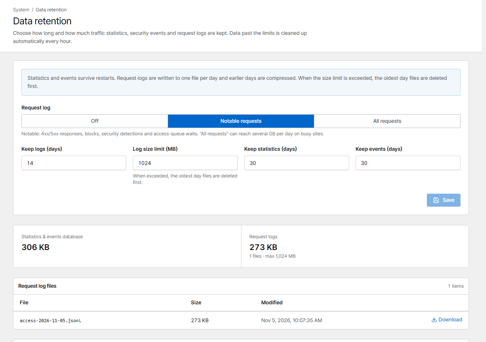

# Traffic monitor

The **Traffic monitor** shows requests, errors and latency in real time, per host and per path.

{ .shot }

Choose a host (or **All hosts**) and a time range at the top. **Live** updates the page every few
seconds.

## Overview

- **Requests**, **Error rate**, **p95** latency, **Blocked** (rate limits and exploit paths),
  **Queued** (sent to an access queue) and **Egress**
- **Requests by status** and **Response latency** (p50 / p95 / p99) over time
- **By host** and **Top paths**: where the traffic and the errors are

## Request logs

Search requests by path or IP, filter by status, and export them as **CSV** or **JSON**. Click a row
to see the details: time, full request, IP, User-Agent, the security rule that matched
and the access-queue decision.

{ .shot }

Which requests are logged is set under **Data retention → Request log**:

{ .shot }

| Mode | Logged |
|---|---|
| **Notable requests** | 4xx/5xx responses, blocks, security detections, access-queue waits |
| **All requests** | Everything (can be several GB per day on busy sites) |
| **Off** | Nothing |

Logs are written to one file per day and older days are compressed. When the size limit is reached
the oldest days are deleted first. Statistics and events are kept separately (see **Data
retention**).

!!! tip "Privacy"
    **Network → Mask IPs in logs** hides the last part of client IPs in logs and exports.

## Events

Blocks, rate limits, challenges, server errors and access-queue waits in time order. Security rule
matches are also listed under **Security rules → Rule events**.

## Prometheus

`/metrics` on the admin port exports Prometheus metrics. Create an [API token](users.md#api-tokens)
with the *Viewer* role and scrape with `Authorization: Bearer <token>`.
