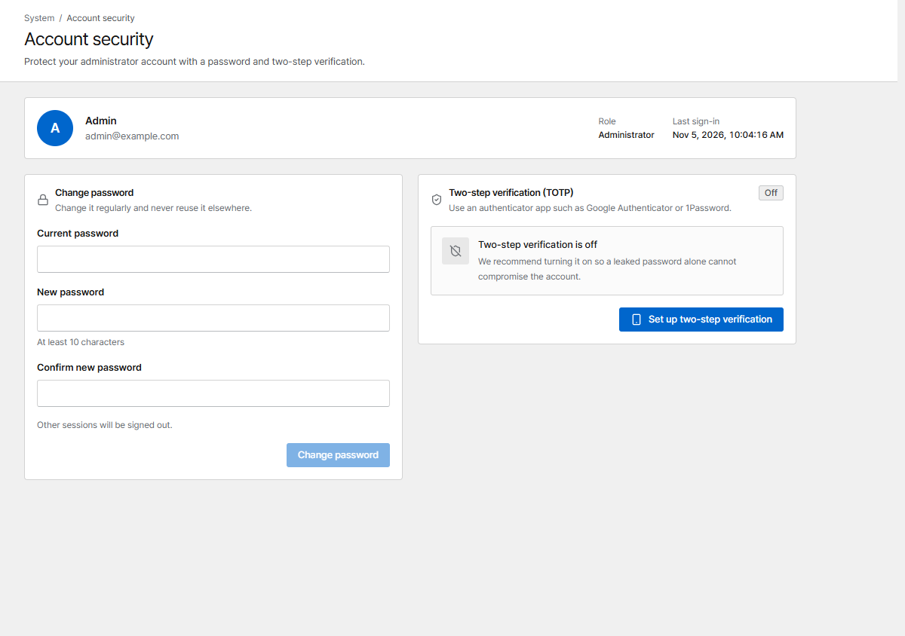

# Users & sign-in

## Roles

Add teammates under **Users**.

| Role | Can |
|---|---|
| **Administrator** | Everything, including users, SSO and system settings |
| **Operator** | Change proxy hosts, access queues, certificates and rules, and deploy |
| **Viewer** | Read only |

## Two-step verification

Every user can turn on two-step verification (TOTP) under **Account security**, with an
authenticator app such as Google Authenticator or 1Password. Save the recovery codes shown once
after setup. Administrators can **Reset MFA** for a user who lost their phone.

{ .shot }

## Single sign-on (OIDC)

Under **SSO** administrators can let users sign in with an OpenID Connect provider: Okta,
Microsoft Entra ID, Google, Keycloak and others. You can limit sign-in to e-mail domains, map
provider groups to roles, and choose whether unknown users are created automatically.

A user is bound to the provider account they sign in with (issuer and subject), not only to the
e-mail address:

- A user created automatically on the first SSO sign-in is linked to that provider account.
- An existing user (for example one created with a password) is linked on their first SSO sign-in
  only if the provider marks the e-mail address as verified (`email_verified: true`, from the ID
  token or the userinfo endpoint). Otherwise the sign-in is refused; ask the provider to send
  verified e-mails, or remove the user and let SSO create it again.
- Some providers never send `email_verified`, among them **Microsoft Entra ID**. If your provider
  only issues addresses it has verified (for Entra ID: users of your own tenant), turn on
  **The identity provider verifies email addresses**: a sign-in without the claim then links the
  existing user. `email_verified: false` is still refused.
- Once linked, the user signs in through that provider account even if the e-mail changes at the
  provider. Another provider account with the same e-mail is refused.
- Administrators can remove a link with **Unlink SSO** in the user's menu, for example when a
  provider account was replaced. The next verified sign-in links the user again.

Users who already signed in with SSO before an upgrade stay linked to the account they used.
The e-mail domain limit relies on the e-mail the provider sends: with a provider that does not
verify e-mail addresses (or a multi-tenant application), also restrict who can sign in at the provider.

## API tokens

Scripts and Prometheus use **API tokens** (created on the *API tokens* page) with an
`Authorization: Bearer cvs_…` header. A token has a role and an optional expiry, can't exceed its
creator's role, and is shown only once. When a password changes (an administrator resets it, or
users change their own on the *Account* page), the user's other sessions end and the API tokens
they created are deleted. See the [HTTP API](../reference/api.md).

## Protect the console

- Failed sign-ins are limited per address and per account. After 10 failures to an account in 15
  minutes, the account is locked for a while. A browser that signed in to the account before keeps
  its own count, so failures from elsewhere don't lock you out. Wrong current passwords when
  changing the password or turning off two-step verification count the same way.
- Allow port 9443 only from trusted networks: with a firewall, or with **Admin console allowed
  networks** on the *Network* page.
- Locked out by that list? Start the container once with `CORVUS_ADMIN_ALLOW_ANY=1`, fix the list,
  and remove the variable again.
- To reach the console under a name or another IP, add them to its certificate with
  `CORVUS_ADMIN_HOSTS` (see [Configuration](../reference/configuration.md)).
- Opening the console through a proxy host (e.g. `https://corvus.example.com`)? Forward it to
  `corvus` (the container name) port `9443` over `https`. The console then sees each visitor's own
  address for login limits, the allowed networks, sessions and the audit log. Behind another reverse
  proxy, list its address in `CORVUS_ADMIN_TRUSTED_PROXIES`.

## Audit log

**Audit log** records every administrative action: who changed what, from which IP, and when.
Entries are kept for 365 days (at most the newest 500,000); older ones are removed automatically.
