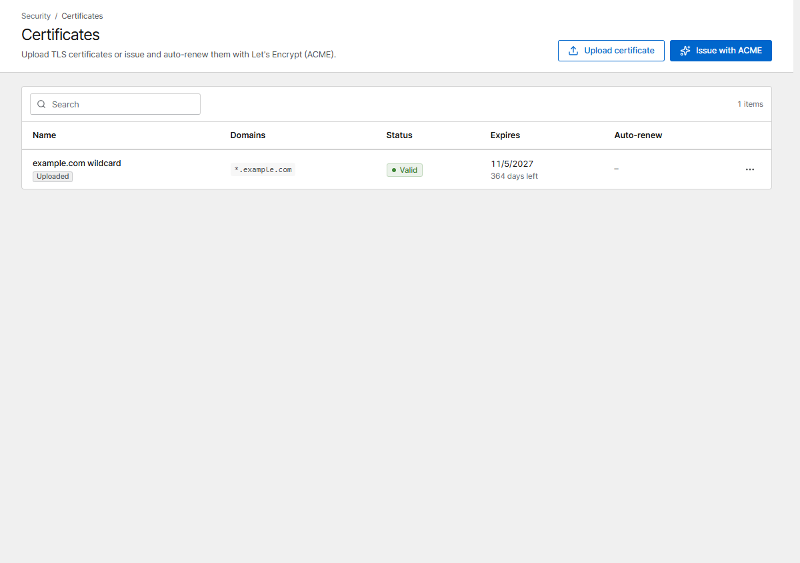

# Certificates

Corvus gets free certificates from Let's Encrypt and renews them automatically, or uses certificates
you upload.

{ .shot }

The quickest way is to request the certificate right in the proxy host form
(**TLS → Certificate → Request a new certificate**). The **Certificates** page lists every
certificate with its expiry date and lets you issue, upload, renew and replace them.

## Let's Encrypt

Click **Issue with ACME** and follow the three steps (domains, validation, review). Issuing runs in
the background; after a minute or two the status changes from **Issuing** to **Valid**.
Certificates renew automatically 30 days before they expire.

### HTTP-01 (default)

Let's Encrypt checks the domain through port 80. The domain's DNS must already point at this server
and port 80 must be reachable from the internet.

### DNS-01

Corvus creates a TXT record with your DNS provider. Use it for **wildcard certificates**
(`*.example.com`) and for servers that are not reachable from the internet.

Supported providers: Cloudflare, DigitalOcean, DuckDNS, Gandi, GoDaddy, Hetzner, Namecheap.
Create an API token at your provider that can edit DNS records and paste it into the form (for
Cloudflare: permission *Zone → DNS → Edit*). The token is stored encrypted and never shown again.

!!! tip "Testing"
    Turn on **Use the staging environment** while you experiment. It has no rate limits, but browsers
    don't trust its certificates.

## Upload your own

Click **Upload certificate** and paste the certificate (PEM, with the chain) and its private key.

When the certificate is renewed, open the row menu and choose **Replace**. The certificate keeps its
ID and its hosts; they are redeployed with the new one.

## Another ACME CA

To use a CA other than Let's Encrypt (for example a private step-ca), set
`CORVUS_ACME_DIRECTORY`, and `LEGO_CA_CERTIFICATES` if the CA is private. See
[Configuration](../reference/configuration.md).

## Expiry warnings

The dashboard lists certificates that expire within 30 days, and the
[alert](../operations/alerts.md) for certificate problems notifies you when a renewal fails.
