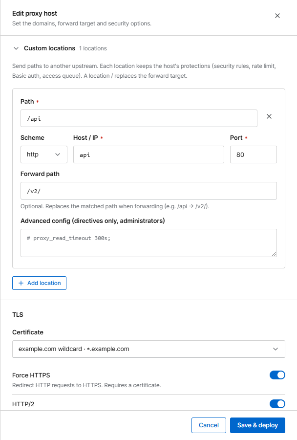

# Custom locations

Custom locations send part of a site to a different service, by path. Example: `shop.example.com`
goes to the web shop, but `shop.example.com/api/…` goes to the API server.

Open a proxy host and expand **Custom locations** in the form, then click **Add location**.

{ .shot .panel }

| Field | Meaning |
|---|---|
| **Path** | Path prefix, e.g. `/api`. Requests to `/api` and everything below it use this location |
| **Scheme / Host / IP / Port** | The service that receives these requests |
| **Forward path** | Optional. Replaces the matched prefix: with path `/api` and forward path `/v2/`, `/api/orders` is sent as `/v2/orders` |
| **Advanced config** | Optional nginx directives for this location only (administrators). Operators can't set, change or clear it, nor remove or move a location that has one |

## Good to know

- **Protection carries over.** Every location keeps the host's security rules, bans, exploit and body
  inspection, "under attack" mode, rate limit, password protection and access queue, as well as its
  upload limit, timeout and gzip setting.
- A location `/` replaces the host's forward target.
- `/__corvus` and `/.well-known/acme-challenge` are reserved.
- Up to 50 locations per host.
- Custom locations are [imported from NPM](../getting-started/migrate-npm.md).
