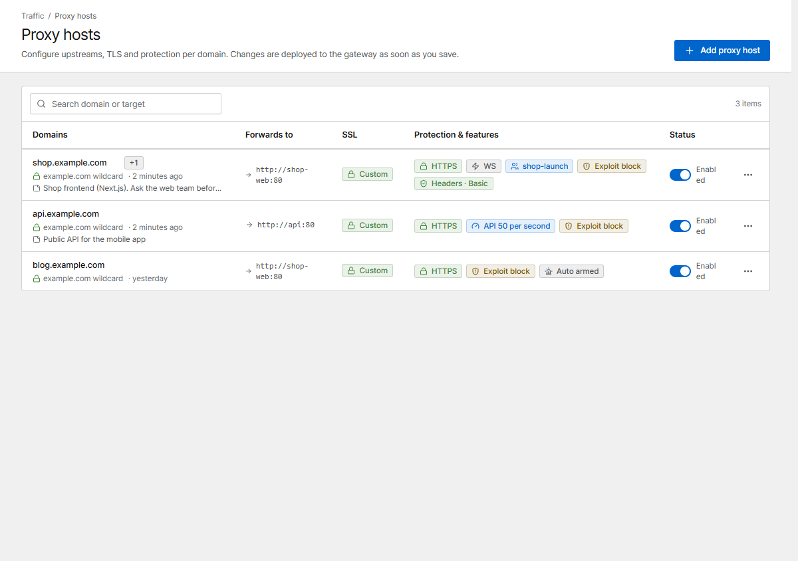
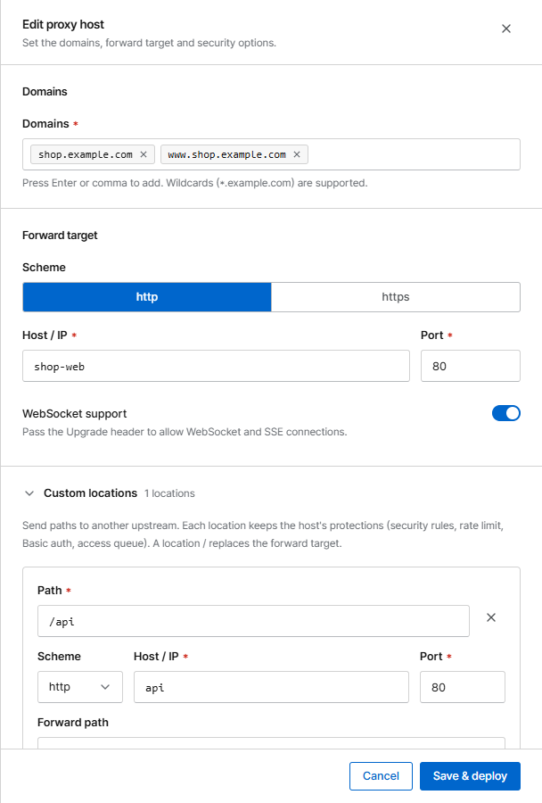
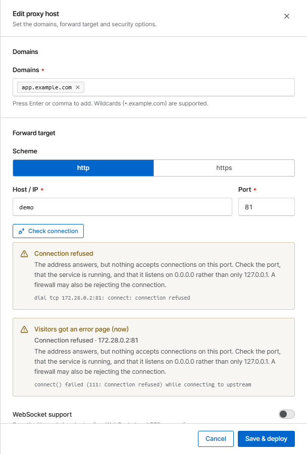
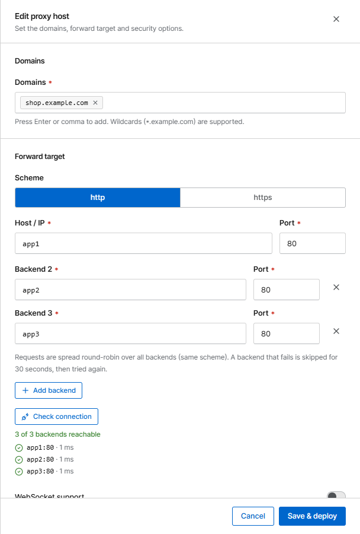
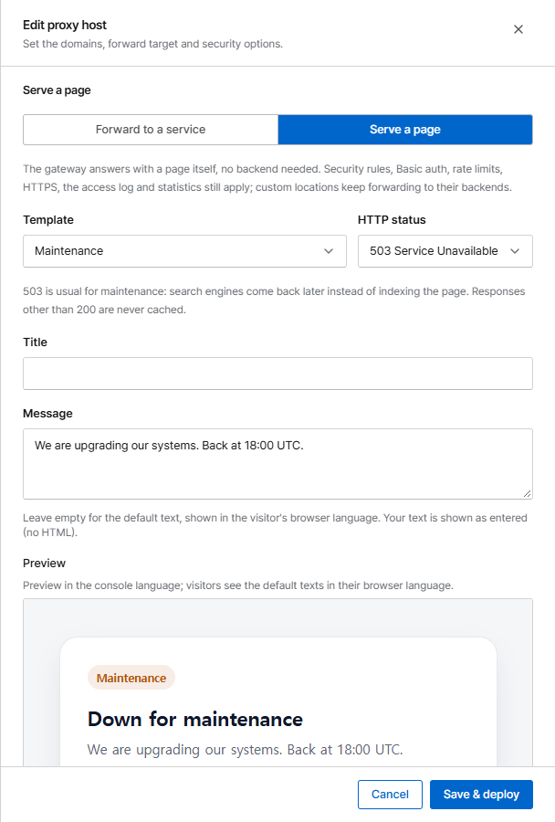
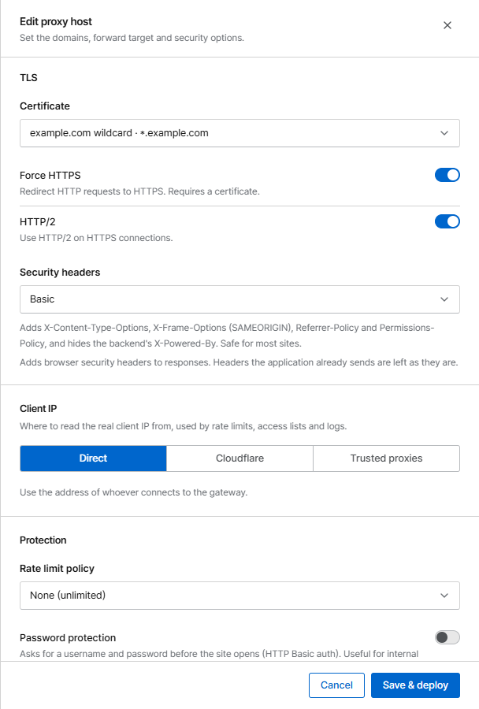
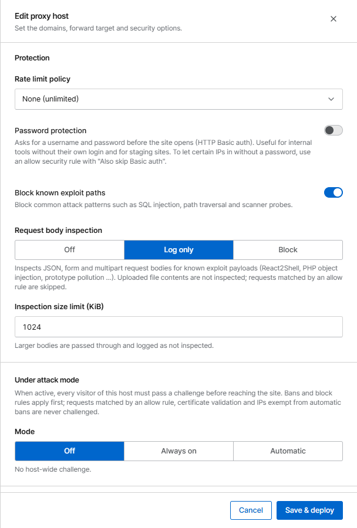
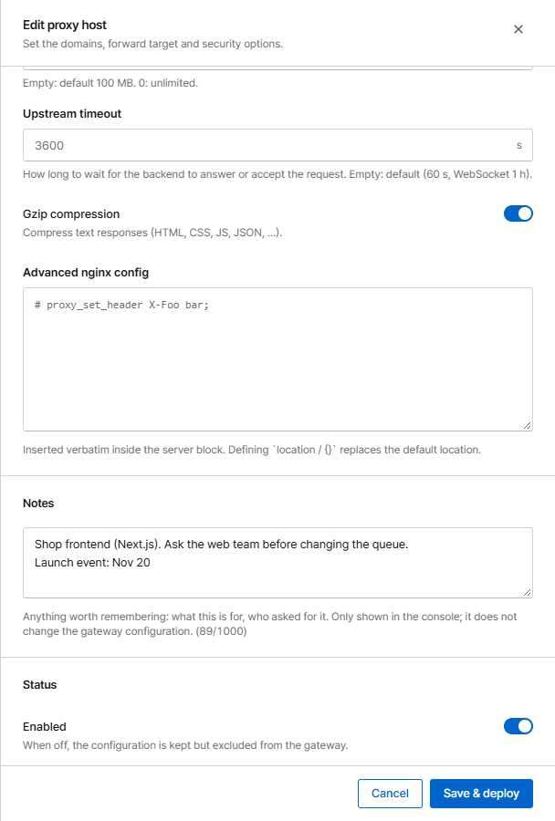
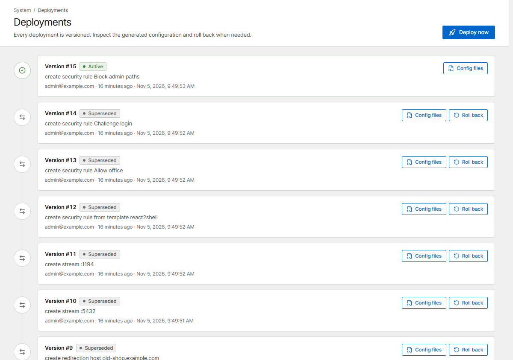

# Proxy hosts

A proxy host forwards requests for one or more domains to a service (the *forward target*) and
applies TLS and protection on the way. For a step-by-step first setup see
[Your first proxy host](../getting-started/first-host.md).

{ .shot }

The list shows each host's target, certificate and the features that are on (HTTPS, WebSocket,
access queue, rate limit, exploit blocking, security headers …). A host that
[serves a page](#serve-a-page-instead-of-a-backend) shows the page instead of a target, for example
**Page: Maintenance (503)**. The switch in **Status** turns a host off without deleting it.

## The form, section by section

{ .shot .panel }

### Domains

Type a domain and press ++enter++ or a comma. Wildcards such as `*.example.com` work. A domain can
belong to only one proxy or redirection host.

### Forward target

**Scheme**, **Host / IP** and **Port** of your service. **WebSocket support** is on for new hosts:
the upgrade is forwarded only when a client asks for a WebSocket, so other apps are unaffected. With
it on and no upstream timeout set, the timeout is 1 hour, so idle WebSocket connections and
server-sent events (SSE) stay open.

#### Forward targets

| Target | Example | Notes |
|---|---|---|
| Another container | `shop-web` port `80` | Corvus must share a Docker network with it: add that network to the `corvus` service |
| A private or public IP | `10.3.2.39` port `8084` | |
| A service on the Docker host | `127.0.0.1` or `localhost` | Inside the container these mean the Docker host, like in NPM; no `host.docker.internal` needed. The service must listen on an address the container can reach (`0.0.0.0` or the Docker bridge), and the host firewall must allow Docker networks |

To reach services that listen only on the host's `127.0.0.1`, run Corvus with
[host networking](../getting-started/install.md#run-it-with-host-networking-optional).

#### Check connection

**Check connection** under the host and port tries the target the way the gateway reaches it,
before you save:

- the forward host is mapped like in the gateway configuration (`127.0.0.1`/`localhost` → the
  Docker host, names from `extra_hosts`/`/etc/hosts` → their address);
- names are looked up with the gateway's DNS resolver as **full names, without search domains**, so
  a short name such as `nas` fails here exactly as it would for visitors;
- a TCP connection is opened (5 second limit), and for **https** a TLS handshake is made with the
  forward host as SNI. Certificates are not verified, as the gateway does not verify them either;
- a name with several addresses is tried on each of them (up to 8), since the gateway spreads
  requests over all of them: the check fails if one fails, and names that address;
- a host with [several backends](#several-backends-round-robin) has each of them checked at once,
  with the result per backend (one check against the limit below).

The result is either *reached* with the address and time, or the reason with a hint:

| Result | Usual fix |
|---|---|
| Name does not resolve | Use the full DNS name (`nas.home.lan`) or the IP address, or add the name to `extra_hosts` |
| Connection refused | Check the port and that the service runs and listens on `0.0.0.0`, not only `127.0.0.1` |
| No answer (timed out) | Allow the gateway server in the target server's firewall; check the address |
| Network unreachable | Check the address; a Docker network may [overlap your network](../getting-started/how-it-works.md#services-on-other-servers) |
| TLS handshake failed | The port speaks plain HTTP: use the `http` scheme or the service's HTTPS port (also shown when the port accepts the connection but never answers the handshake) |

Custom locations have the same button. Operators and administrators can use it, up to 20 checks a
minute per user.

{ .shot .panel }

#### Upstream errors in the list

When the gateway could not reach a host's service, for example after the service was stopped, the
list shows **Upstream error** next to the domain. Hover it for the reason (as above), the address
the gateway tried and when it happened; the host's form shows the same with nginx's message. The
warning disappears 15 minutes after the last failed request, or as soon as a saved change is
deployed. It
comes from the gateway's error log, so it shows what visitors actually got (502 or 504).

For a host with [several backends](#several-backends-round-robin) the warning reads **Backend
error** and names the backend that failed: the gateway retried the request on another backend, so
visitors were normally still served. Only when no backend was left to try does it say **All
backends failing**, which means visitors got the error page.

#### Several backends (round-robin)

A proxy host can forward to several copies of the same service, for example an app running on
several servers that keeps its sessions in a shared store (Redis, a database). Under the first
host and port, **Add backend** adds another host and port; up to 32 backends per host. The scheme
(`http`/`https`) is the same for all of them, and each backend follows the same rules as the first
one (the [forward targets](#forward-targets) above, no duplicates).

{ .shot .panel }

- **Round-robin**: requests are spread over the backends in turn. Keep-alive connections are kept
  per backend.
- **Passive failover**: when a backend refuses the connection or times out, the request is sent to
  the next backend. A backend that fails 3 times within 30 seconds is skipped for 30 seconds, then
  tried again with real requests. A `POST`, `PATCH` or `LOCK` request that already reached a backend
  is never repeated on another one (it might have been processed): that request gets the error
  page.
- With **https**, the first backend's host name is sent as SNI to all backends.
- A host with a single target behaves exactly as before: every request goes to it, without failure
  tracking.

Deliberately not included, to keep the feature small: active health checks (backends are judged by
real requests only), weights, sticky sessions (keep sessions in a shared store instead) and other
balancing methods. [Custom locations](locations.md) and [streams](streams.md) keep a single
target. A backend that does not answer at all (rather than refusing the connection, for example a
stopped server) delays a request by the pool's connection timeout of 3 seconds (instead of the
usual 10) before the next backend is tried, until the backend is skipped. A
`proxy_connect_timeout` in the host's advanced configuration replaces these 3 seconds.

The list shows **N backends** next to the forward target; hover it for the addresses. Through the
[API](../reference/api.md), `forward_host`/`forward_port` stay the first backend and
`extra_targets` lists the others; clients that do not send `extra_targets` keep working unchanged.

### Serve a page instead of a backend

When a domain has no service yet, or its service is down for maintenance, choose **Serve a page**
instead of **Forward to a service** at the top of the forward target section. The gateway then
answers with a page itself: no forward host is needed, and **Check connection** is not shown.

{ .shot .panel }

| Template | Shows | Default status |
|---|---|---|
| Coming soon | "Coming soon" with a short text | 200 |
| Maintenance | "Down for maintenance" with a short text | 503 |
| Parked domain | "This domain is parked" | 200 |
| Custom HTML | Your own page, sent exactly as entered (up to 256 KB) | 200 |

- **HTTP status**: 200, 404, 410 or 503. 503 is the usual answer while a site is down for
  maintenance: search engines come back later instead of indexing the page. Answers other than 200
  carry `Cache-Control: no-store`, so browsers and CDNs do not keep the page once the host forwards
  again. No `Retry-After` header is sent.
- **Title** and **Message** (built-in templates): leave them empty for the default text, which the
  page shows in the visitor's browser language (the 8 console languages). Your own text is shown as
  entered, as plain text: HTML is escaped, line breaks are kept. The built-in pages also show the
  host name and look like the gateway's [block and error pages](../operations/pages.md), in light
  and dark.
- **Custom HTML**: put images (`data:` URLs) and CSS into the page or load them from another site;
  the host serves only this one page. Nothing in it is replaced (`{{HOST}}` stays as written).
- The preview in the form is rendered by the control plane with the same template, in the console
  language.
- The page answers every path and method (`GET /anything`, `POST /form` …); `HEAD` gets the headers
  only.
- Everything else applies as for a host that forwards: security rules, bans, attack-pattern
  blocking, "under attack" mode, rate limit, Basic auth or the login page, the access queue, Force HTTPS and HSTS,
  security headers, the access log and traffic statistics.
- [Custom locations](locations.md) keep forwarding, for example a maintenance page at `/` while
  `/api` still reaches the backend. A location `/` is not allowed on a host that serves a page (it
  would replace the page), nor a `location /` in its advanced configuration.
- Switching back to **Forward to a service** keeps the page (and a host that serves a page keeps a
  forward target entered before), so you can switch back and forth.

Through the [API](../reference/api.md) the host has `content` (`forward` or `page`) and `page`;
clients that do not send them keep working unchanged.

### Custom locations

Send paths such as `/api` to another service. See [Custom locations](locations.md).

In the list, a host with custom locations shows **N locations** next to its target; hover the badge
or move the keyboard focus to it to see each path with its target. The list search also finds a host
by a location's path or forward host.

### TLS

{ .shot .panel }

- **Certificate**: an existing certificate, **Request a new certificate (Let's Encrypt)**, or
  **None (HTTP only)**. See [Certificates](certificates.md).
- **Force HTTPS** redirects HTTP to HTTPS and sends `Strict-Transport-Security`.
- **HTTP/2** on HTTPS connections.

### Client IP

Where the real visitor IP comes from. It is used by rules, bans, rate limits and logs.

| Option | Use when |
|---|---|
| **Direct** | Visitors connect straight to Corvus (default) |
| **Cloudflare** | The site is behind Cloudflare. `CF-Connecting-IP` is trusted only from Cloudflare's official ranges |
| **Trusted proxies** | Another proxy or load balancer is in front. Set its ranges and header on the **Network** page |

!!! warning
    A wrong trusted-proxy setting lets clients fake their IP and get around rate limits and bans.

#### Behind a TCP tunnel or load balancer (PROXY protocol)

A TCP tunnel or load balancer (FRP, HAProxy, a cloud load balancer) passes the connection through
without reading it, so Corvus sees the tunnel's address for every visitor. Most of them can send
the visitor's address in a [PROXY protocol](https://www.haproxy.org/download/2.9/doc/proxy-protocol.txt)
header (v1 or v2) at the start of the connection. Corvus accepts that header on two extra ports:

1. On the **Network** page, in the **PROXY protocol** card, enter the address the tunnel connects
   from in **Trusted PROXY protocol sources**. The header is used only on connections from there.
   This is a separate list: don't add the tunnel to **Trusted proxies**, which are trusted for
   `X-Forwarded-For` (see below). [Streams](streams.md#proxy-protocol) use the same list.
2. In the same card, turn on **Accept PROXY protocol**. The ports default to **8080** (HTTP) and
   **8443** (HTTPS); they can't be Corvus's own ports or a stream's port, and the switch can't be
   turned on with an empty trusted list.
3. Publish the ports in `docker-compose.yml`. When the tunnel runs on the same host, publish them on
   loopback only:

    ```yaml
        ports:
          - '80:80'
          - '443:443'
          - '9443:9443'
          - '127.0.0.1:8080:8080'   # PROXY protocol, HTTP
          - '127.0.0.1:8443:8443'   # PROXY protocol, HTTPS
    ```

    When the tunnel or load balancer is on another machine, publish them without `127.0.0.1:` and
    let a firewall allow only that machine's address to reach them.

4. Point the tunnel at these ports with the PROXY protocol turned on.

Ports 80 and 443 stay as they are: visitors on your network and the tunnel can use Corvus side by
side. (A port that expects the header refuses connections without one, so the extra ports should be
used by the tunnel only.)

**Which address to trust.** Enter the address Corvus sees the tunnel connect from:

- **frpc (or HAProxy) in a container on a Docker network shared with Corvus**, connecting to the
  Corvus container by name: that container's address, or the network's subnet if it changes. The
  ports don't need to be published at all in this case.
- **frpc on the host, ports published on `127.0.0.1` as above**: the Docker bridge gateway
  (e.g. `172.18.0.1`, shown as the client address on the **Traffic** page before you add it).
- **A load balancer on another machine**: its address.

!!! warning "Don't trust the Docker gateway unless the ports are on loopback"
    With ports published on all addresses, Docker often makes outside connections appear to come
    from the bridge gateway (its userland proxy, IPv6 without ip6tables, Docker Desktop, rootless
    Docker). Trusting the gateway then lets anyone who reaches the port set their own address.

=== "FRP"

    `frpc.toml` on the machine next to Corvus (frp 0.52 or later):

    ```toml
    [[proxies]]
    name = "corvus-https"
    type = "tcp"
    localIP = "127.0.0.1"      # the Corvus host (or the Corvus container's name)
    localPort = 8443
    remotePort = 443
    transport.proxyProtocolVersion = "v2"

    [[proxies]]
    name = "corvus-http"
    type = "tcp"
    localIP = "127.0.0.1"
    localPort = 8080
    remotePort = 80
    transport.proxyProtocolVersion = "v2"
    ```

=== "HAProxy"

    ```
    frontend https_in
        mode tcp
        bind :443
        default_backend corvus_https

    backend corvus_https
        mode tcp
        server corvus 192.168.1.10:8443 send-proxy-v2
    ```

TLS still ends at Corvus, so certificates (including Let's Encrypt HTTP-01 through the HTTP port)
work as usual.

The address from the header is used by hosts set to **Direct**, by redirection hosts and for
unknown hosts. Hosts set to **Cloudflare** or **Trusted proxies** keep reading the address from
their header with their own rules, also when reached through the tunnel. Don't add the tunnel to
**Trusted proxies** for them unless the tunnel sets `X-Forwarded-For` itself: the tunnel passes on
whatever the visitor sent, so trusting it would let visitors choose their own address. With
Cloudflare in front of the tunnel, set the host to **Trusted proxies** with the `CF-Connecting-IP`
header and add the tunnel to **Trusted proxies** only when the tunnel's public ports accept nothing
but Cloudflare's addresses (a firewall on the tunnel server).

!!! note "Advanced configuration with real IP directives"
    While the PROXY protocol is on, Corvus sets `set_real_ip_from` and `real_ip_header` for all
    servers. An advanced configuration that sets only one of them (only `real_ip_header`, or only
    `set_real_ip_from`) is combined with the other one from Corvus. Set both, or neither.

!!! note
    [Streams](streams.md#proxy-protocol) accept the PROXY protocol per stream, with the same
    trusted sources; this switch is not needed for them.

### Protection

{ .shot .panel }

| Option | What it does |
|---|---|
| **Rate limit policy** | Limits requests per IP. See [Bans & rate limits](../security/bans.md#rate-limits) |
| **Require sign-in** | **None**; **Password protection**: asks for a username and password before the site opens (HTTP Basic auth), good for staging sites and internal tools; or **Login page**: a Corvus login page with one PIN or password, or with sign-in users and optional two-step verification. See [Login page](../security/login-page.md) |
| **Block known exploit paths** | Blocks common attack patterns: SQL injection, path traversal, scanner probes. **On by default** |
| **Request body inspection** | Checks JSON, form and multipart bodies for known exploit payloads: **Off**, **Log only** or **Block**. In **Block** mode, bodies that cannot be fully inspected (compressed, malformed multipart, a body declared as JSON that is not valid JSON, a charset other than UTF-8 or another ASCII-compatible one, too many fields) are refused too. Bodies above the inspection size limit pass and are logged as not inspected |
| **Under attack mode** | Makes every visitor pass a browser challenge. See [Challenge & under attack](../security/challenge.md) |
| **Security headers** | Adds browser security headers (**Basic** or **Strict**). Headers your app already sends are never replaced |

### Access queue

Attach an [access queue](../access-queue.md) and choose the **Protected path** (usually `/`).

### Advanced

{ .shot .panel }

| Option | Default | Meaning |
|---|---|---|
| **Max upload size** | 100 MB | Largest request body. `0` = unlimited. Larger uploads get `413` |
| **Upstream timeout** | 60 s (1 h with WebSocket) | How long Corvus waits for your service to answer. Empty: 60 s, or 1 h for WebSocket hosts; a value you set applies as is |
| **Gzip compression** | On | Compresses text responses (HTML, CSS, JS, JSON …). Responses that are already compressed pass unchanged |
| **Advanced nginx config** | empty | Nginx directives inserted into the host's `server` block (administrators only). Directives that run code or make the gateway write files it names are refused (`*_by_lua*`, `include`, `proxy_store`, `*_temp_path`, …); `access_log` and `error_log` may write to `off`, `stderr`, `syslog:` or a `*.log` file |

### Notes

{ .shot .panel }

Optional free text, up to 1000 characters: what the host is for, who asked for it, why it has a
special rule. The first line is shown under the domain in the list, and the search box also
searches notes. Notes are only shown in the console; they don't change the gateway configuration.

### Status

When **Enabled** is off, the host's settings are kept but it is removed from the gateway.

If you opened the console through a proxy host (for example `https://corvus.example.com`), that
host is marked **Console** in the list. Editing it shows a reminder, and disabling or deleting it
asks for confirmation first, because the console would no longer be reachable at that address. Port
9443 of the server (`https://server-ip:9443`) keeps working either way.

## How changes are applied

**Save & deploy** creates a new configuration version, tests it with `openresty -t` and applies it
without dropping connections. If the test fails, nothing changes and the error is shown. Every
version is listed under **Deployments**, where you can inspect the generated files and roll back.

{ .shot }
