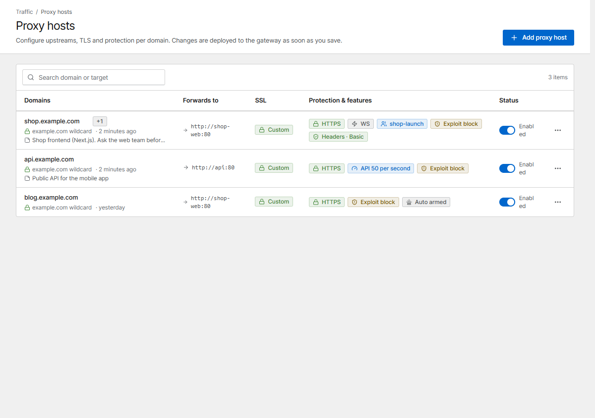
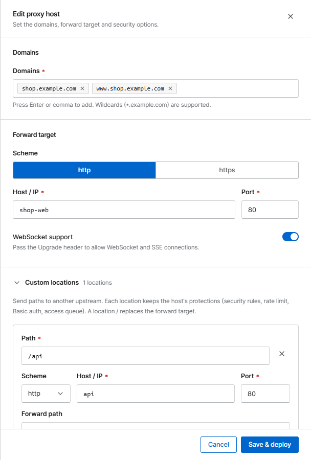
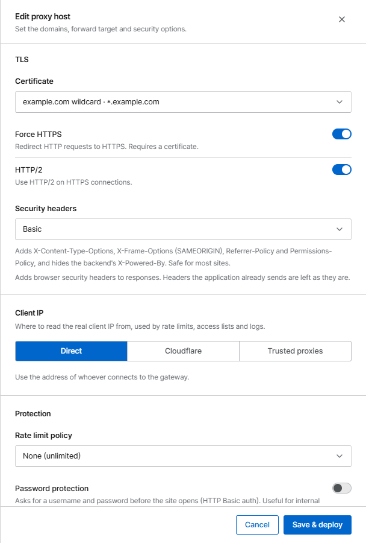
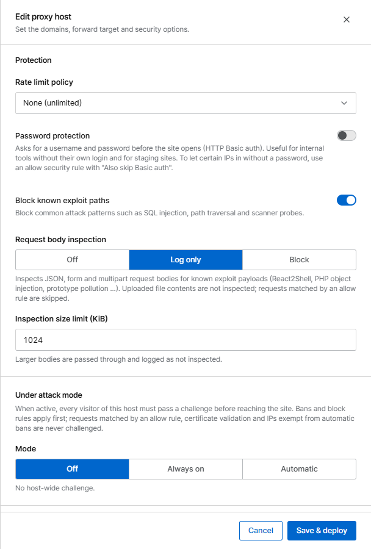
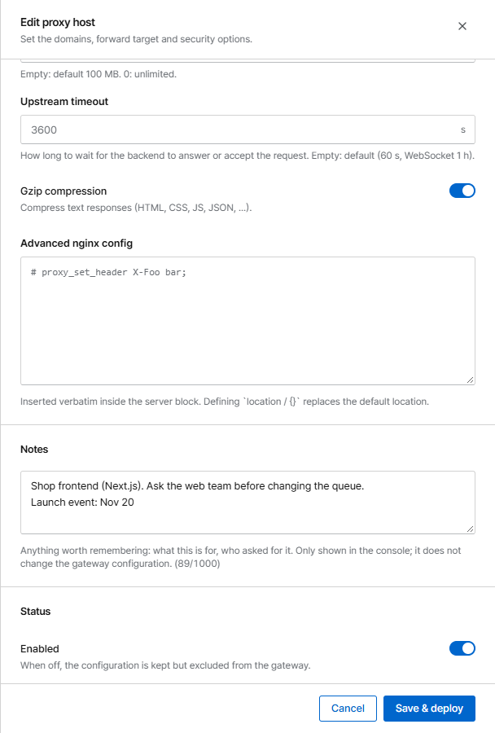
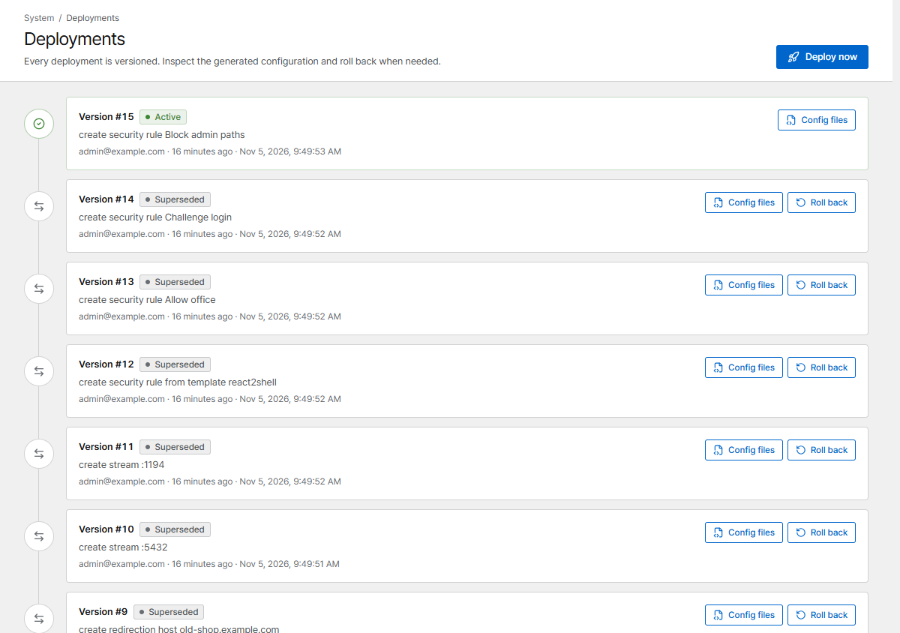

# Proxy hosts

A proxy host forwards requests for one or more domains to a service (the *forward target*) and
applies TLS and protection on the way. For a step-by-step first setup see
[Your first proxy host](../getting-started/first-host.md).

{ .shot }

The list shows each host's target, certificate and the features that are on (HTTPS, WebSocket,
access queue, rate limit, exploit blocking, security headers …). The switch in **Status** turns a
host off without deleting it.

## The form, section by section

{ .shot .panel }

### Domains

Type a domain and press ++enter++ or a comma. Wildcards such as `*.example.com` work. A domain can
belong to only one proxy or redirection host.

### Forward target

**Scheme**, **Host / IP** and **Port** of your service. Turn on **WebSocket support** for apps that
use WebSockets or server-sent events.

#### Forward targets

| Target | Example | Notes |
|---|---|---|
| Another container | `shop-web` port `80` | Corvus must share a Docker network with it: add that network to the `corvus` service |
| A private or public IP | `10.3.2.39` port `8084` | |
| A service on the Docker host | `127.0.0.1` or `localhost` | Inside the container these mean the Docker host, like in NPM; no `host.docker.internal` needed. The service must listen on an address the container can reach (`0.0.0.0` or the Docker bridge), and the host firewall must allow Docker networks |

To reach services that listen only on the host's `127.0.0.1`, run Corvus with
[host networking](../getting-started/install.md#run-it-with-host-networking-optional).

### Custom locations

Send paths such as `/api` to another service. See [Custom locations](locations.md).

### TLS

{ .shot .panel }

- **Certificate**: an existing certificate, **Request a new certificate (Let's Encrypt)**, or
  **None (HTTP only)**. See [Certificates](certificates.md).
- **Force HTTPS** redirects HTTP to HTTPS and sends `Strict-Transport-Security`.
- **HTTP/2** on HTTPS connections.

### Client IP

Where the real visitor IP comes from. It is used by rules, bans, rate limits and logs.

| Option | Use when |
|---|---|
| **Direct** | Visitors connect straight to Corvus (default) |
| **Cloudflare** | The site is behind Cloudflare. `CF-Connecting-IP` is trusted only from Cloudflare's official ranges |
| **Trusted proxies** | Another proxy or load balancer is in front. Set its ranges and header on the **Network** page |

!!! warning
    A wrong trusted-proxy setting lets clients fake their IP and get around rate limits and bans.

### Protection

{ .shot .panel }

| Option | What it does |
|---|---|
| **Rate limit policy** | Limits requests per IP. See [Bans & rate limits](../security/bans.md#rate-limits) |
| **Password protection** | Asks for a username and password before the site opens (HTTP Basic auth). Good for staging sites and internal tools |
| **Block known exploit paths** | Blocks common attack patterns: SQL injection, path traversal, scanner probes. **On by default** |
| **Request body inspection** | Checks JSON, form and multipart bodies for known exploit payloads: **Off**, **Log only** or **Block** |
| **Under attack mode** | Makes every visitor pass a browser challenge. See [Challenge & under attack](../security/challenge.md) |
| **Security headers** | Adds browser security headers (**Basic** or **Strict**). Headers your app already sends are never replaced |

### Access queue

Attach an [access queue](../access-queue.md) and choose the **Protected path** (usually `/`).

### Advanced

{ .shot .panel }

| Option | Default | Meaning |
|---|---|---|
| **Max upload size** | 100 MB | Largest request body. `0` = unlimited. Larger uploads get `413` |
| **Upstream timeout** | 60 s (1 h with WebSocket) | How long Corvus waits for your service to answer |
| **Gzip compression** | On | Compresses text responses (HTML, CSS, JS, JSON …). Responses that are already compressed pass unchanged |
| **Advanced nginx config** | empty | Nginx directives inserted into the host's `server` block (administrators only) |

### Notes

{ .shot .panel }

Optional free text, up to 1000 characters: what the host is for, who asked for it, why it has a
special rule. The first line is shown under the domain in the list, and the search box also
searches notes. Notes are only shown in the console; they don't change the gateway configuration.

### Status

When **Enabled** is off, the host's settings are kept but it is removed from the gateway.

If you opened the console through a proxy host (for example `https://corvus.example.com`), that
host is marked **Console** in the list. Editing it shows a reminder, and disabling or deleting it
asks for confirmation first, because the console would no longer be reachable at that address. Port
9443 of the server (`https://server-ip:9443`) keeps working either way.

## How changes are applied

**Save & deploy** creates a new configuration version, tests it with `openresty -t` and applies it
without dropping connections. If the test fails, nothing changes and the error is shown. Every
version is listed under **Deployments**, where you can inspect the generated files and roll back.

{ .shot }
