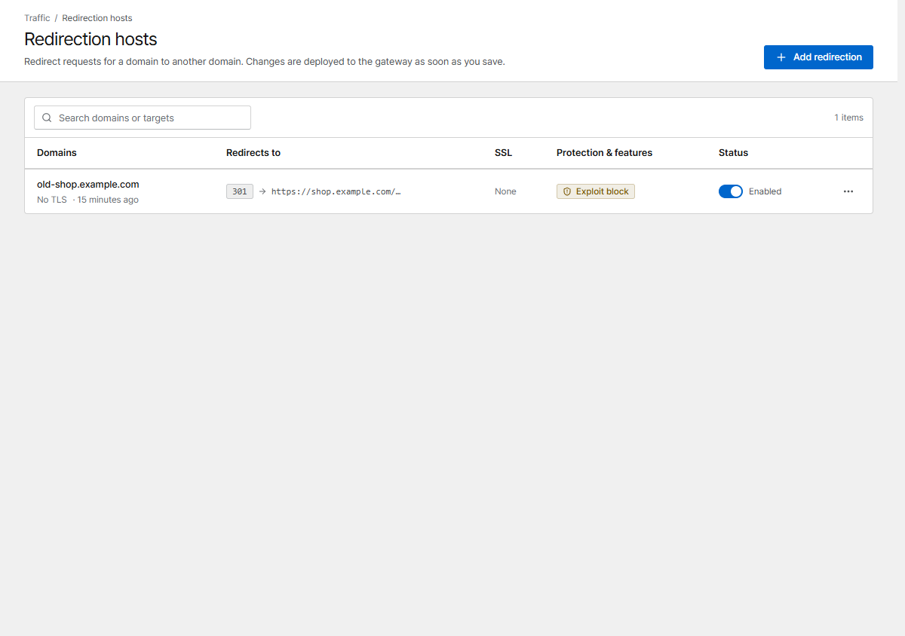

# Redirection hosts

A redirection host sends visitors of one domain to another address, for example an old domain to
the new one, or `example.com` to `www.example.com`.

{ .shot }

Click **Add redirection** and set:

| Field | Meaning |
|---|---|
| **Domains** | The domains to answer |
| **Scheme** | `auto` keeps the request's scheme (http or https); or always `http` / `https` |
| **Target domain** | Where to send visitors, without `http://`. A port and a path may be added: `example.com`, `example.com/blog` |
| **Status code** | `301` permanent (default), `302` temporary, `303`, `307` / `308` (keep the request method) |
| **Preserve path** | Appends the request path and query to the target: `old.example.com/a?b=1` → `new.example.com/a?b=1`. When off, every request goes to the target address |
| **TLS** | Certificate, Force HTTPS and HTTP/2, as for proxy hosts |

IP bans, security rules that apply to all hosts, and exploit-path blocking protect redirection hosts
too.

Redirection hosts are [imported from NPM](../getting-started/migrate-npm.md).
