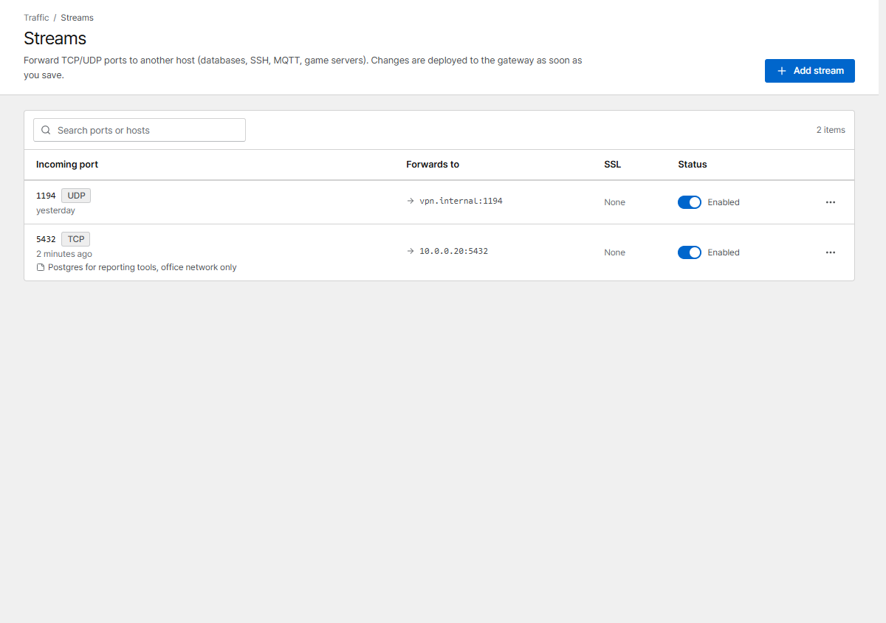
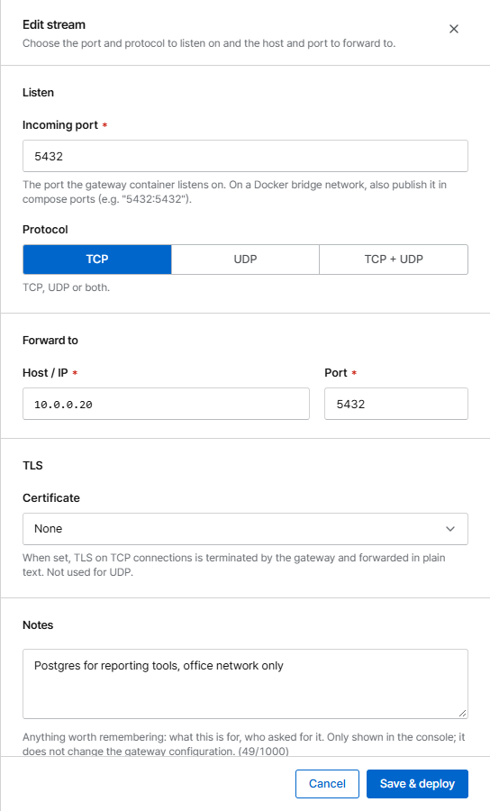

# Streams (TCP/UDP)

Streams forward a TCP and/or UDP port to another host, for services that don't speak HTTP:
databases, SSH, MQTT, VPNs, game servers.

{ .shot }

Click **Add stream** and set:

{ .shot .panel }

| Field | Meaning |
|---|---|
| **Incoming port** | The port Corvus listens on |
| **Protocol** | TCP, UDP or both |
| **Forward to** | Host / IP and port of the service (same [forward targets](proxy-hosts.md#forward-targets) as proxy hosts) |
| **Certificate** | Optional, TCP only: Corvus terminates TLS and forwards plain TCP. The TCP port opens once the certificate is issued |
| **Notes** | Optional, for people only ([as for proxy hosts](proxy-hosts.md#notes)) |

## Publish the port

With the default bridge network, Docker only passes the ports listed in `docker-compose.yml`.
Add every stream port there and apply it with `docker compose up -d`:

```yaml hl_lines="6 7"
    ports:
      - '80:80'
      - '443:443'
      - '9443:9443'
      - '5432:5432'       # stream: PostgreSQL (TCP)
      - '1194:1194/udp'   # stream: OpenVPN (UDP)
```

With `network_mode: host` nothing else is needed.

## Limits

- Ports Corvus uses itself (80, 443, 9443 and its internal ports) can't be used.
- Two enabled streams can't share a port and protocol.
- Streams have no request log, and IP bans and security rules don't apply to them yet. Restrict
  access with a firewall if needed.

Streams are [imported from NPM](../getting-started/migrate-npm.md).
