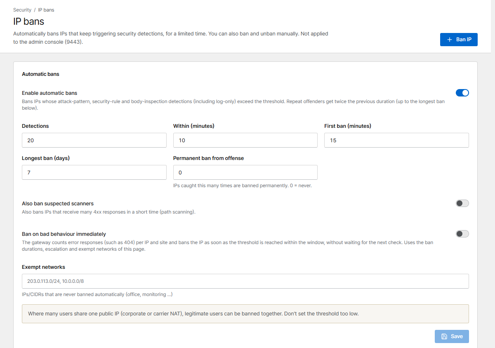

# Bans & rate limits

## IP bans

Corvus bans IPs that keep attacking, for a limited time, without you doing anything. You can also
ban and unban by hand. Bans apply to all proxy and redirection hosts, not to the admin console.

{ .shot }

### Automatic bans

| Setting | Default | Meaning |
|---|---|---|
| **Enable automatic bans** | On | Ban IPs whose detections (attack patterns and body inspection, also in log-only mode, and security rules that block) exceed the threshold. Matches of rules in **Log** mode never count |
| **Detections** within **minutes** | 20 in 10 min | The threshold |
| **First ban** | 15 min | Each repeat offense doubles the duration … |
| **Longest ban** | 7 days | … up to this (at most 30 days) |
| **Permanent ban from offense** | 0 (never) | Ban permanently from the N-th offense |
| **Also ban suspected scanners** | Off | Also ban IPs that get many 4xx responses in a short time (path scanning) |
| **Ban on bad behaviour immediately** | Off | The gateway counts error responses (e.g. 404) per IP **and site** and bans as soon as the threshold is reached, without waiting for the next check |
| **Exempt networks** | – | IPs/CIDRs that are never banned automatically: office, monitoring, your own servers |

An automatic ban covers an IPv4 address, or for IPv6 the client's whole `/64` network (shown as
for example `2001:db8:1:2::/64`). An IPv6 device can switch between many addresses of its `/64`, so
banning one address would not stop it. Detections from all addresses of a `/64` count together.
An exempt address or network inside a `/64` keeps that whole `/64` from being banned automatically.

!!! warning "Shared IPs"
    Where many people share one public IP (company or mobile carrier NAT), they can be banned
    together. Don't set thresholds too low, and add known shared networks to **Exempt networks**.

### Manual bans

**Ban IP** bans an address for 15 minutes up to **Until removed**. In the list, **Unban** lifts a ban
and **Make permanent** keeps it forever. From an [alert](../operations/alerts.md) about a repeated
attack source you can ban the IP for 24 hours with one click.

Bans don't apply to the admin console (port 9443). To limit who can reach the console, use
**Network → Admin console allowed networks** (see [Users & sign-in](../operations/users.md#protect-the-console)).

## Rate limits

A rate limit policy caps how fast one IP may send requests to a host. Create policies on the
**Rate limits** page and attach one in the proxy host form (**Protection → Rate limit policy**).

| Setting | Meaning |
|---|---|
| **Requests / s** | Average allowed rate per IP |
| **Burst** | Extra requests allowed in a short spike |
| **Concurrent connections per IP** | 0 = no limit |
| **Status when limited** | Usually `429` |
| **Observe mode** | Nothing is blocked; would-be blocks are recorded in the traffic monitor |
| **Exempt ranges** | IPs that are never limited |

!!! tip
    Start a new policy in **Observe mode**, watch the *Traffic monitor* for a few days, then turn
    enforcement on.
