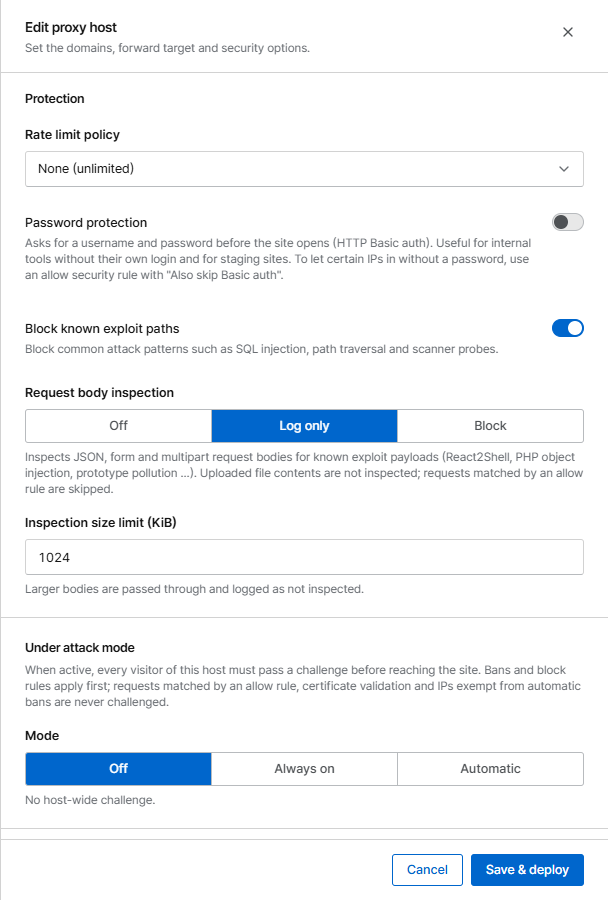

# Challenge & under attack mode

A **challenge** asks the browser to prove it is a real browser before it reaches your site. It needs
no third-party service (no CAPTCHA provider) and stores nothing on the server.

## Challenge types

| Type | What the browser does | Stops |
|---|---|---|
| **JavaScript (proof of work)** | Solves a small computation, usually within a second or a few | Bots that don't run JavaScript; makes mass requests expensive |
| **Cookie check** | Accepts a cookie and sends a form back | Simple scripts and HTTP clients |

Visitors who pass get a signed cookie bound to their IP (optionally also their browser) and are not
challenged again until it expires (**Pass valid for**, default 24 hours for rules).

!!! warning "Non-browser clients can't pass"
    API clients, mobile apps, feed readers, monitoring and search engine crawlers can't solve a
    challenge. Put an **Allow** rule for them above the challenge, or limit the challenge to the
    paths people use in a browser.

## Challenge with a rule

Create a [security rule](rules.md) with the action **Challenge**, e.g. for `/login` or for a country
that sends a lot of abuse. Block rules still apply to visitors who passed.

## Under attack mode

Under attack mode challenges **every visitor of a host**. Set it in the proxy host form under
**Protection → Under attack mode**.

{ .shot .panel }

| Mode | Behaviour |
|---|---|
| **Off** | No host-wide challenge (default) |
| **Always on** | Every request without a pass gets the challenge. Turn it on while you are under attack |
| **Automatic** | Turns on by itself when requests per second or the share of blocked requests goes above a threshold, and off again once traffic has stayed below for the activation period |

Automatic mode settings:

| Setting | Default |
|---|---|
| Requests per second | 200 |
| Blocked share | 50 % (0 = not used) |
| Window | 30 seconds |
| Stay on for | 15 minutes, extended while still above a threshold |

When it turns on or off you get an [alert](../operations/alerts.md), and the dashboard shows a
banner. **Deactivate now** ends an automatic activation early.

Never challenged: requests an allow rule matched, certificate validation, and IPs in the
automatic-ban exemptions.
