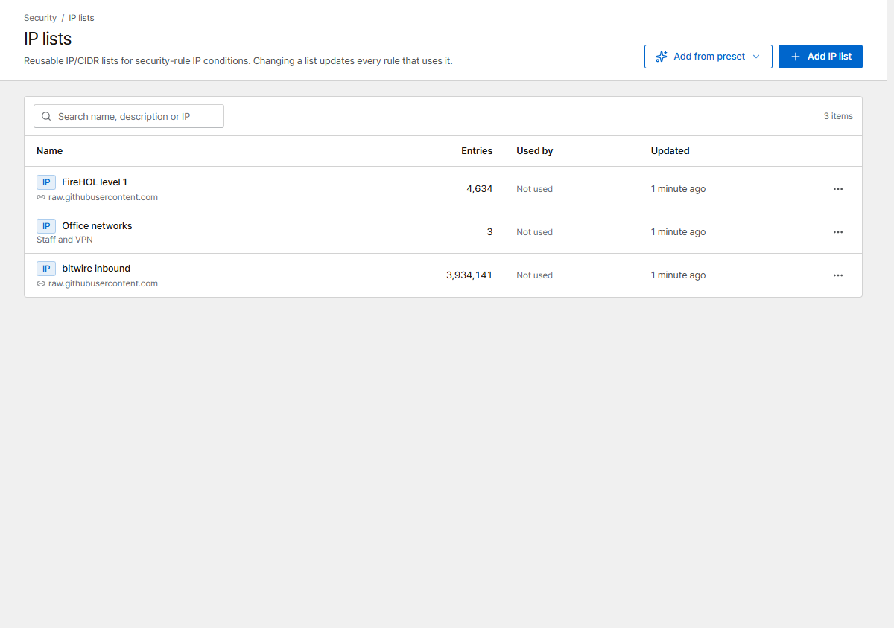

# IP lists

Lists group IP ranges or User-Agent strings so several [security rules](rules.md) can use them.
Change the list once and every rule that uses it follows.

{ .shot }

## IP lists

One IP address or CIDR per line (IPv4 and IPv6, up to 50,000 entries when you type them; lists
[from a URL](#lists-from-a-url) can hold millions). Typical lists: office and VPN ranges,
monitoring servers, known bad networks.

To see whether an address is in a saved list, open the list and use **Check an IP address**.

Use them in a rule with the condition **IP in list**.

## User-Agent lists

Choose **Kind → User-Agent**. One entry per line; a request matches when its User-Agent **contains**
an entry, ignoring case. No wildcards or regular expressions, so a list can't slow the gateway down.

Use them in a rule with the condition **User-Agent list**.

## Lists from a URL

Instead of typing entries, choose **Entries → From a URL** and Corvus keeps the list up to date in
the background (every hour by default). **Add from preset** fills in well-known feeds:

| Preset | Kind |
|---|---|
| Tor exit nodes | IP |
| Bad-bot User-Agents | User-Agent |

- Only `https://` URLs; internal and private addresses are refused.
- One entry per line; lines starting with `#` or `;` are comments. IP lists: at most 64 MB and
  5 million entries (further entries are ignored and counted in the warning). User-Agent lists: at
  most 5 MB and 10,000 entries.
- Ranges broader than `/8` (IPv4) or `/16` (IPv6), such as `0.0.0.0/0`, are ignored and counted
  in the list's warning, so a feed cannot cover everyone with one line.
- If a fetch fails, the previous entries stay in effect and the list shows the error.
- The gateway configuration is redeployed only when the entries actually change.

!!! tip
    Feed lists can be broad. Use them with a **Log** rule first and check *Rule events* before you
    block.

## Large blocklists

IP lists from a URL may hold millions of entries, such as community blocklists of about 4 million
addresses. Corvus keeps them small:

- While the list downloads, every entry becomes an address range; overlapping and adjacent entries
  are merged. The ranges are stored in a compact file in `./data/lists/` (8 bytes per IPv4 range,
  32 per IPv6 range), named after its SHA-256 checksum, not in the settings database.
- The gateway maps that file into memory once, read-only, and every worker process shares it;
  a lookup is a binary search over the ranges. Each worker no longer builds its own copy.
- The list page shows the number of entries and ranges, the first 100 ranges and **Check an IP
  address**; it never loads the whole list.
- Files that no list and no kept configuration version uses any more are deleted automatically.

Measured with a blocklist of 3.9 million entries (56 MB download):

| | |
|---|---|
| Stored file | 3.55 million ranges, 28.5 MB |
| Download and conversion (control plane) | about 1 s, about 35 MB of memory at the peak, given back afterwards |
| Gateway memory | the file once (shared page cache), for all workers; with a list of 1.2 million entries the whole container grew by 17 MiB |
| Check of the file when a configuration loads | about 80 ms |
| Lookups | about 1.9 million per second and CPU core (4 million ranges) |

Before, the same list would have taken over 200 MB of memory **per worker** and several seconds
to load at every reload.

If the gateway finds a list file missing or damaged while it loads a configuration, it **rejects
the configuration**: the deployment fails with the reason and the running configuration stays in
place. Corvus checks every file before it uses it, so this only happens if files are changed by
hand.

!!! note "Backups"
    Backups don't include the downloaded entries of lists from a URL (they are downloaded again).
    After a restore those lists are empty until Corvus downloads them again, which happens
    automatically within about a minute; the list page shows a warning meanwhile. Lists whose
    entries you typed are part of the backup.
