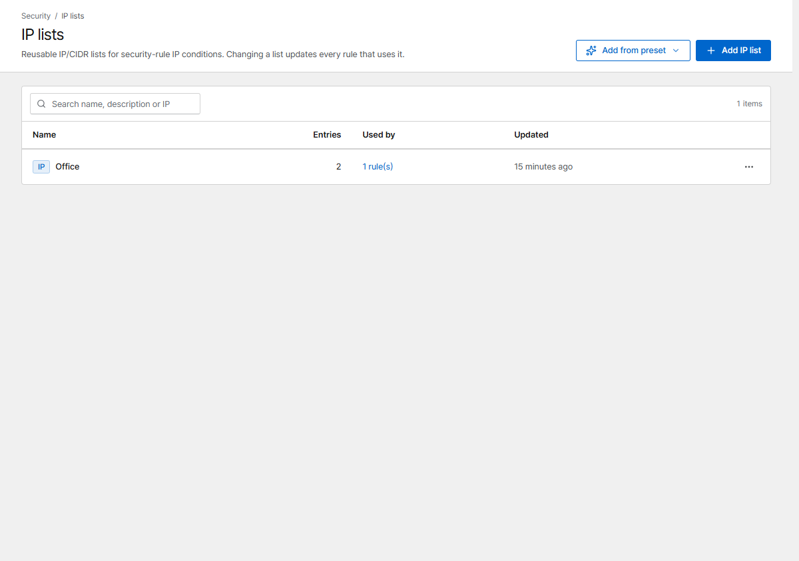

# IP lists

Lists group IP ranges or User-Agent strings so several [security rules](rules.md) can use them.
Change the list once and every rule that uses it follows.

{ .shot }

## IP lists

One IP address or CIDR per line (IPv4 and IPv6, up to 50,000 entries). Typical lists: office and
VPN ranges, monitoring servers, known bad networks.

Use them in a rule with the condition **IP in list**.

## User-Agent lists

Choose **Kind → User-Agent**. One entry per line; a request matches when its User-Agent **contains**
an entry, ignoring case. No wildcards or regular expressions, so a list can't slow the gateway down.

Use them in a rule with the condition **User-Agent list**.

## Lists from a URL

Instead of typing entries, choose **Entries → From a URL** and Corvus keeps the list up to date in
the background (every hour by default). **Add from preset** fills in well-known feeds:

| Preset | Kind |
|---|---|
| Tor exit nodes | IP |
| Bad-bot User-Agents | User-Agent |

- Only `https://` URLs; internal and private addresses are refused.
- One entry per line; lines starting with `#` or `;` are comments. At most 5 MB.
- If a fetch fails, the previous entries stay in effect and the list shows the error.
- The gateway configuration is redeployed only when the entries actually change.

!!! tip
    Feed lists can be broad. Use them with a **Log** rule first and check *Rule events* before you
    block.
