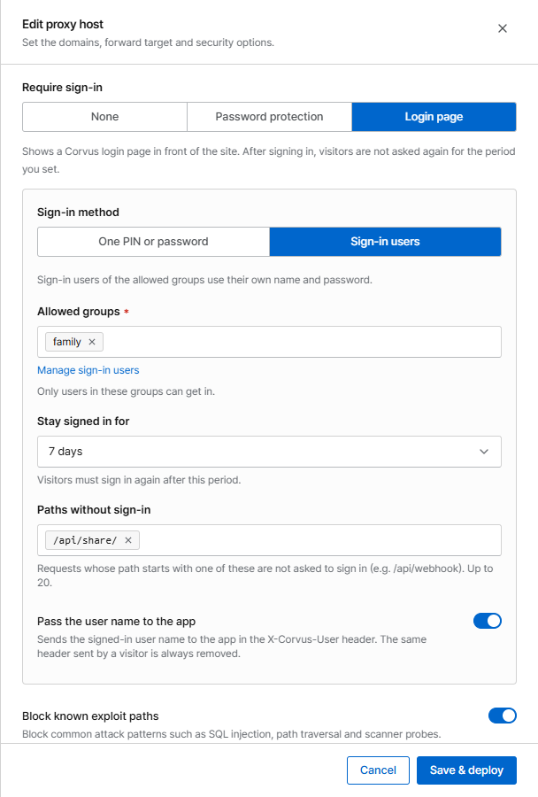
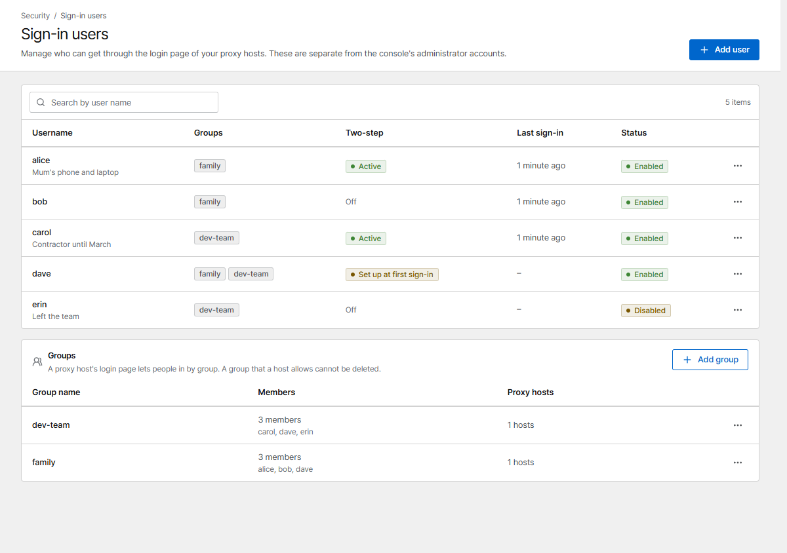
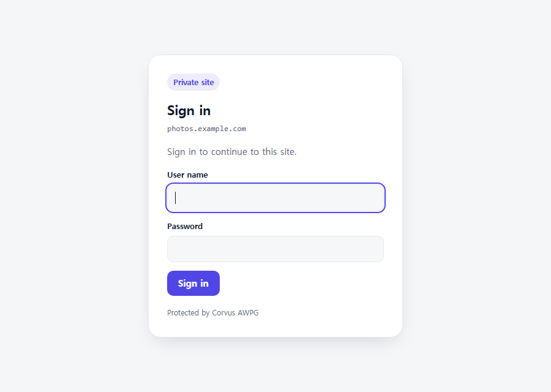

# Login page

A proxy host can show a Corvus login page before the site opens. Use it for apps that have no
login of their own or should not face the internet openly: a photo album for the family, an internal
tool, a staging site, a dashboard.

{ .shot .panel }

## Choose how to protect a host

In the proxy host form, section **Protection**, **Require sign-in** has three choices:

| Choice | What visitors get | Good for |
|---|---|---|
| **None** | The site opens for anyone | Public sites |
| **Password protection** | The browser's own user name and password box (HTTP Basic auth) | Scripts and tools that send Basic auth; quick protection |
| **Login page** | A Corvus login page; after signing in they are not asked again for the period you set | People using a browser, also on phones |

A host has either password protection or a login page, not both.

The login page has two **Sign-in method**s:

| Method | Use when |
|---|---|
| **One PIN or password** | A few people share one secret, for example the family. No accounts to manage, but you can't tell who signed in or lock out one person: changing the PIN signs everyone out |
| **Sign-in users** | Each person has their own name and password, optionally with two-step verification. You can see who signed in, sign out or disable one person, and allow different groups on different hosts |

## Set up a login page with a PIN

1. Edit the proxy host and go to **Protection**.
2. Set **Require sign-in** to **Login page** and **Sign-in method** to **One PIN or password**.
3. Enter the **PIN or password** (at least 4 characters). It can't be shown again after saving; the
   form shows **Set** with a **Change** button. Leave it blank when editing to keep the current PIN.
4. Choose **Stay signed in for** (1 hour to 30 days, default 7 days) and click **Save & deploy**.

Changing the PIN signs out everyone who signed in with the old one.

## Set up sign-in users

Sign-in users are separate from the console's [users](../operations/users.md): they can open the
sites you allow, nothing else, and they can't sign in to the console. Operators and administrators
manage them; viewers see the lists read-only.

{ .shot }

1. Open **Sign-in users** (under *Security* in the menu).
2. Under **Groups**, click **Add group**, for example `family` or `dev-team`.
3. Under **Users**, click **Add user**: a user name (lower-case letters, digits and `. _ @ -`; not
   case-sensitive), a password (at least 8 characters; **Generate** makes one) and the groups. Turn
   on **Require two-step verification** if wanted.
4. Edit the proxy host. In **Protection**, set **Require sign-in** to **Login page**, **Sign-in
   method** to **Sign-in users** and pick the **Allowed groups**.
5. **Save & deploy**. Give each person their user name and password.

Only users in an allowed group get in; a group is allowed per host, so one user can reach some sites
and not others. A group that a host allows can't be deleted. The hosts list shows
**Login · users** or **Login · PIN** for hosts with a login page.

## Two-step verification

With **Require two-step verification**, the user sets up an authenticator app (Google
Authenticator, 1Password, Aegis …) themselves at their first sign-in: after the password the login
page shows a QR code and the key to type in by hand, and asks for a 6-digit code to confirm. From then
on they enter a code after the password. Administrators never see the QR code or the key.

The **Two-step** column shows **Active** or **Set up at first sign-in**. If a user loses their
phone, **Reset two-step verification** removes the old authenticator and signs them out; they set up
a new one at the next sign-in. There are no recovery codes.

## Paths without sign-in

**Paths without sign-in** lists path prefixes that are let through without a session, up to 20.
Use it for parts of the app that browsers don't open:

- webhooks (`/api/webhook`, `/hooks/`),
- an API used by a mobile app or a sync client with its own login,
- a public share link path, a health check.

A prefix matches the start of the path as text: `/api/` matches `/api/v1/items`, while `/api` also
matches `/apikeys`, so end a folder with `/`. Paths that hide `/`, `\` or `.` behind percent-encoding
(`%2F`, `%5C`, `%2E`) are not let through. `/` itself and `/__corvus` are not allowed. Bans,
security rules and the other protection still apply to these paths. An
[allow rule](rules.md#then-action) with **Also skip Basic auth** skips the login page too, for
example for your home network.

## Pass the user name to the app

With sign-in users, **Pass the user name to the app** sends the signed-in user name to your app in
the `X-Corvus-User` header. Apps that trust a header from a reverse proxy can use it to sign the user
in (look for "header authentication" or "trusted header" in the app's settings). An
`X-Corvus-User` header sent by a visitor is always removed, also on hosts without a login page, so the
app can rely on it as long as it is reachable only through Corvus.

The session cookie (`__corvus_login`) is not passed to the app.

## Sessions

- A sign-in lasts for **Stay signed in for**; then the visitor signs in again.
- A session belongs to one host. Signing in on `photos.example.com` doesn't sign you in on
  `wiki.example.com`.
- It isn't bound to the visitor's IP address, so a phone that moves between Wi-Fi and mobile data
  stays signed in.
- To sign out, open `/__corvus/login` on the site and click **Sign out**.

A user's sessions end at once when you:

- disable or delete the user, or set a new password,
- click **Sign out everywhere**, or **Reset two-step verification**,
- remove the user from the host's allowed groups (or remove the group from the host),
- change the host's PIN (PIN mode).

## What visitors and apps get

Without a valid session, a browser opening a page (`GET` or `HEAD` that accepts HTML) is redirected
to `/__corvus/login` and back to the page after signing in. Every other request, for example an API
call from JavaScript, gets `401` with `{"error":"login_required"}`. Single-page apps that call their
API in the background therefore need a reload to show the login page when the session runs out.

The login page is shown in the visitor's browser language (the 8 console languages), in light and
dark, and works without JavaScript.

{ .shot }

## Failed sign-ins

- Sign-ins are limited per visitor address and per user name: after 10 failures, the page asks the
  visitor to wait. Wrong user names, wrong passwords, users in other groups and disabled users all
  get the same message.
- Failed sign-ins count as detections for [automatic bans](bans.md#automatic-bans) and the
  **Repeated attack source** [alert](../operations/alerts.md), like attack patterns do.
- In [Traffic → Events](../operations/traffic.md#events) they show as **Sign-in failed**, next to
  **Signed in**, **Sent to the login page** and **Sign-in attempts limited**.

## Limits

- **Use HTTPS.** Without a certificate the PIN or password travels unencrypted; the form warns about
  it. Attach a certificate and turn on **Force HTTPS**.
- **Not single sign-on.** Sign-in users live in Corvus. There is no OpenID Connect, LDAP or
  forward-auth to an identity provider, and each host is signed in to separately. If you need SSO
  across apps, use Authelia, Authentik or Pangolin.
- Users can't change or reset their own password; an operator sets a new one in the console.
- Signing in needs the control plane (`corvus-control`). If it is down, visitors who are signed in
  keep working, but nobody new can sign in until it is back.
- For APIs and other non-browser clients use **Paths without sign-in** (and the app's own
  authentication), or **Password protection** instead.

Through the [HTTP API](../reference/api.md), the host field is `login`, and sign-in users and groups
are under `/api/signin-users` and `/api/signin-groups`.
