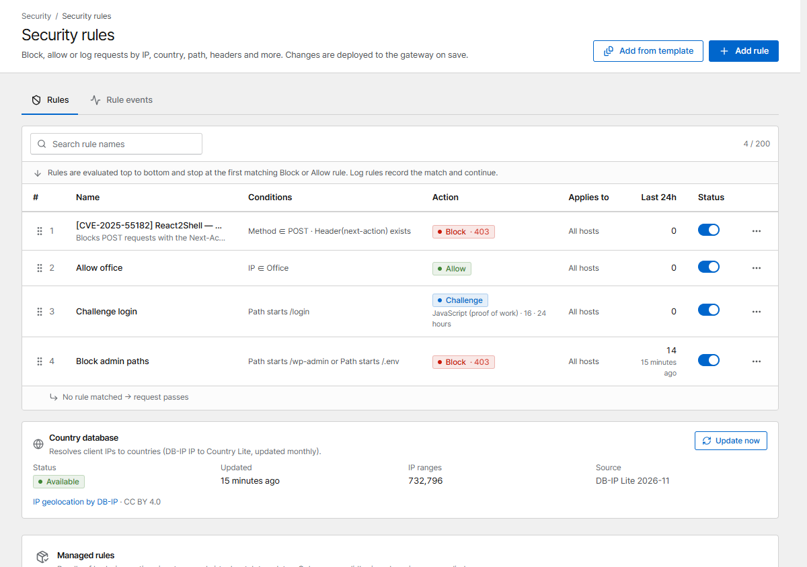
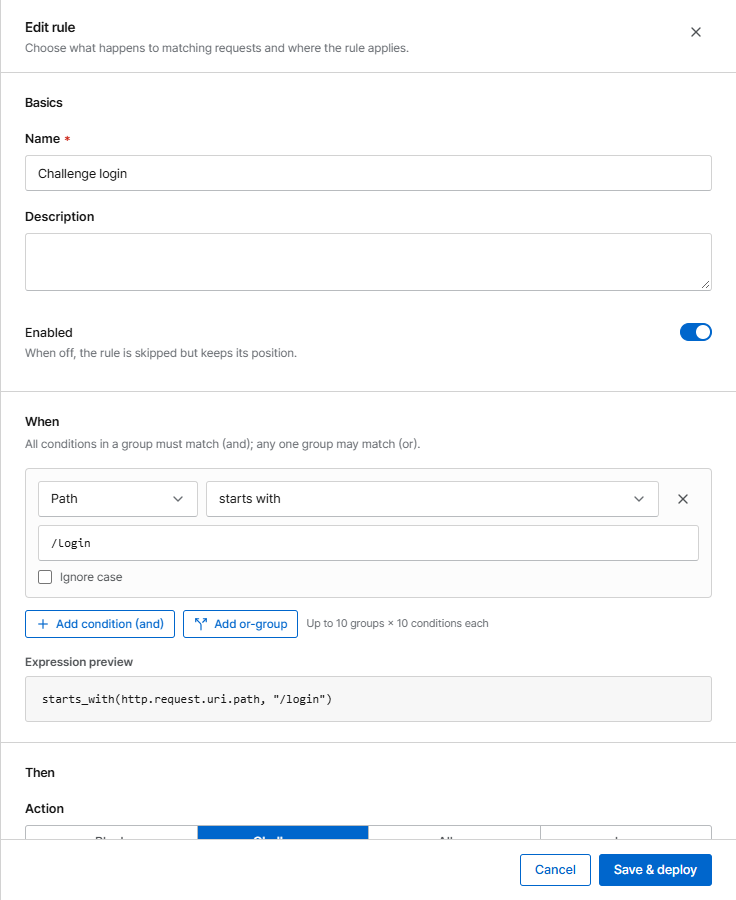

# Security rules

Security rules decide what happens to requests that match conditions you choose: block them, allow
them, only log them, or ask the browser to pass a challenge.

{ .shot }

Rules are checked **top to bottom**. Evaluation stops at the first matching **Block** or **Allow**
rule; a **Log** rule records the match and continues; a **Challenge** rule shows the challenge to
visitors who haven't passed one yet. Drag a rule (or use the arrows)
to change the order. If no rule matches, the request passes.

## Create a rule

Click **Add rule**.

{ .shot .panel }

### When: conditions

All conditions in a group must match (**and**); any one group may match (**or**).

| Field | Example |
|---|---|
| IP | `203.0.113.0/24`, or an [IP list](ip-lists.md) |
| Country | `CN`, `RU` (uses the built-in country database) |
| Host, path, query | path *starts with* `/admin` |
| Method | `POST` |
| Header, Referer, User-Agent | User-Agent *contains* `curl` |
| User-Agent list | a [User-Agent list](ip-lists.md#user-agent-lists) such as bad bots |
| Request body | body *contains* a string (needs body inspection on the host) |

Text conditions support *equals*, *contains*, *starts with*, *ends with* and regular expressions,
optionally ignoring case.

### Then: action

| Action | Effect |
|---|---|
| **Block** | Refuse with a status code (`403` default, or `401`, `404`, `410`, `429`, `444` = close the connection) and the [block page](../operations/pages.md) |
| **Allow** | Let the request through and skip later rules, exploit blocking and rate limits. **Also skip Basic auth** lets it bypass password protection too |
| **Log** | Only record the match. Use it to try a new rule before you block; matches never lead to [automatic bans](bans.md) |
| **Challenge** | Show a browser challenge first. See [Challenge & under attack](challenge.md) |

### Applies to

**All hosts**, or **Selected hosts**.

## Common recipes

??? example "Admin area only from the office"
    1. Create an [IP list](ip-lists.md) *Office* with your office ranges.
    2. Rule *Allow office*: IP **in** list *Office* → **Allow**.
    3. Below it, rule *Block admin*: path **starts with** `/admin` → **Block**.

??? example "Block a country"
    Country **in** `XX` → **Block** (status `403`). Start with **Log** for a day and look at
    *Rule events* to see who would be blocked.

??? example "Slow down bots on the login page"
    Path **starts with** `/login` → **Challenge** (JavaScript). Real browsers pass in a second; simple
    bots don't.

??? example "Let monitoring through"
    IP **in** `198.51.100.10` → **Allow**, at the top, so health checks are never challenged or
    rate-limited.

## Check what a rule does

**Rule events** (tab on the same page) lists every request a rule matched, newest first, with IP,
country, host and path. Start new rules as **Log**, check the events, then switch to **Block**.
