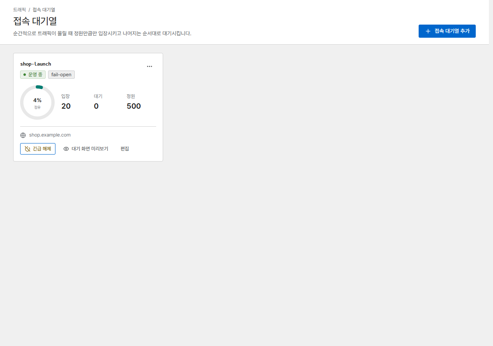
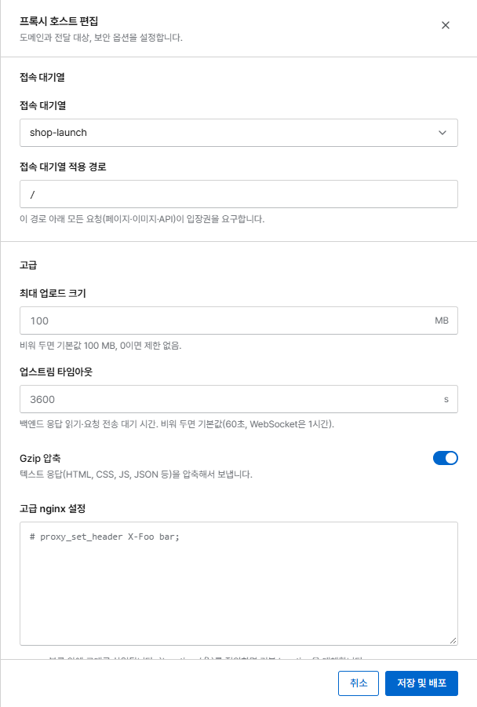
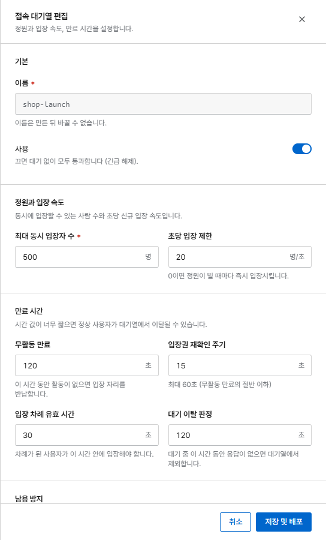

# 접속 대기열

접속 대기열(대기실)은 출시, 티켓 판매, 갑작스러운 트래픽 급증 때도 사이트가 버티게 해 줍니다.
Corvus는 서비스가 감당할 수 있는 만큼만 방문자를 들여보내고, 나머지는 **순서대로** 기다리게
합니다. 기다리는 방문자에게는 자기 순번이 표시된 페이지가 8개 언어로 보이며, 페이지는 저절로
새로 고쳐집니다.

{ .shot }

## 설정하기

1. **접속 대기열**을 열고 **접속 대기열 추가**를 누릅니다.
2. 정원(아래 참고)을 정하고 저장합니다.
3. 프록시 호스트를 열고 **접속 대기열**에서 대기열을 고릅니다. **접속 대기열 적용 경로**를 `/`로
   하면 사이트 전체를, `/event`로 하면 그 부분만 보호합니다.

{ .shot .panel }

## 설정 항목

{ .shot .panel }

| 설정 | 의미 |
|---|---|
| **최대 동시 입장자 수** | 동시에 안에 들어와 있을 수 있는 방문자 수 |
| **초당 입장 제한** | 1초에 새로 들여보내는 방문자 수(0이면 자리가 나는 즉시) |
| **무활동 만료** | 이 시간 동안 요청이 없으면 방문자의 자리를 반납합니다 |
| **입장 차례 유효 시간** | 차례가 온 방문자는 이 시간 안에 들어와야 합니다. 놓치더라도(예: 백그라운드 탭) 대기 이탈 판정 시간 안에 다시 확인하면 줄 맨 앞으로 돌아갑니다 |
| **대기 이탈 판정** | 응답을 멈춘 대기 방문자를 대기열에서 뺍니다 |
| **캐시 DB 장애 시** | **모두 통과**(fail-open, 가용성 우선) 또는 **접속 차단**(fail-closed, 정원 보호) |
| **최대 대기 인원** | 이를 넘으면 새 방문자에게 나중에 다시 오라고 안내합니다(0이면 무제한) |
| **IP당 대기열 진입** | IP 하나가 1분에 새로 만들 수 있는 대기열 진입 수 |
| **입장권을 접속 네트워크에 묶기** | 같은 네트워크에서만 입장권이 통하므로 다른 사람과 공유할 수 없습니다. 네트워크를 바꾼 방문자는 다시 줄을 섭니다 |

!!! tip "정원 정하기"
    부하 테스트에서 서비스가 무리 없이 처리한 동시 사용자 수로 시작하고, 이벤트 중에는 대시보드의
    **입장**과 **대기 인원**을 지켜보세요.

## 이벤트 중에는

- 대시보드와 **접속 대기열** 페이지에서 입장·대기 인원을 실시간으로 볼 수 있습니다. **입장** 수는
  확보된 자리 수입니다. 차례가 와서 들어오는 중인 방문자와, 페이지를 닫지 않고 떠난 방문자(비활성
  만료 시간이 지날 때까지)도 포함됩니다.
- **긴급 해제**는 모든 방문자를 바로 통과시킵니다. 예를 들어 급증이 끝났을 때 씁니다. 대기
  페이지에 남아 있던 방문자도 자동으로 들어갑니다. **다시 켜기**를 누르면 대기열이 다시 동작합니다.
- 캐시 DB가 다시 시작되면(예: Corvus 업그레이드) 이미 입장한 방문자는 그대로 입장 상태를 유지하고,
  대기열은 먼저 확인 요청을 보낸 방문자부터 다시 쌓입니다.
- 대기 인원이 늘어나면 [알림](operations/alerts.md)으로 알려 줄 수 있습니다.

## API와 앱

보호 경로 아래의 페이지, 이미지, API 호출은 모두 입장권이 필요합니다. 브라우저는 대기 페이지에서
기다리는 동안 입장권(쿠키)을 자동으로 받습니다. `fetch`/XHR 호출이나 앱처럼 대기 페이지를 보여 줄
수 없는 요청은 기다리는 동안 `Retry-After` 헤더와 작은 JSON 본문이 담긴
**`429 Too Many Requests`**를 받습니다. 이 응답은 서버 오류로 집계되지 않습니다.

!!! warning "다른 사이트의 클라이언트"
    HTTPS에서는 대기열 쿠키가 `SameSite=None`이라, 다른 사이트를 거쳐 돌아오는 방문자(예: 결제
    대행사의 3-D Secure 인증)도 순서를 유지합니다. 일반 HTTP에서는 `SameSite=Lax`라 이런 경우 다시
    대기합니다. **다른 사이트**의 웹 앱(예: `app.example.org`이 `api.example.com`을 호출)은
    자격 증명을 함께 보내야 합니다(`credentials: "include"`). 그렇지 않다면 사람이 브라우저로 여는
    경로만 보호하거나, API는 대기열이 없는 호스트에 두세요.
