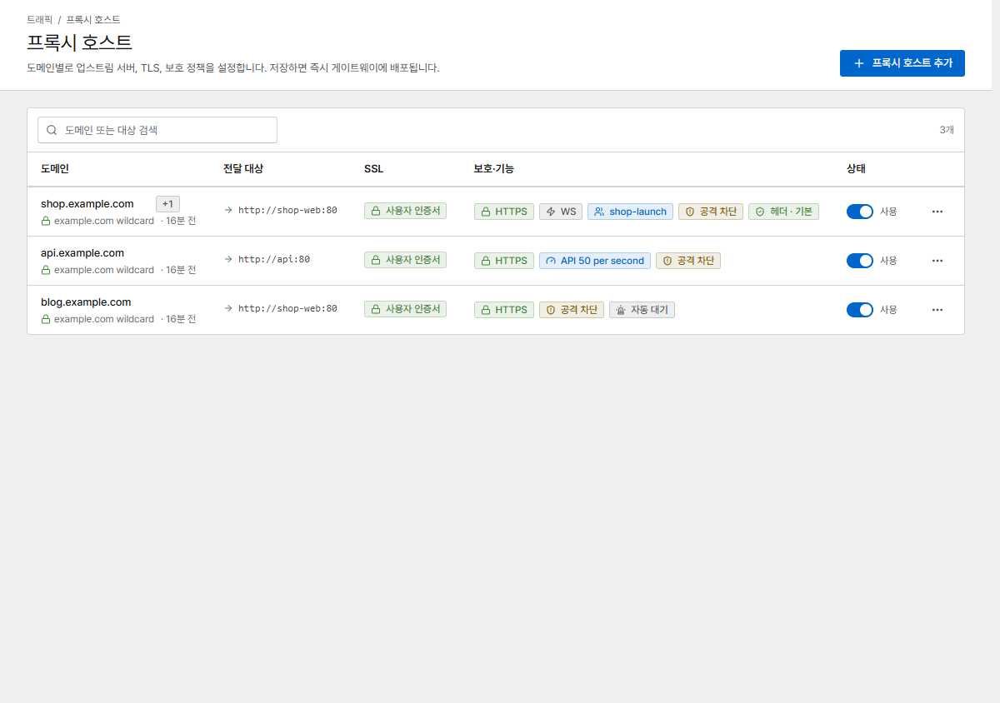
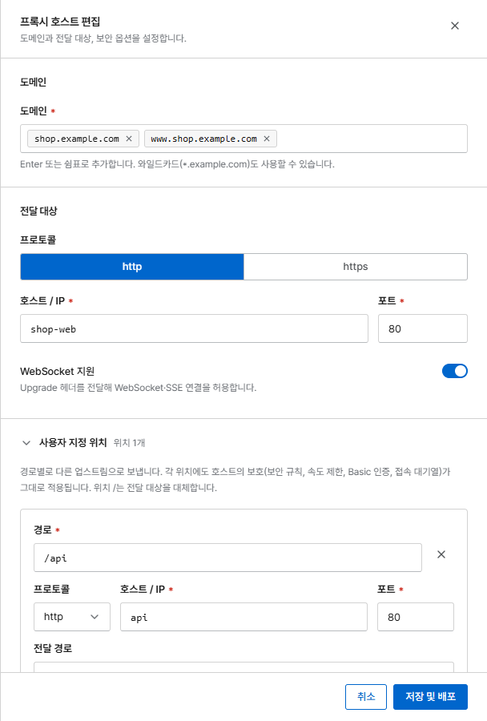
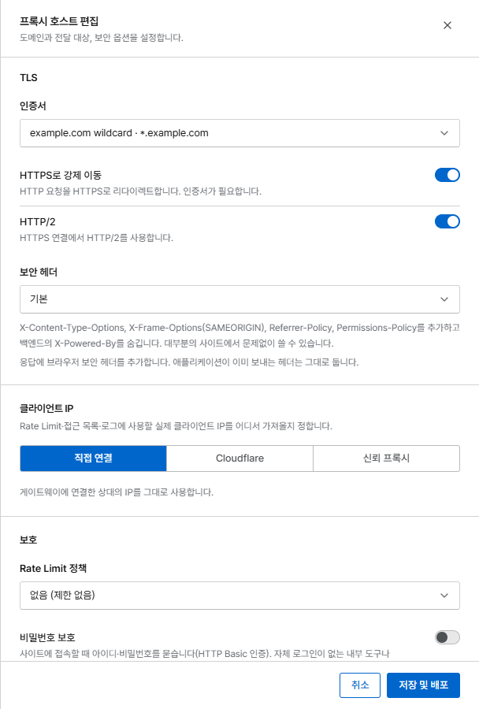

# 첫 프록시 호스트

**프록시 호스트**는 어떤 도메인(예: `shop.example.com`)으로 들어온 요청을 Corvus 뒤에 있는
서비스(예: 80 포트의 `shop-web` 컨테이너)로 보냅니다.

## 시작하기 전에

- 도메인의 DNS(`A`/`AAAA` 레코드)가 Corvus 서버를 가리켜야 합니다.
- Corvus가 서비스에 접속할 수 있어야 합니다. 다른 컨테이너라면 두 컨테이너가 같은 Docker
  네트워크에 있어야 합니다([전달 대상](../proxy/proxy-hosts.md#forward-targets) 참고).

## 1. 호스트 추가

**프록시 호스트**를 열고 **프록시 호스트 추가**를 누릅니다.

{ .shot }

다음 항목을 입력합니다.

1. **도메인**: 도메인을 입력하고 ++enter++를 누릅니다. 필요한 만큼 추가할 수 있습니다.
2. **전달 대상**: 서비스의 프로토콜(대부분 `http`), **호스트 / IP**, **포트**.
3. 앱이 WebSocket이나 SSE(server-sent events)를 쓴다면 **WebSocket 지원**을 켭니다.

{ .shot .panel }

## 2. HTTPS 켜기

**TLS** 섹션에서 **인증서 → 새 인증서 요청 (Let's Encrypt)**을 고르고, 이메일을 입력한 뒤
약관에 동의합니다. **HTTPS로 강제 이동**을 켜면 방문자가 항상 HTTPS로 이동합니다.

{ .shot .panel }

호스트는 곧바로 HTTP로 서비스를 시작하고, 인증서가 발급되면(보통 1분 이내) HTTPS가 자동으로
켜집니다. 와일드카드 도메인은 [DNS 챌린지](../proxy/certificates.md#dns-01)가 필요합니다.

## 3. 저장 및 배포

**저장 및 배포**를 누릅니다. Corvus는 새 설정 버전을 만들고 검사한 뒤, 연결을 끊지 않고
적용합니다. 문제가 있으면 오류를 보여 주고 이전 설정이 그대로 동작합니다.

브라우저에서 도메인을 열어 보세요. 이것으로 끝입니다. 호스트는 이미 알려진 공격 패턴으로부터
보호되고 있으며(**알려진 공격 경로 차단**이 기본으로 켜져 있음),
[트래픽 관제](../operations/traffic.md)에 표시됩니다.

## 다음 단계

- `/api`를 다른 서비스로 보내기: [사용자 지정 위치](../proxy/locations.md)
- 관리자 영역을 사무실에서만 열기: [보안 규칙](../security/rules.md)
- 출시 준비하기: [접속 대기열](../access-queue.md)
- 문제가 생기면 알림 받기: [알림](../operations/alerts.md)
