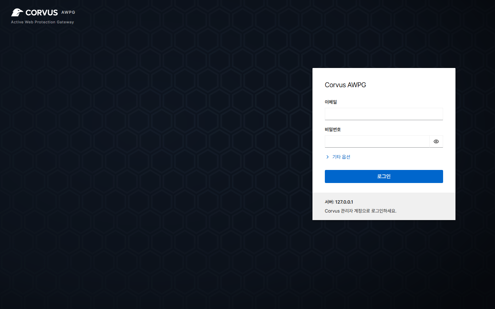

# 설치

Corvus는 **컨테이너 하나**로 동작합니다. 게이트웨이, 관리 콘솔, 접속 대기열 저장소가 모두
그 안에 들어 있습니다.

## 요구 사항

- [Docker와 Compose 플러그인](https://docs.docker.com/engine/install/)이 설치된 Linux 서버(amd64 또는 arm64)
- 게이트웨이용 **80**, **443** 포트와 관리 콘솔용 **9443** 포트가 비어 있어야 합니다
- Let's Encrypt 인증서를 쓰려면 도메인의 DNS가 서버를 가리켜야 합니다

## 1. `docker-compose.yml` 만들기

```yaml
services:
  corvus:
    image: 'ghcr.io/corvus-gateway/gateway:latest'
    restart: unless-stopped
    ports:
      - '80:80'
      - '443:443'
      - '9443:9443'
    volumes:
      - ./data:/data
```

| 포트 | 용도 |
|---|---|
| 80 / 443 | 게이트웨이: 프록시하는 트래픽 |
| 9443 | 관리 콘솔과 API. 신뢰하는 네트워크에서만 접속하도록 제한하세요(방화벽 또는 *네트워크 → 관리 콘솔 접근 허용 네트워크*) |

모든 설정, 인증서, 기록은 `./data`에 저장됩니다.

## 2. 시작

```bash
docker compose up -d
```

## 3. 설정 토큰 확인

처음 시작할 때 서버 소유자임을 확인하는 일회용 토큰이 출력됩니다.

```bash
docker compose logs corvus | grep setup_token
```

토큰을 직접 정하고 싶다면 `CORVUS_SETUP_TOKEN`을 설정하세요(12자 이상,
[설정](../reference/configuration.md) 참고).

## 4. 관리자 계정 만들기

브라우저에서 `https://<서버 주소>:9443`을 엽니다. 처음에는 관리 콘솔이 자체 서명 인증서를 쓰므로
브라우저에 경고가 표시됩니다. 페이지로 계속 진행한 뒤 **설정 토큰**, 이메일, 비밀번호(10자 이상)를
입력합니다.

{ .shot }

!!! tip "다음 단계"
    [첫 프록시 호스트를 추가하세요](first-host.md). 1분 정도면 됩니다.

## 호스트 네트워크로 실행하기(선택) { #run-it-with-host-networking-optional }

프록시할 서비스가 서버의 `127.0.0.1`에서만 수신하거나, 기존 NPM이 `network_mode: host`를
썼다면 `ports:` 대신 호스트 네트워크를 사용합니다.

```yaml
services:
  corvus:
    image: 'ghcr.io/corvus-gateway/gateway:latest'
    restart: unless-stopped
    network_mode: host
    volumes:
      - ./data:/data
```

호스트에서 6379 포트를 이미 쓰고 있다면 `CORVUS_REDIS_PORT`도 설정하세요
([환경 변수](../reference/configuration.md) 참고).

## 관련 문서

- [NAS에 설치](nas.md): TrueNAS SCALE 앱, 포트, 다른 NAS에서 주의할 점
- [환경 변수](../reference/configuration.md): 환경 변수 설정
- [강화 설치](../reference/hardened.md): 읽기 전용 루트 파일 시스템, capability 없음
- [업그레이드](upgrade.md)
