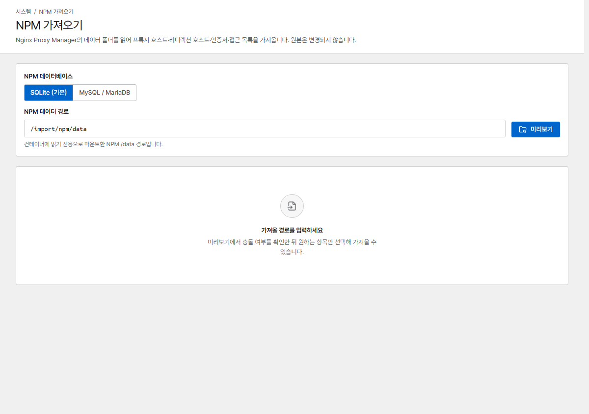

# NPM에서 이전

**NPM 가져오기**는 NPM 설정을 Corvus로 복사합니다.

- 프록시 호스트(사용자 지정 위치 포함), 리디렉션 호스트, 스트림
- 인증서: Let's Encrypt 인증서와 직접 올린 인증서, Cloudflare DNS 토큰 포함
- 접근 목록: 사용자와 IP 규칙

NPM의 파일과 데이터베이스를 **읽기만** 합니다. NPM은 변경되지 않으므로 언제든 되돌아갈 수 있습니다.

가져오지 않는 항목: 404 호스트, NPM 전용 변수를 쓰는 고급 설정. 미리보기에서 건너뛸 항목을
모두 보여 줍니다.
접근 목록으로 보호된 호스트는 그 접근 목록과 함께 가져올 때만 가져오므로, 보호 없이 공개되는 일은
없습니다. 인증서를 가져오지 않은 호스트는 HTTPS 없이 가져오고 결과 목록에 표시합니다.

{ .shot }

## 1. NPM이 쓰는 데이터베이스 확인

NPM의 `docker-compose.yml`을 엽니다.

| 이렇게 보이면 | NPM이 쓰는 DB |
|---|---|
| `DB_MYSQL_*` / `DB_POSTGRES_*` 변수가 없고 `data/database.sqlite`가 있음 | **SQLite** (NPM 기본값) |
| `DB_MYSQL_HOST`, `DB_MYSQL_USER`, … 그리고 대개 별도의 `db` 서비스 | **MySQL / MariaDB** |
| `DB_POSTGRES_*` | PostgreSQL: 가져오기를 지원하지 않습니다. 콘솔에서 호스트를 다시 만드세요 |

## 2. NPM 폴더를 Corvus에 마운트

Corvus는 NPM의 `data`와 `letsencrypt` 폴더에서 인증서 파일을 읽습니다. 읽기 전용으로 마운트하고
`CORVUS_IMPORT_DIR`을 설정하세요.

```yaml hl_lines="10 11 14 15"
services:
  corvus:
    image: 'ghcr.io/corvus-gateway/gateway:latest'
    restart: unless-stopped
    ports:
      - '80:80'
      - '443:443'
      - '9443:9443'
    environment:
      CORVUS_IMPORT_DIR: /import
    volumes:
      - ./data:/data
      - /path/to/npm/data:/import/npm/data:ro
      - /path/to/npm/letsencrypt:/import/npm/letsencrypt:ro
```

NPM의 `./data`, `./letsencrypt` 볼륨의 호스트 경로를 사용하세요. NPM과 Corvus는 둘 다 80/443
포트가 필요하므로 동시에 실행할 수 없습니다.

## 3. 가져오기

=== "SQLite를 쓰는 NPM"

    ```bash
    cd /path/to/npm && docker compose down        # stop NPM (frees 80/443)
    cd /path/to/corvus && docker compose up -d     # start Corvus with the mounts above
    ```

    콘솔에서 **NPM 가져오기**를 열고 **SQLite**를 그대로 둔 채 **미리보기**를 누른 다음,
    가져올 항목을 골라 **선택 항목 가져오기**를 누릅니다.

    미리보기에 `permission denied`가 나오면 Corvus(uid 10001로 실행)가 파일을 읽을 수 있게
    권한을 바꿔 주세요.

    ```bash
    sudo chmod o+rx /path/to/npm/data && sudo chmod o+r /path/to/npm/data/database.sqlite
    ```

=== "MySQL / MariaDB를 쓰는 NPM"

    가져오는 동안 Corvus가 NPM 데이터베이스에 접속해야 하므로, NPM의 프록시 서비스만 멈추고
    데이터베이스는 계속 실행해 둡니다.

    ```bash
    cd /path/to/npm && docker compose stop app     # the NPM service that owns 80/443 (often "app")
    cd /path/to/corvus && docker compose up -d

    # connect Corvus to NPM's Docker network for the import
    docker network ls | grep -i npm                # e.g. npm_default
    docker network connect npm_default $(docker compose ps -q corvus)
    ```

    **NPM 가져오기**에서 **MySQL / MariaDB**를 고르고 NPM 데이터베이스 정보를 입력합니다.
    호스트는 데이터베이스 서비스 이름(대개 `db`), 포트는 `3306`, 그리고 `DB_MYSQL_NAME`,
    `DB_MYSQL_USER`, `DB_MYSQL_PASSWORD` 값을 넣습니다. 연결은 읽기 전용이며 비밀번호는 저장하지
    않습니다. 그다음 **미리보기** → **선택 항목 가져오기**를 누릅니다.

    가져오기가 끝나면 다음을 실행합니다.

    ```bash
    docker network disconnect npm_default $(docker compose ps -q corvus)
    cd /path/to/npm && docker compose down         # stop NPM's database too
    ```

가져온 항목은 바로 배포됩니다.

## 4. 가져온 뒤에

- 가져온 호스트를 확인한 다음, `CORVUS_IMPORT_DIR`과 두 개의 `/import` 마운트를 지우고
  `docker compose up -d`를 다시 실행합니다.
- 인증서는 Corvus에서 계속 갱신됩니다. 지원하지 않는 DNS 업체를 쓰던 호스트는 자동 갱신 없이
  가져오며, 미리보기에서 경고를 보여 줍니다.
- **스트림:** 브리지 네트워크에서는 스트림 포트마다 `docker-compose.yml`에서 포트를 공개해야
  합니다([스트림](../proxy/streams.md) 참고).
- **되돌아가기:** Corvus에서 `docker compose down`을 실행한 뒤 NPM에서 `docker compose up -d`를
  실행합니다.

## NPM 용어와 Corvus 용어

| NPM | Corvus |
|---|---|
| Proxy Hosts | **프록시 호스트** |
| Custom Locations | 프록시 호스트 입력 화면의 **사용자 지정 위치** |
| Redirection Hosts | **리디렉션 호스트** |
| Streams | **스트림** |
| SSL Certificates | **인증서** |
| Access Lists | 사용자와 IP 규칙을 함께 가져와 같은 호스트에 연결합니다. 새 호스트에는 프록시 호스트 입력 화면의 **비밀번호 보호**를, IP 제한에는 [보안 규칙](../security/rules.md)을 사용하세요 |
| Advanced (사용자 지정 Nginx 설정) | **고급 → 고급 nginx 설정** |
| Settings → Default Site | **차단·오류 페이지**의 [알 수 없는 호스트](../operations/pages.md#unknown-hosts): 404와 Congratulations는 **찾을 수 없음 페이지 (404)**가 되고, No Response(444)와 Redirect는 그대로 가져옵니다. Custom Page(HTML)는 가져오지 않습니다 |
