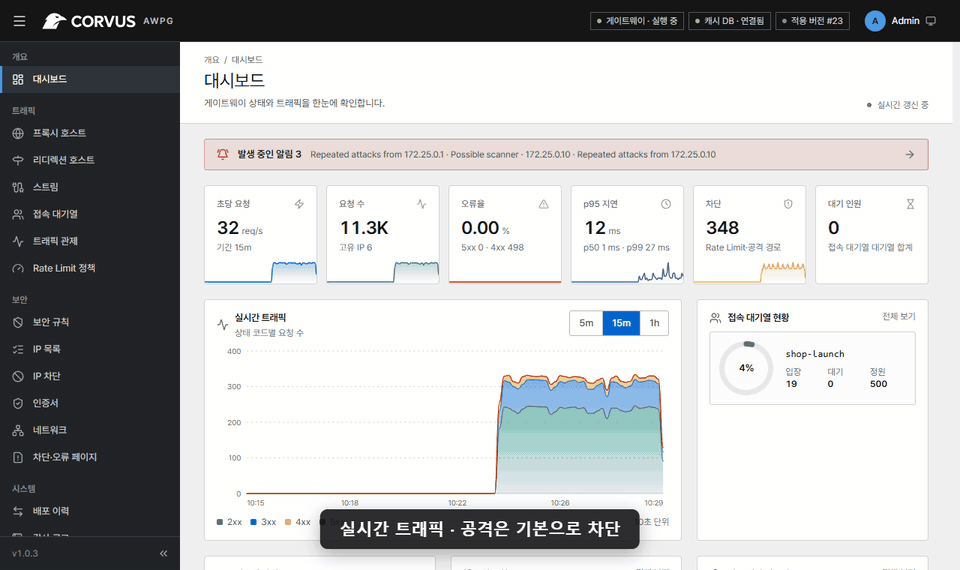

# Corvus AWPG

**Corvus는 웹 서비스 앞에 두는 자체 호스팅 게이트웨이입니다.** Nginx Proxy Manager처럼 쉽게
운영할 수 있고(도메인 연결, 전달, 무료 SSL을 몇 번의 클릭으로), 지나가는 트래픽을 **관제하고,
보호하고, 제어**합니다. 모든 것이 내 서버에서 동작하며, 트래픽이 외부 클라우드로 나가지 않습니다.

Corvus가 80·443 포트로 요청을 받아 뒤에 있는 알맞은 앱이나 웹 서버로 넘겨 주므로, 서버 한 대에서 여러
사이트를 HTTPS와 보호 기능을 갖춘 채 운영할 수 있습니다. 이미 쓰던 웹 서버 앞에 Corvus를 두는 방법까지
[동작 방식](getting-started/how-it-works.md)에서 설명합니다.

{ .shot }

- :material-rocket-launch: **[5분 만에 설치](getting-started/install.md)**

    컨테이너 하나, `docker-compose.yml` 하나, 그리고 브라우저만 있으면 됩니다.

- :material-swap-horizontal: **[NPM을 쓰고 계신가요?](getting-started/migrate-npm.md)**

    [Corvus와 무엇이 다른지](getting-started/compare-npm.md) 확인하고 프록시 호스트, 인증서, 스트림,
    접근 목록을 가져오세요. NPM 자체는 변경하지 않습니다.

- :material-shield-check: **[보호](security/index.md)**

    호스트를 추가하는 순간부터 공격 차단이 동작합니다. 규칙, 차단, 챌린지는 필요할 때 쓰면 됩니다.

- :material-account-clock: **[접속 대기열](access-queue.md)**

    출시나 한정 판매 때 감당할 수 있는 만큼만 방문자를 입장시키고, 나머지는 공정하게 대기시킵니다.

## 주요 기능

| | |
|---|---|
| **프록시와 TLS** | [메모](proxy/proxy-hosts.md#notes)를 남길 수 있는 프록시 호스트, [사용자 지정 위치](proxy/locations.md), [리디렉션](proxy/redirection-hosts.md), [TCP/UDP 스트림](proxy/streams.md), 자동 갱신되는 [Let's Encrypt 인증서](proxy/certificates.md)와 저장해 두고 다시 쓰는 DNS 인증 정보, Cloudflare·프록시·TCP 터널([PROXY protocol](proxy/proxy-hosts.md#behind-a-tcp-tunnel-or-load-balancer-proxy-protocol)) 뒤에서도 [실제 클라이언트 IP](proxy/proxy-hosts.md#client-ip) 확인, [알 수 없는 호스트](operations/pages.md#unknown-hosts) 응답 선택(404, 연결 끊기, 리디렉션) |
| **보안** | 알려진 공격 패턴 기본 차단, [보안 규칙](security/rules.md), [IP·User-Agent 목록](security/ip-lists.md), [브라우저 챌린지와 공격 대응 모드](security/challenge.md), [자동 차단](security/bans.md) |
| **접속 대기열** | 트래픽 급증에 대비한 [정원 기반 대기실](access-queue.md) |
| **관제** | [실시간 트래픽, 요청 로그, 보안 이벤트](operations/traffic.md), Slack·Discord·Teams·Telegram 등으로 보내는 [알림](operations/alerts.md) |
| **운영** | 모든 변경은 검사 후 버전으로 관리, [백업과 복원](operations/backup.md), [역할·MFA·SSO](operations/users.md), [새 버전 알림](reference/configuration.md) |

!!! tip "안전한 기본값"
    시작할 때 규칙을 하나도 쓸 필요가 없습니다. 새 호스트마다 기본 공격 탐지가 켜져 있고,
    고급 옵션은 모두 선택 사항입니다.
