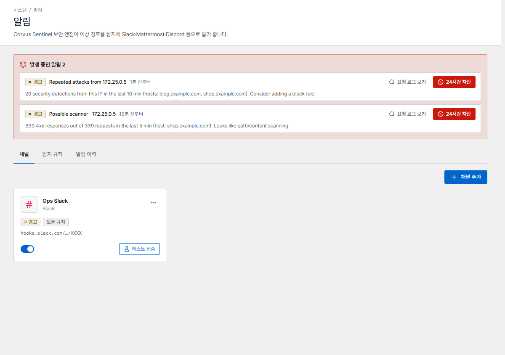

# 알림

Corvus는 문제와 공격을 감시하다가 팀 채팅으로 알려 줍니다.

{ .shot }

## 1. 채널 추가

**알림 → 채널 → 채널 추가**를 열고 종류를 고릅니다.

| 종류 | 필요한 것 |
|---|---|
| Slack | Slack 앱 → *Incoming Webhooks* 사용 → 채널 선택 → Webhook URL 복사 |
| Mattermost | *Integrations* → *Incoming Webhook* 추가 → URL 복사 |
| Discord | 채널 설정 → *연동(Integrations)* → *웹후크(Webhooks)* → *새 웹후크* → URL 복사 |
| Microsoft Teams | 채널 → *Workflows* → "Post to a channel when a webhook request is received" → URL 복사 |
| Telegram | @BotFather에서 받은 봇 토큰, 그리고 봇을 초대한 채팅의 `chat_id` |
| Webhook | JSON `POST`를 받는 아무 URL. 비밀 값을 설정하면 요청에 HMAC 서명(`X-Corvus-Signature`)이 붙습니다 |

**최소 등급**을 고르고, 원하면 일부 규칙만 받도록 고릅니다. **테스트 전송**을 눌러 연결을
확인하세요.

## 2. 탐지 규칙

**탐지 규칙**에는 Corvus가 감시하는 항목이 나열됩니다. 규칙마다 끌 수 있고 각자의 기준값이 있습니다.

| 규칙 | 알림 조건 |
|---|---|
| 5xx 오류율 | 호스트의 5xx 응답 비율이 기준을 넘을 때 |
| 응답 지연 (p95) | 호스트의 p95 응답 시간이 기준을 넘을 때 |
| 트래픽 급증 | 초당 요청 수가 1시간 평균의 몇 배로 뛸 때 |
| Rate Limit 차단 급증 | 호스트의 많은 요청이 Rate Limit에 걸릴 때 |
| 공격 패턴 탐지 | 호스트에서 공격 패턴이 많이 탐지·차단될 때 |
| 보안 이벤트 증가 | 호스트에서 보안 규칙·본문 검사 탐지가 많을 때 |
| 반복 공격 IP | IP 하나가 탐지를 계속 일으킬 때(알림에 IP가 표시되며 **24시간 차단**을 한 번에 누를 수 있습니다) |
| 스캐너 의심 | IP 하나가 짧은 시간에 4xx 응답을 많이 받을 때 |
| 접속 대기열 대기열 | 대기 중인 방문자 수가 기준에 닿을 때 |
| 캐시 DB 연결 끊김 | 접속 대기열 저장소에 접속할 수 없을 때 |
| 인증서 만료 임박 / 인증서 발급·갱신 실패 | 인증서가 곧 만료되거나 갱신에 실패했을 때 |
| 배포 실패 | 게이트웨이가 설정을 거부했을 때 |
| 관리자 로그인 실패 | 콘솔 로그인 실패가 많을 때 |
| 공격 대응 모드 자동 전환 | [공격 대응 모드](../security/challenge.md)가 자동으로 켜지거나 꺼졌을 때 |

**공통 설정**: 문제가 계속되는 동안 얼마나 자주 다시 알릴지, 해결되었을 때 메시지를 보낼지, 알림
언어, 메시지 속 링크에 쓸 **관리 콘솔 주소**를 정합니다.

## 알림 이력

**알림 이력**에는 모든 알림이 상태(*발생*, *해제*)와 전송 결과와 함께 남습니다. 현재 발생 중인
알림은 대시보드 맨 위에도 표시됩니다.
