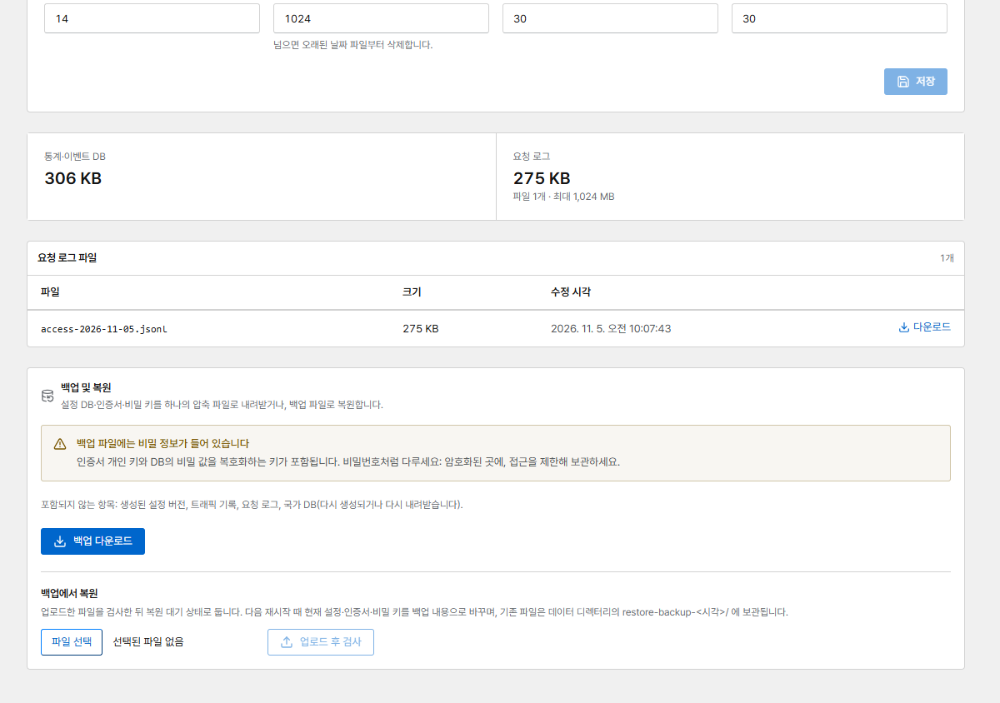

# 백업과 복원

Corvus에 필요한 모든 것은 `./data`에 있습니다. **가장 중요한 것은 `secrets/`입니다.** 데이터베이스
안의 MFA 비밀 값과 DNS 토큰을 복호화하는 키가 여기에 들어 있습니다.

## 백업 내려받기

**데이터 보관 → 백업 및 복원**을 열고 **백업 다운로드**를 누릅니다(브라우저로 로그인한 관리자만
가능하며, API 토큰으로는 백업을 내려받을 수 없습니다).

{ .shot }

`corvus-backup-<version>-<time>.tar.gz` 파일에는 다음이 들어 있습니다.

- `corvus.db`: Corvus가 계속 동작하는 동안 만든, 일관성 있는 설정 데이터베이스 사본
- `secrets/`, `certs/`, `rules/`
- `manifest.json`: 버전 정보와 모든 파일의 SHA-256 체크섬

다음은 다시 생성되거나 다시 내려받으므로 포함되지 않습니다: 생성된 설정 버전, 트래픽 기록, 요청
로그, 국가 DB.

!!! danger "백업에는 개인 키가 들어 있습니다"
    인증서 개인 키와 데이터 키가 포함됩니다. 암호화된 곳에, 접근을 제한해 보관하세요. 모든
    다운로드는 감사 로그에 기록됩니다.

PostgreSQL(`CORVUS_DB_URL`)을 쓰면 압축 파일에 데이터베이스가 들어가지 않습니다. 데이터베이스는
`pg_dump`로 백업하고, 덤프 파일을 압축 파일과 함께 보관하세요.

## 콘솔에서 복원

1. **백업에서 복원 → 백업 파일 선택 → 업로드 후 검사**(최대 200 MB). 압축 파일을 검증(체크섬,
   경로, 데이터베이스 종류)하고 요약을 보여 줍니다.
2. **다음 재시작 때 복원**을 누르면 복원 대기 상태가 됩니다. 아직은 아무것도 바뀌지 않습니다.
3. 컨테이너를 재시작합니다.

    ```bash
    docker compose restart
    ```

시작할 때 Corvus는 현재 파일을 `./data/restore-backup-<time>/`으로 옮기고 그 자리에 백업 내용을
넣습니다. 되돌리려면 컨테이너를 멈추고 그 파일들을 다시 옮기면 됩니다. 대기 중인 파일이 검사를
통과하지 못하면 현재 상태를 유지하고, 파일은 `./data/restore-failed-<time>/`으로 옮깁니다
(`docker compose logs` 참고).

## 직접 복원

압축 파일의 구조는 데이터 디렉터리의 구조와 같습니다. 새 서버에서 처음 시작하기 전에 다음을
실행합니다.

```bash
mkdir data && tar -xzf corvus-backup-….tar.gz -C data
docker compose up -d
```
