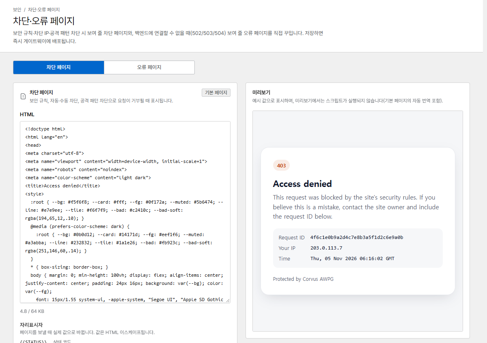
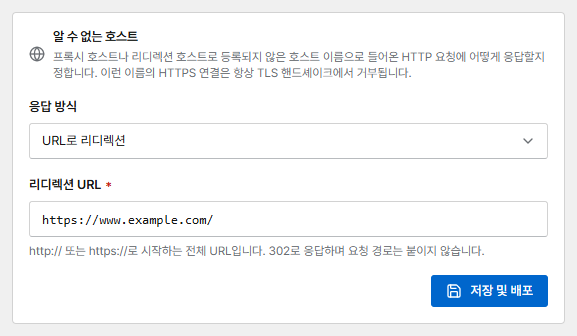

# 차단·오류 페이지

Corvus는 요청을 거부하거나 서비스에 접속할 수 없을 때 자체 페이지를 보여 줍니다. 두 페이지 모두
**차단·오류 페이지**에서 직접 만든 HTML로 바꿀 수 있습니다.

{ .shot }

| 페이지 | 표시되는 경우 |
|---|---|
| **차단 페이지** | 보안 규칙, 차단, 공격 경로 차단이 요청을 거부했을 때 |
| **오류 페이지** | 호스트의 서비스가 응답하지 않거나(연결 거부, 타임아웃) 잘못된 응답을 보냈을 때: `502`, `503`, `504`. 서비스가 직접 보내는 오류 페이지는 그대로 전달합니다 |

기본 페이지는 방문자의 언어로 자동 번역됩니다.

## 치환 변수

페이지를 보낼 때 아래 변수가 값으로 바뀝니다(HTML 이스케이프 처리).

| 변수 | 값 |
|---|---|
| `{{STATUS}}` | 상태 코드 |
| `{{RID}}` | 요청 ID |
| `{{HOST}}` | 요청한 사이트 |
| `{{IP}}` | 방문자 IP: 방문자가 문제를 알려 오면 [요청 로그](traffic.md#request-logs)에서 이 IP로 검색하세요 |
| `{{TIME}}` | 시각 |

페이지는 최대 64 KB까지 쓸 수 있습니다. 저장하면 바로 배포되며, **기본값으로 복원**을 누르면 기본
페이지로 돌아갑니다.

## 알 수 없는 호스트 { #unknown-hosts }

프록시 호스트나 리디렉션 호스트로 등록되지 않은 호스트 이름(잘못 입력한 이름, IP 주소로 직접 접속,
스캐너 등)으로 들어온 요청에는 페이지 아래쪽 **알 수 없는 호스트**에서 고른 방식으로 응답합니다.

{ .shot .panel }

| 응답 방식 | 응답 |
|---|---|
| **찾을 수 없음 페이지 (404)** | 짧은 `404` 페이지(기본값) |
| **연결 끊기** | 아무 응답 없이 연결을 끊습니다(nginx `444`) |
| **URL로 리디렉션** | 입력한 URL(예: `https://www.example.com/`)로 `302` 응답합니다. 요청 경로는 붙이지 않습니다 |

이 설정은 HTTP 요청에 적용됩니다. 알 수 없는 이름의 HTTPS 연결은 항상 TLS 핸드셰이크에서 거부하므로
인증서가 노출되지 않습니다. Let's Encrypt HTTP 인증은 어떤 방식에서도 그대로 동작합니다.
