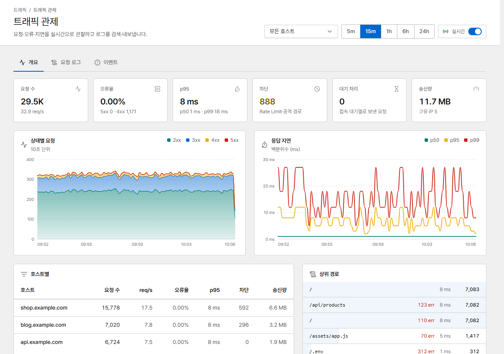
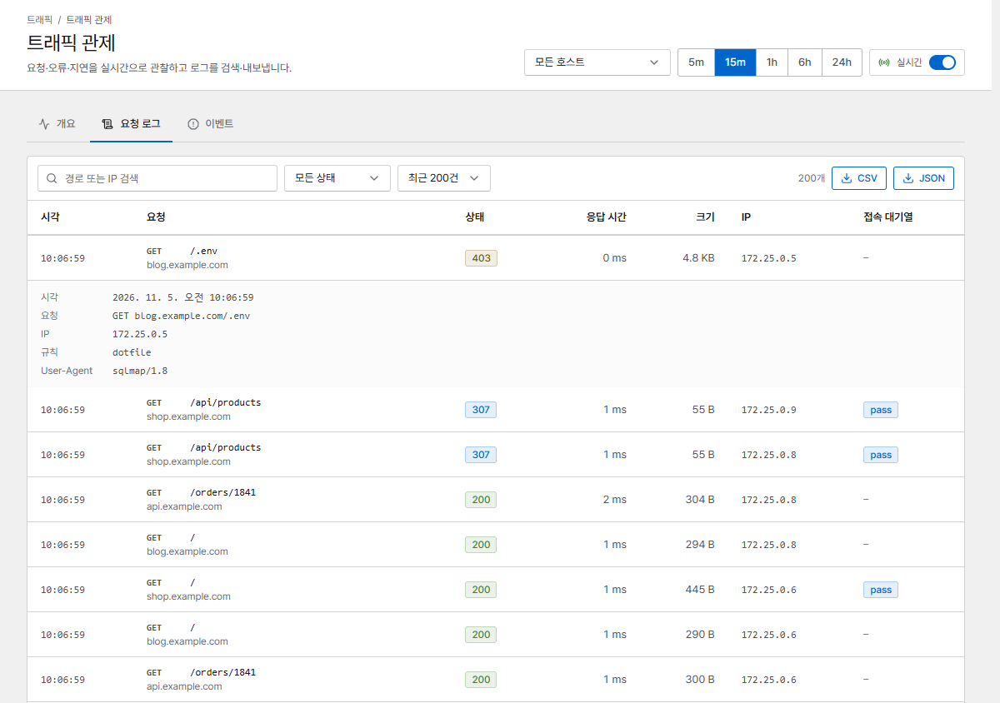
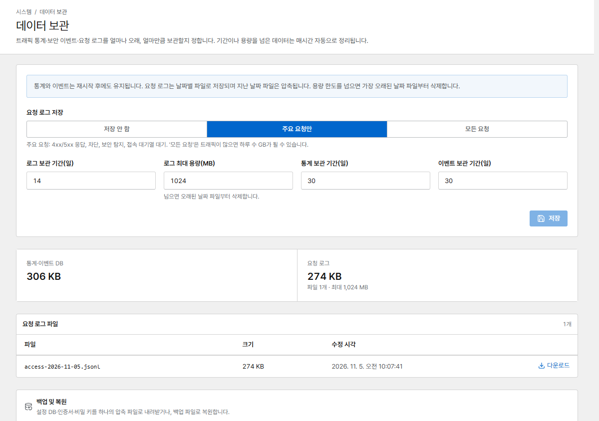

# 트래픽 관제

**트래픽 관제**는 요청, 오류, 응답 지연을 호스트별·경로별로 실시간으로 보여 줍니다.

{ .shot }

맨 위에서 호스트(또는 **모든 호스트**)와 기간을 고릅니다. **실시간**을 켜면 몇 초마다 페이지가
갱신됩니다.

## 개요

- **요청 수**, **오류율**, **p95** 지연, **차단**(Rate Limit과 공격 경로), **대기 처리**(접속 대기열로
  보낸 요청), **송신량**
- 시간에 따른 **상태별 요청**과 **응답 지연**(p50 / p95 / p99)
- **호스트별**, **상위 경로**: 트래픽과 오류가 어디에 몰리는지

## 요청 로그 { #request-logs }

경로나 IP로 요청을 검색하고, 상태로 거르고, **CSV**나 **JSON**으로 내보낼 수 있습니다. 행을 누르면
시각, 전체 요청, IP, User-Agent, 일치한 보안 규칙, 접속 대기열 판정 같은 상세 정보가 보입니다.

{ .shot }

어떤 요청을 기록할지는 **데이터 보관 → 요청 로그 저장**에서 정합니다.

{ .shot }

| 모드 | 기록 대상 |
|---|---|
| **주요 요청만** | 4xx/5xx 응답, 차단, 보안 탐지, 접속 대기열 대기 |
| **모든 요청** | 전부(바쁜 사이트는 하루에 몇 GB가 될 수 있습니다) |
| **저장 안 함** | 기록하지 않음 |

로그는 하루에 파일 하나로 기록되며, 지난 날짜의 파일은 압축됩니다. 용량 한도에 닿으면 가장 오래된
날짜부터 지웁니다. 통계와 이벤트는 따로 보관합니다(**데이터 보관** 참고).

!!! tip "개인정보 보호"
    **네트워크 → 로그에서 IP 마스킹**을 켜면 로그와 내보낸 파일에서 클라이언트 IP의 마지막 부분을
    가립니다.

## 이벤트

차단, Rate Limit, 챌린지, 서버 오류, 접속 대기열 대기를 시간순으로 보여 줍니다. 보안 규칙 일치는
**보안 규칙 → 규칙 이벤트**에도 나열됩니다.

## Prometheus

관리 포트의 `/metrics`가 Prometheus 메트릭을 내보냅니다. *조회자* 권한으로 [API 토큰](users.md#api-tokens)을
만들고 `Authorization: Bearer <token>`으로 수집하세요.
