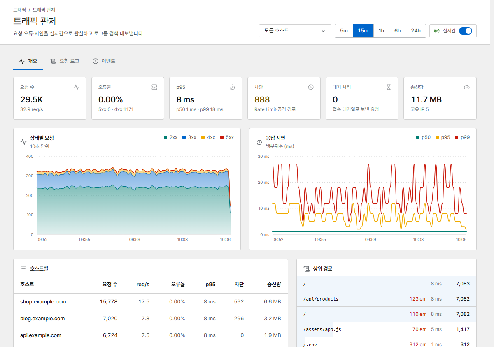
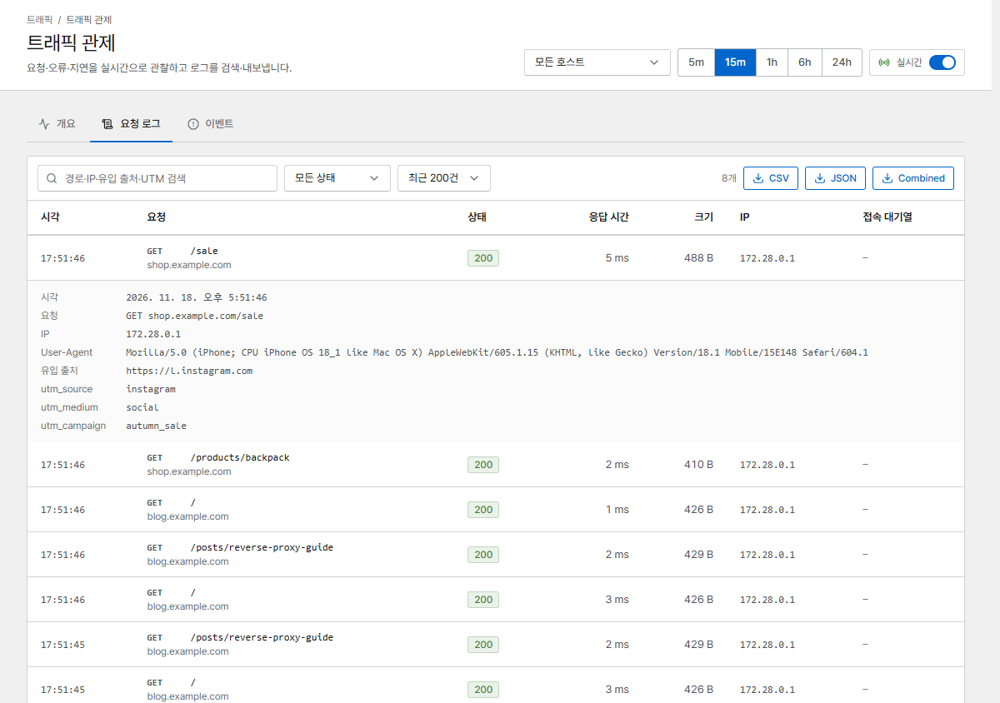
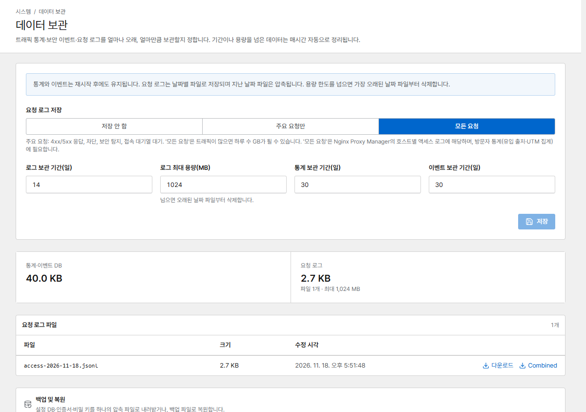

# 트래픽 관제

**트래픽 관제**는 요청, 오류, 응답 지연을 호스트별·경로별로 실시간으로 보여 줍니다.

{ .shot }

맨 위에서 호스트(또는 **모든 호스트**)와 기간을 고릅니다. **실시간**을 켜면 몇 초마다 페이지가
갱신됩니다.

## 개요

- **요청 수**, **오류율**, **p95** 지연, **차단**(Rate Limit과 공격 경로), **대기 처리**(접속 대기열에
  새로 줄을 선 방문자. 기다리는 동안의 새로고침은 다시 세지 않습니다), **송신량**
- 시간에 따른 **상태별 요청**과 **응답 지연**(p50 / p95 / p99)
- **호스트별**, **상위 경로**: 트래픽과 오류가 어디에 몰리는지

## 요청 로그 { #request-logs }

경로, IP, 유입 출처, UTM 값으로 요청을 검색하고, 상태로 거르고, **CSV**, **JSON**, **Combined**(nginx의
표준 액세스 로그 형식, [방문자 통계](#visitor-statistics) 참고)로 내보낼 수 있습니다. 행을 누르면 시각,
전체 요청, IP, User-Agent, 유입 출처, UTM 값, 일치한 보안 규칙, 접속 대기열 판정 같은 상세 정보가
보입니다.

{ .shot }

어떤 요청을 기록할지는 **데이터 보관 → 요청 로그 저장**에서 정합니다.

{ .shot }

| 모드 | 기록 대상 |
|---|---|
| **주요 요청만** | 4xx/5xx 응답, 차단, 보안 탐지, 접속 대기열 대기 |
| **모든 요청** | 전부(바쁜 사이트는 하루에 몇 GB가 될 수 있습니다) |
| **저장 안 함** | 기록하지 않음 |

로그는 하루에 파일 하나로 기록되며, 지난 날짜의 파일은 압축됩니다. 용량 한도에 닿으면 가장 오래된
날짜부터 지웁니다. 통계와 이벤트는 따로 보관합니다(**데이터 보관** 참고).

!!! tip "개인정보 보호"
    **네트워크 → 로그에서 IP 마스킹**을 켜면 로그와 내보낸 파일에서 클라이언트 IP의 마지막 부분을
    가립니다.

### 유입 출처와 UTM

방문자가 어디서 왔는지는 기록하되, 비밀이 담길 수 있는 URL 부분(비밀번호 재설정 토큰, OAuth 코드,
API 키, 검색어)은 기록하지 않습니다.

| 항목 | 기록하는 내용 | 예 |
|---|---|---|
| **유입 출처** | `Referer` 헤더의 출처(origin)만: 소문자로 바꾼 `scheme://host[:port]`. 경로, 쿼리, 프래그먼트, 사용자 이름은 기록하지 않습니다 | `https://www.google.com/search?q=…` → `https://www.google.com` |
| **UTM** | 쿼리 문자열의 `utm_source`, `utm_medium`, `utm_campaign`만(디코딩, 각 최대 100자, 제어 문자와 보이지 않는 서식 문자 제거) | `?utm_source=newsletter&token=…` → `utm_source = newsletter` |

나머지 쿼리 문자열은 기록하지 않습니다. 두 값 모두 게이트웨이(nginx)에서 먼저 줄인 뒤 넘기므로 전체
Referer와 다른 쿼리 파라미터는 요청 로그, 내보낸 파일, 통계에 들어가지 않습니다. Corvus 1.6 이전에
기록된 로그 줄에는 유입 출처와 UTM 값이 없습니다.

!!! warning "컨테이너 로그"
    이 내용은 요청 로그에만 해당합니다. 컨테이너 로그(`docker logs`)로 나가는 nginx 자체의 오류·경고
    메시지는 그 원인이 된 요청을 함께 적습니다(예: 요청 수 제한으로 거부된 요청, 응답하지 않는
    업스트림). 여기에는 **쿼리 문자열을 포함한 전체 요청 줄**과 **전체 Referer**가 들어갈 수 있습니다.
    컨테이너 로그는 민감한 정보로 다루고, 읽을 수 있는 사람과 Docker 로깅 드라이버의 보관 기간을
    제한하세요.

## 방문자 통계 { #visitor-statistics }

요청 로그로 방문자 수, 많이 본 페이지, 유입 출처를 보려면:

1. **데이터 보관 → 요청 로그 저장**에서 **모든 요청**을 고릅니다. (**주요 요청만**은 오류와 차단만
   남기므로 통계에는 부족합니다.)
2. 로그를 nginx **combined** 형식으로 내보냅니다.
    - **트래픽 관제 → 요청 로그 → Combined**: 지금 필터에 맞는 최근 요청(최대 1000개)
    - **데이터 보관 → 요청 로그 파일 → Combined**: 하루치 전체를 내려받으면서 변환
3. [GoAccess](https://goaccess.io/) 같은 로그 분석 도구로 분석합니다.

    ```bash
    goaccess access-2026-11-18.log --log-format=COMBINED -o report.html
    ```

내보내는 형식은 표준인
`IP - - [시각] "METHOD /path?utm_source=… HTTP/1.1" status bytes "referrer" "user-agent"`입니다.
Corvus는 쿼리 문자열과 프로토콜 버전을 보관하지 않으므로, 쿼리에는 기록된 UTM 값만 들어가고(없으면
쿼리도 없음) 프로토콜은 항상 `HTTP/1.1`입니다. referrer는 기록된 출처이며 없으면 `-`입니다. **로그에서
IP 마스킹**을 켜면 트래픽 관제에서 내보낸 파일의 IP도 가려집니다.

!!! note "본격적인 웹 분석"
    액세스 로그는 사람이 아니라 요청을 셉니다. 브라우저 캐시나 CDN이 응답한 방문은 보이지 않고,
    봇과 브라우저를 확실히 구분하지 못하며, 화면 크기나 전환 같은 정보도 없습니다. 본격적인 웹
    분석이 필요하면 [Umami](https://umami.is/), [Plausible](https://plausible.io/), Google Analytics 4
    같은 도구를 Corvus와 함께 쓰세요. 요청 로그는 서버 쪽 기록으로 남습니다.

## 이벤트

차단, Rate Limit, 챌린지, 서버 오류, 접속 대기열 대기를 시간순으로 보여 줍니다. 보안 규칙 일치는
**보안 규칙 → 규칙 이벤트**에도 나열됩니다.

## Prometheus

관리 포트의 `/metrics`가 Prometheus 메트릭을 내보냅니다. *조회자* 권한으로 [API 토큰](users.md#api-tokens)을
만들고 `Authorization: Bearer <token>`으로 수집하세요.
