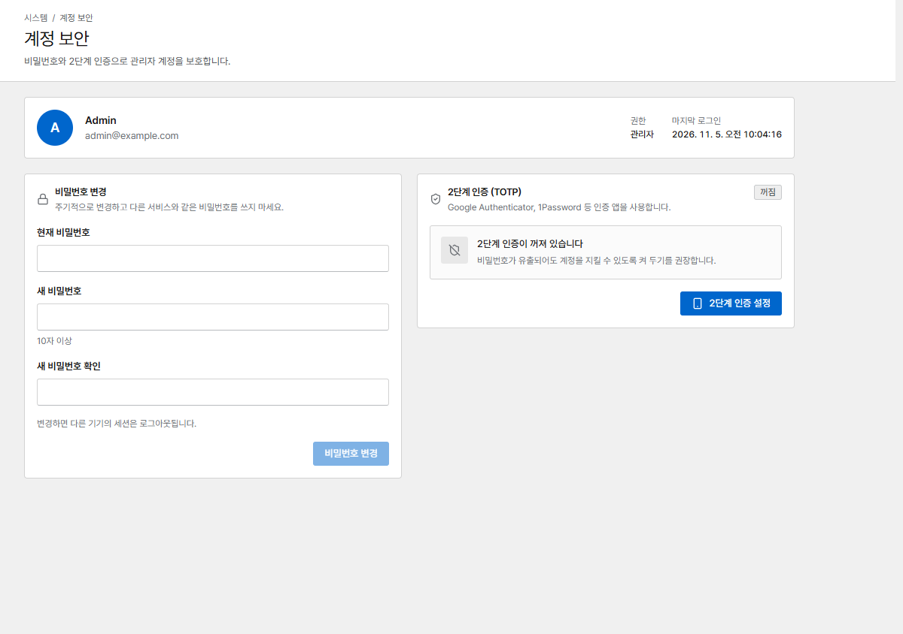

# 사용자와 로그인

## 역할

**사용자**에서 팀원을 추가합니다.

| 역할 | 할 수 있는 일 |
|---|---|
| **관리자** | 사용자, SSO, 시스템 설정을 포함한 모든 작업 |
| **운영자** | 프록시 호스트, 접속 대기열, 인증서, 규칙 변경과 배포 |
| **조회자** | 읽기 전용 |

## 2단계 인증

모든 사용자는 **계정 보안**에서 Google Authenticator나 1Password 같은 인증 앱으로 2단계
인증(TOTP)을 켤 수 있습니다. 설정 후 한 번만 보여 주는 복구 코드를 꼭 저장해 두세요. 휴대폰을 잃어버린
사용자는 관리자가 **MFA 초기화**를 해 줄 수 있습니다.

{ .shot }

## 통합 로그인 (OIDC)

관리자는 **SSO**에서 Okta, Microsoft Entra ID, Google, Keycloak 같은 OpenID Connect 제공자로
로그인하도록 설정할 수 있습니다. 로그인할 수 있는 이메일 도메인을 제한하고, 제공자의 그룹을 역할에
연결하고, 처음 보는 사용자를 자동으로 만들지 정할 수 있습니다.

사용자는 이메일 주소만이 아니라 로그인에 쓴 제공자 계정(issuer와 subject)에 연결됩니다.

- 첫 SSO 로그인 때 자동으로 만들어진 사용자는 그 제공자 계정에 연결됩니다.
- 이미 있는 사용자(예: 비밀번호로 만든 사용자)는 제공자가 이메일 주소를 인증된 것으로 표시할 때
  (ID 토큰 또는 userinfo 엔드포인트의 `email_verified: true`)만 첫 SSO 로그인에서 연결됩니다. 그렇지
  않으면 로그인이 거부됩니다. 제공자가 인증된 이메일을 보내도록 설정하거나, 사용자를 지우고 SSO로 다시
  만들게 하세요.
- **Microsoft Entra ID** 등 일부 제공자는 `email_verified`를 보내지 않습니다. 제공자가 인증된 주소만
  발급한다면(Entra ID는 자기 테넌트의 사용자) **ID 공급자가 이메일 주소를 인증함**을 켜세요. 그러면 이
  클레임이 없는 로그인도 기존 사용자와 연결됩니다. `email_verified: false`는 여전히 거부됩니다.
- 한 번 연결되면 제공자에서 이메일이 바뀌어도 그 제공자 계정으로 로그인합니다. 같은 이메일을 쓰는 다른
  제공자 계정은 거부됩니다.
- 제공자 계정이 바뀐 경우처럼 연결을 지워야 하면 관리자가 사용자 메뉴의 **SSO 연결 해제**를
  누릅니다. 다음에 인증된 이메일로 로그인하면 다시 연결됩니다.

업그레이드 전에 이미 SSO로 로그인한 사용자는 그때 쓴 계정에 그대로 연결됩니다.
이메일 도메인 제한은 제공자가 보내는 이메일을 기준으로 합니다. 이메일 주소를 인증하지 않는 제공자(또는
멀티 테넌트 애플리케이션)를 쓴다면 제공자 쪽에서도 로그인할 수 있는 사람을 제한하세요.

## API 토큰 { #api-tokens }

스크립트와 Prometheus는 `Authorization: Bearer cvs_…` 헤더와 함께 **API 토큰**(*API 토큰* 페이지에서
생성)을 사용합니다. 토큰에는 역할과 만료일(선택)이 있고, 만든 사람의 역할을 넘을 수 없으며, 한 번만
표시됩니다. 비밀번호가 바뀌면(관리자가 재설정하거나 사용자가 *계정* 페이지에서 직접 바꾸면) 그 사용자의
다른 세션이 종료되고 그 사용자가 만든 API 토큰도 삭제됩니다. [HTTP API](../reference/api.md)를 참고하세요.

## 콘솔 보호 { #protect-the-console }

- 로그인 실패는 주소별, 계정별로 제한됩니다. 한 계정에 15분 동안 10번 실패하면 그 계정은 잠시
  잠깁니다. 그 계정으로 로그인한 적이 있는 브라우저는 실패 횟수를 따로 세므로, 다른 곳의 실패
  때문에 내가 잠기지는 않습니다. 비밀번호를 바꾸거나 2단계 인증을 끌 때 현재 비밀번호를 잘못 넣은
  것도 같은 방식으로 셉니다.
- 9443 포트는 신뢰하는 네트워크에서만 열어 두세요. 방화벽을 쓰거나, *네트워크* 페이지의 **관리 콘솔
  접근 허용 네트워크**를 사용합니다.
- 그 목록 때문에 접속이 막혔다면 `CORVUS_ADMIN_ALLOW_ANY=1`로 컨테이너를 한 번 시작해 목록을 고친
  다음, 변수를 다시 지우세요.
- 이름이나 다른 IP로 콘솔에 접속하려면 `CORVUS_ADMIN_HOSTS`로 콘솔 인증서에 추가하세요
  ([환경 변수](../reference/configuration.md) 참고).
- 프록시 호스트(예: `https://corvus.example.com`)로 콘솔에 접속한다면 대상을 `https`, `corvus`(컨테이너
  이름), 포트 `9443`으로 지정하세요. 그러면 콘솔이 로그인 시도 제한, 접근 허용 네트워크, 세션, 감사
  로그에서 방문자 각자의 주소를 봅니다. 다른 리버스 프록시 뒤에 둔다면 그 프록시 주소를
  `CORVUS_ADMIN_TRUSTED_PROXIES`에 넣으세요.

## 감사 로그

**감사 로그**에는 모든 관리 작업이 기록됩니다: 누가, 무엇을, 어느 IP에서, 언제 바꿨는지.
기록은 365일 동안(최근 500,000건까지) 보관되고, 그보다 오래된 기록은 자동으로 지워집니다.
