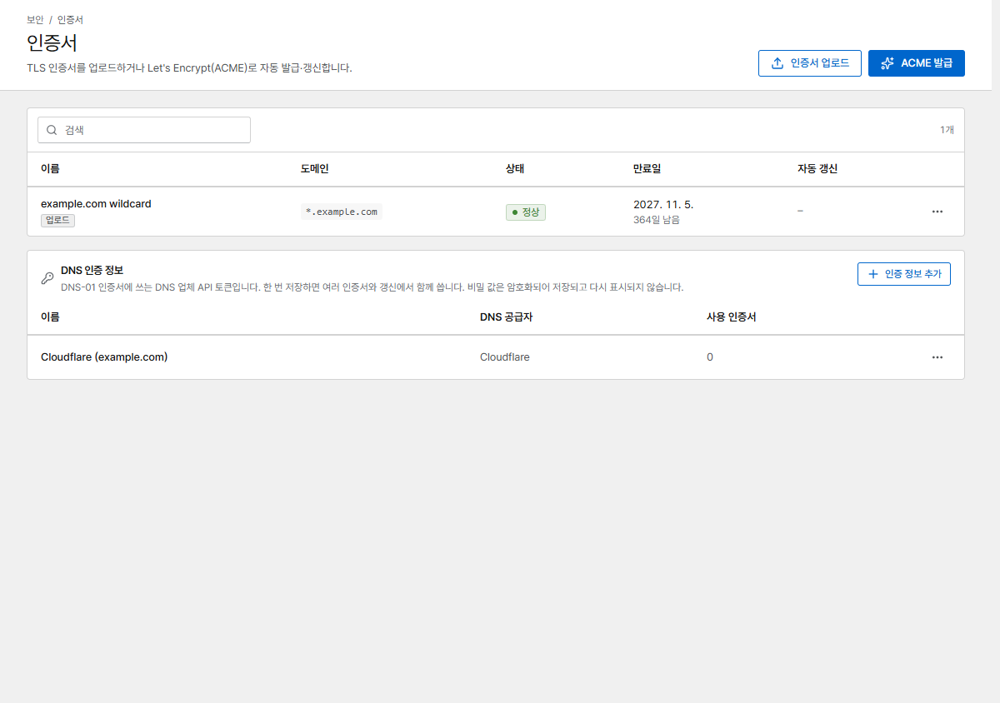
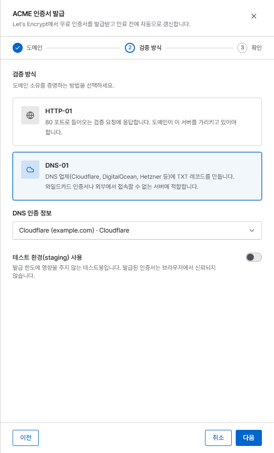
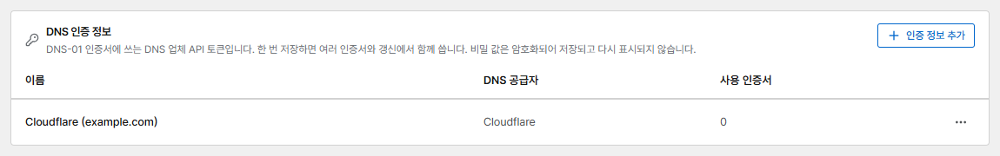

# 인증서

Corvus는 Let's Encrypt에서 무료 인증서를 받아 자동으로 갱신하거나, 직접 올린 인증서를 사용합니다.

{ .shot }

가장 빠른 방법은 프록시 호스트 입력 화면에서 바로 인증서를 요청하는 것입니다
(**TLS → 인증서 → 새 인증서 요청**). **인증서** 페이지에서는 모든 인증서와 만료일을 보고,
발급·업로드·갱신·교체할 수 있습니다.

## Let's Encrypt

**ACME 발급**을 누르고 세 단계(도메인, 검증, 확인)를 따라갑니다. 발급은 백그라운드에서 진행되며,
1~2분 뒤 상태가 **발급 중**에서 **정상**으로 바뀝니다. 인증서는 만료 30일 전에 자동으로 갱신됩니다.

### HTTP-01 (기본값)

Let's Encrypt가 80 포트로 도메인을 확인합니다. 도메인의 DNS가 이미 이 서버를 가리키고 있어야
하며, 인터넷에서 80 포트로 접속할 수 있어야 합니다.

### DNS-01 { #dns-01 }

Corvus가 DNS 업체에 TXT 레코드를 만듭니다. **와일드카드 인증서**(`*.example.com`)나 인터넷에서
접속할 수 없는 서버에 사용하세요.

지원하는 업체: Cloudflare, DigitalOcean, DuckDNS, Gandi, GoDaddy, Hetzner, Namecheap.
DNS 업체에서 DNS 레코드를 수정할 수 있는 API 토큰을 만들어 입력 화면에 붙여 넣으세요
(Cloudflare는 *Zone → DNS → Edit* 권한). 토큰은 암호화해 저장하며 다시 보여 주지 않습니다.

#### 저장된 DNS 인증 정보 { #saved-dns-credentials }

토큰은 한 번만 입력하면 됩니다. 처음 입력한 토큰은 업체 이름(*Cloudflare*, 그다음은
*Cloudflare 2* …)으로 **DNS 인증 정보**에 저장됩니다. 다음부터는 입력 화면에 **DNS 인증 정보**
목록이 나타나므로 저장된 것을 고르거나, **새 인증 정보 입력**을 골라 새 토큰을 넣고 필요하면
**인증 정보 이름**을 정하세요. 인증서 화면뿐 아니라 프록시 호스트·리디렉션 호스트 폼에서
인증서를 요청할 때도 똑같이 동작합니다.

{ .shot .panel }

{ .shot }

인증서 화면 아래쪽의 **DNS 인증 정보** 카드에서 저장된 인증 정보와 DNS 공급자, 각각을 쓰는
인증서 수(**사용 인증서**)를 볼 수 있습니다. 행 메뉴에서 할 수 있는 일은 다음과 같습니다.

- **비밀 값 교체**: DNS 업체에서 토큰을 새로 발급했을 때 새 토큰을 넣습니다. 이 인증 정보를 쓰는
  모든 인증서가 다음 갱신부터 새 토큰을 쓰며, 지금 바로 다시 발급하지는 않습니다.
- **이름 변경**
- **삭제**: 어떤 인증서도 쓰지 않는 인증 정보만 삭제할 수 있습니다.

**인증 정보 추가**로 미리 저장해 둘 수도 있습니다. 이전 버전에서 만든 인증서와 Nginx Proxy
Manager에서 가져온 DNS 인증서도 업체·토큰별로 하나씩 자동으로 저장된 인증 정보로 옮겨집니다.

!!! tip "테스트"
    이것저것 시험해 볼 때는 **테스트 환경(staging) 사용**을 켜세요. 발급 횟수 제한이 없지만,
    브라우저가 이 인증서를 신뢰하지 않습니다.

## 직접 올리기

**인증서 업로드**를 누르고 인증서(PEM, 체인 포함)와 개인 키를 붙여 넣습니다.

인증서를 새로 받았다면 행 메뉴에서 **교체**를 고릅니다. 인증서의 ID와 연결된 호스트는 그대로
유지되며, 호스트는 새 인증서로 다시 배포됩니다.

## 다른 ACME CA

Let's Encrypt가 아닌 CA(예: 사설 step-ca)를 쓰려면 `CORVUS_ACME_DIRECTORY`를 설정하고, 사설 CA라면
`LEGO_CA_CERTIFICATES`도 설정합니다. [환경 변수](../reference/configuration.md)를 참고하세요.

## 만료 경고

대시보드에 30일 안에 만료되는 인증서가 표시되며, 인증서 문제 [알림](../operations/alerts.md)이
갱신에 실패했을 때 알려 줍니다.
