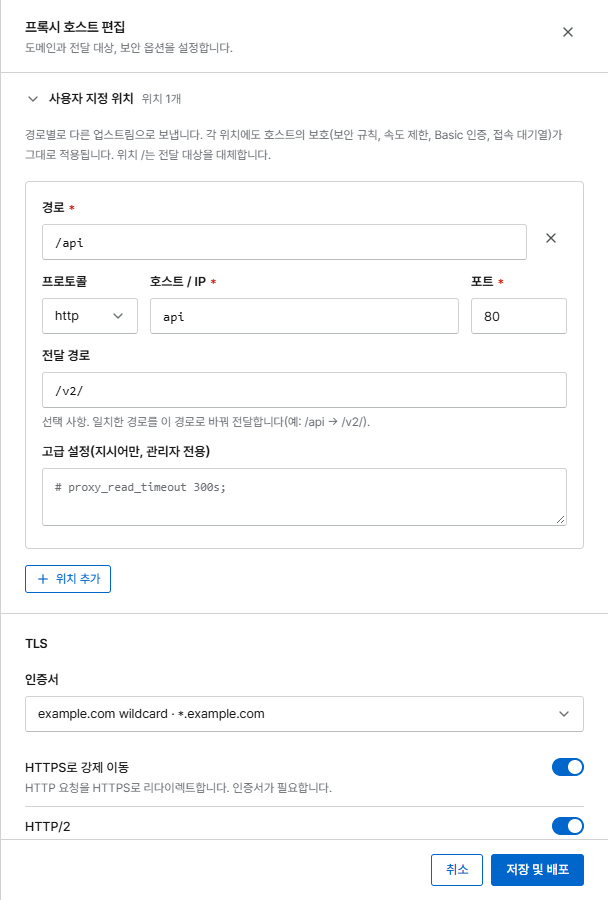

# 사용자 지정 위치

사용자 지정 위치는 사이트의 일부 경로를 다른 서비스로 보냅니다. 예를 들어 `shop.example.com`은
웹 쇼핑몰로 가지만 `shop.example.com/api/…`는 API 서버로 보낼 수 있습니다.

프록시 호스트를 열고 입력 화면에서 **사용자 지정 위치**를 펼친 다음 **위치 추가**를 누릅니다.

{ .shot .panel }

| 필드 | 의미 |
|---|---|
| **경로** | 경로 접두사(예: `/api`). `/api`와 그 아래의 모든 요청이 이 위치를 사용합니다 |
| **프로토콜 / 호스트 / IP / 포트** | 이 요청을 받을 서비스 |
| **전달 경로** | 선택 사항. 일치한 접두사를 바꿉니다. 경로가 `/api`, 전달 경로가 `/v2/`이면 `/api/orders`는 `/v2/orders`로 전달됩니다 |
| **고급 설정** | 선택 사항. 이 위치에만 적용할 nginx 지시어(관리자 전용) |

## 알아 두면 좋은 점

- **보호 설정이 그대로 적용됩니다.** 모든 위치에 호스트의 보안 규칙, 차단, 공격 경로·본문 검사,
  공격 대응 모드, Rate Limit, 비밀번호 보호, 접속 대기열은 물론 업로드 크기 제한, 타임아웃,
  gzip 설정도 그대로 적용됩니다.
- 위치를 `/`로 만들면 호스트의 전달 대상을 대체합니다.
- `/__corvus`와 `/.well-known/acme-challenge`는 예약된 경로입니다.
- 호스트당 최대 50개까지 만들 수 있습니다.
- 사용자 지정 위치도 [NPM에서 가져옵니다](../getting-started/migrate-npm.md).
