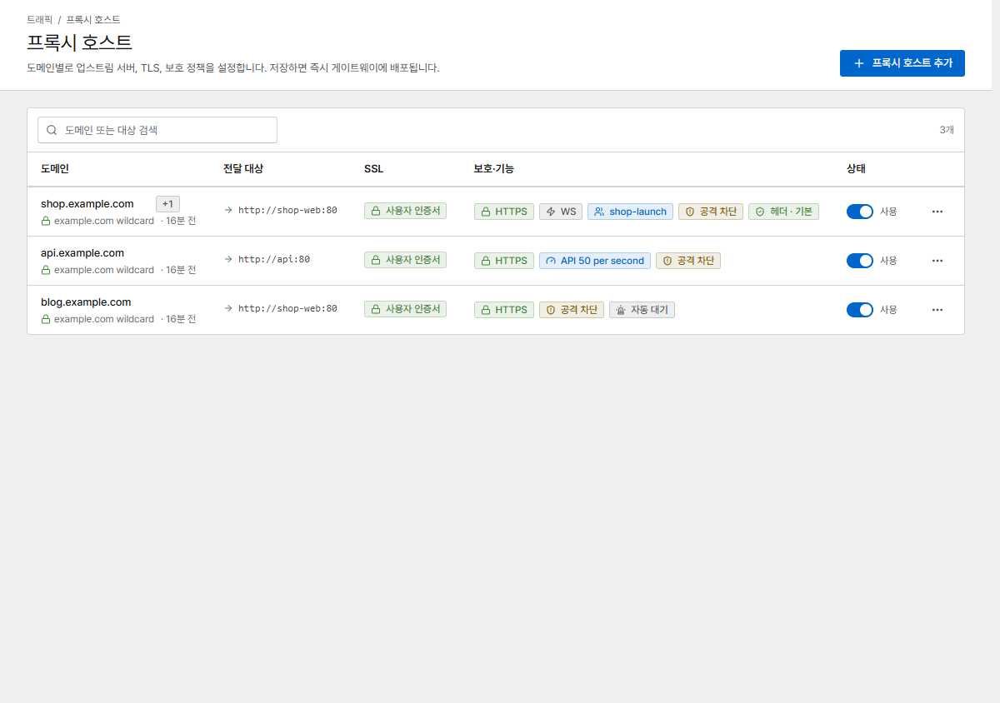
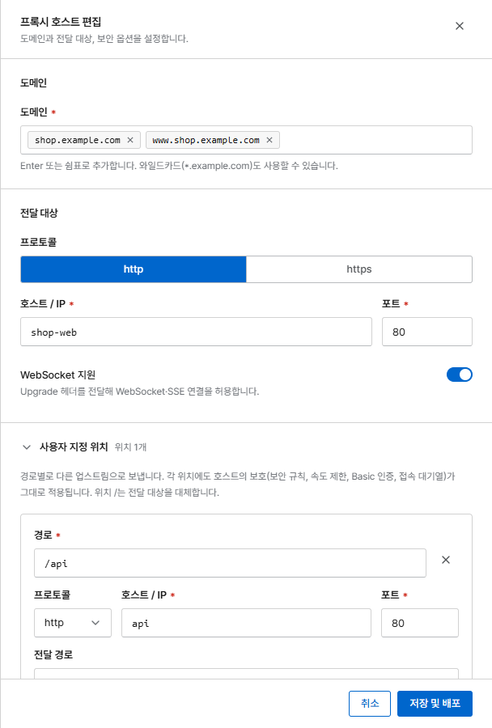
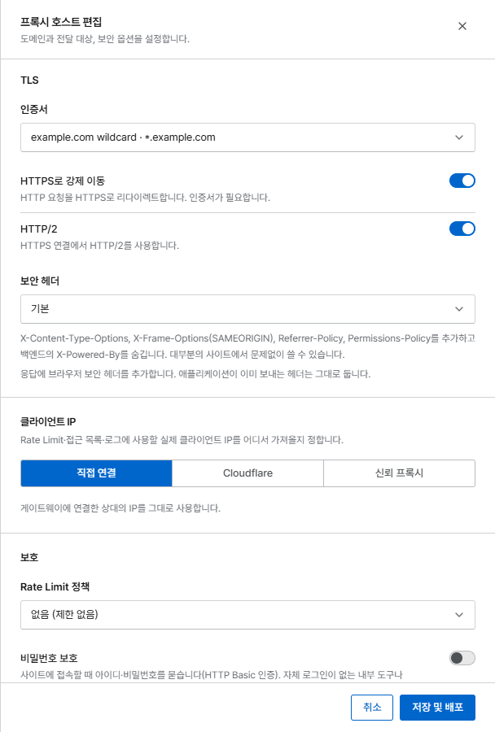
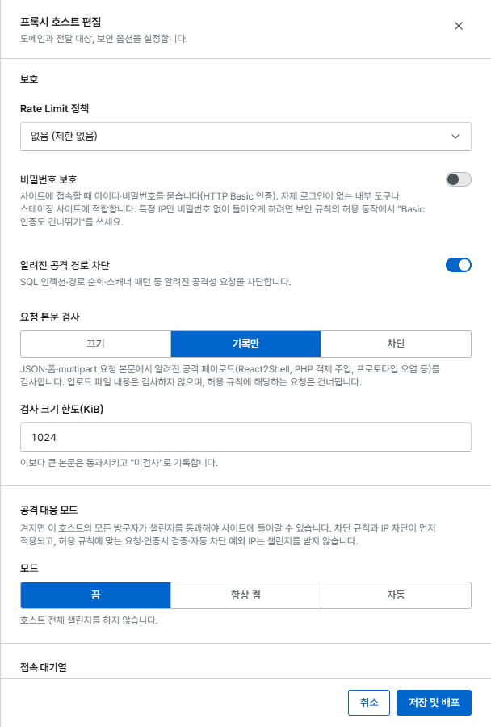
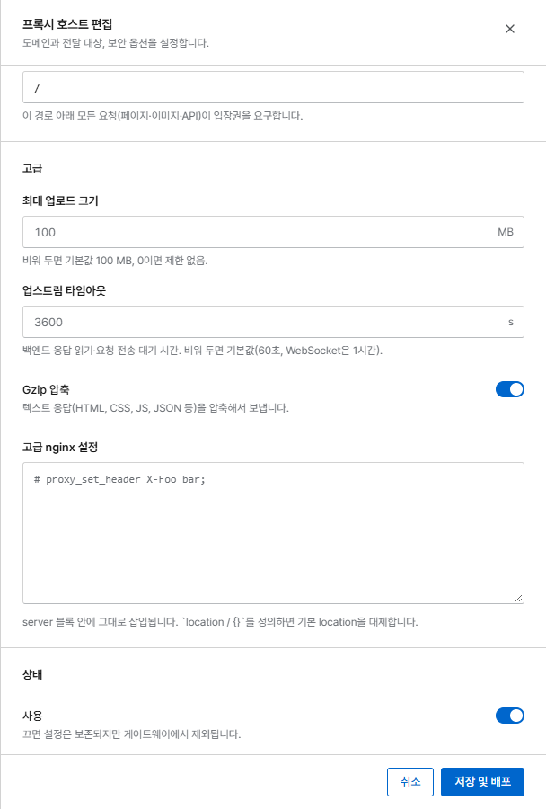
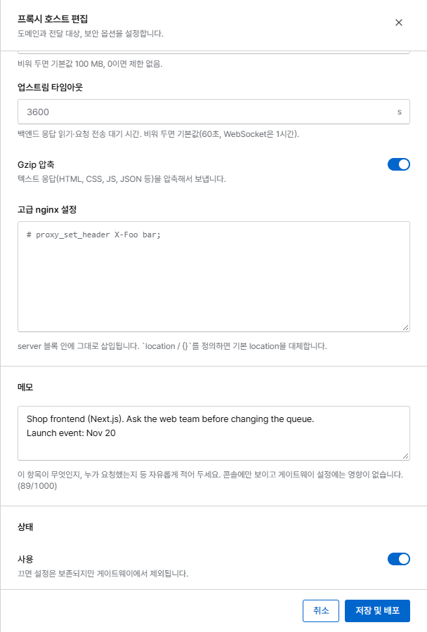
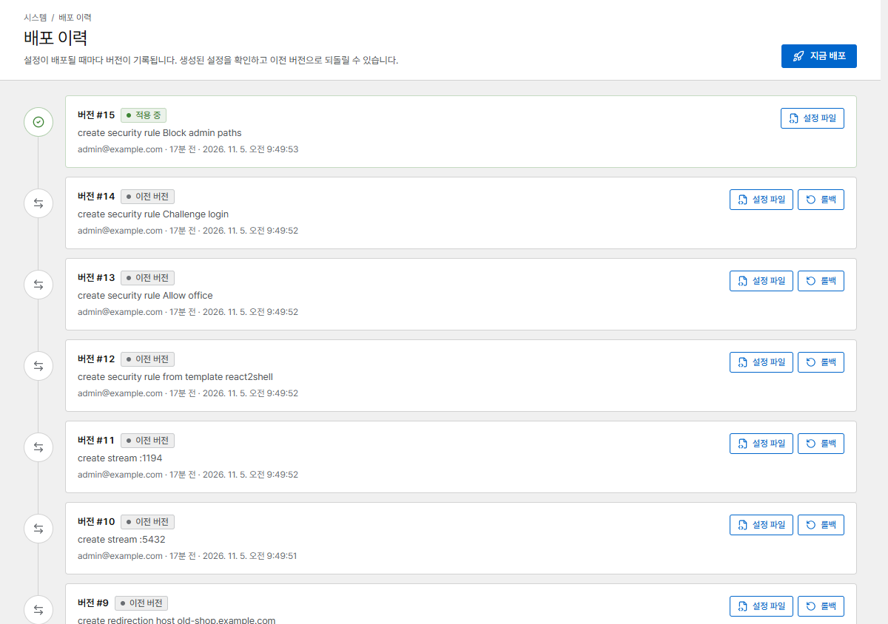

# 프록시 호스트

프록시 호스트는 하나 이상의 도메인으로 들어온 요청을 서비스(*전달 대상*)로 전달하고, 그 과정에서
TLS와 보호 기능을 적용합니다. 처음 설정하는 방법은
[첫 프록시 호스트](../getting-started/first-host.md)를 참고하세요.

{ .shot }

목록에는 호스트마다 전달 대상, 인증서, 켜져 있는 기능(HTTPS, WebSocket, 접속 대기열, Rate Limit,
공격 차단, 보안 헤더 …)이 표시됩니다. **상태**의 스위치를 끄면 호스트를 삭제하지 않고 멈출 수
있습니다.

## 입력 화면 섹션별 안내

{ .shot .panel }

### 도메인

도메인을 입력하고 ++enter++나 쉼표를 누릅니다. `*.example.com` 같은 와일드카드도 쓸 수 있습니다.
하나의 도메인은 프록시 호스트나 리디렉션 호스트 하나에만 속할 수 있습니다.

### 전달 대상

서비스의 **프로토콜**, **호스트 / IP**, **포트**입니다. 새 호스트는 **WebSocket 지원**이 켜져
있습니다. 클라이언트가 WebSocket을 요청할 때만 업그레이드를 전달하므로 다른 앱에는 영향이 없습니다.
켜 두고 업스트림 타임아웃을 비워 두면 타임아웃이 1시간이 되어, 유휴 WebSocket 연결과
SSE(server-sent events)가 끊기지 않습니다.

#### 전달 대상 예시 { #forward-targets }

| 대상 | 예 | 참고 |
|---|---|---|
| 다른 컨테이너 | `shop-web` 포트 `80` | Corvus와 같은 Docker 네트워크에 있어야 합니다. 그 네트워크를 `corvus` 서비스에 추가하세요 |
| 사설 또는 공인 IP | `10.3.2.39` 포트 `8084` | |
| Docker 호스트의 서비스 | `127.0.0.1` 또는 `localhost` | NPM과 마찬가지로 컨테이너 안에서 이 주소는 Docker 호스트를 뜻하며, `host.docker.internal`은 필요 없습니다. 서비스가 컨테이너에서 접속할 수 있는 주소(`0.0.0.0` 또는 Docker 브리지)에서 수신해야 하고, 호스트 방화벽이 Docker 네트워크를 허용해야 합니다 |

호스트의 `127.0.0.1`에서만 수신하는 서비스에 접속하려면 Corvus를
[호스트 네트워크](../getting-started/install.md#run-it-with-host-networking-optional)로 실행하세요.

### 사용자 지정 위치

`/api` 같은 경로를 다른 서비스로 보냅니다. [사용자 지정 위치](locations.md)를 참고하세요.

### TLS

{ .shot .panel }

- **인증서**: 기존 인증서, **새 인증서 요청 (Let's Encrypt)**, 또는 **없음 (HTTP만)**.
  [인증서](certificates.md)를 참고하세요.
- **HTTPS로 강제 이동**은 HTTP를 HTTPS로 리디렉션하고 `Strict-Transport-Security`를 보냅니다.
- **HTTP/2**는 HTTPS 연결에서 HTTP/2를 사용합니다.

### 클라이언트 IP { #client-ip }

실제 방문자 IP를 어디서 가져올지 정합니다. 규칙, 차단, Rate Limit, 로그에 이 IP를 사용합니다.

| 옵션 | 이럴 때 사용 |
|---|---|
| **직접 연결** | 방문자가 Corvus에 바로 접속합니다(기본값) |
| **Cloudflare** | 사이트가 Cloudflare 뒤에 있습니다. `CF-Connecting-IP`는 Cloudflare 공식 IP 대역에서 온 요청만 신뢰합니다 |
| **신뢰 프록시** | 앞에 다른 프록시나 로드 밸런서가 있습니다. 그 대역과 헤더는 **네트워크** 페이지에서 설정합니다 |

!!! warning
    신뢰 프록시를 잘못 설정하면 클라이언트가 IP를 속여 Rate Limit과 차단을 피할 수 있습니다.

#### TCP 터널이나 로드 밸런서 뒤에 있을 때 (PROXY protocol) { #behind-a-tcp-tunnel-or-load-balancer-proxy-protocol }

TCP 터널이나 로드 밸런서(FRP, HAProxy, 클라우드 로드 밸런서)는 연결 내용을 읽지 않고 그대로 넘기므로,
Corvus에는 모든 방문자가 터널의 주소로 보입니다. 이런 도구는 대부분 연결 맨 앞에
[PROXY protocol](https://www.haproxy.org/download/2.9/doc/proxy-protocol.txt) 헤더(v1 또는 v2)로
방문자 주소를 실어 보낼 수 있고, Corvus는 별도의 포트 두 개에서 이 헤더를 받습니다.

1. **네트워크** 페이지에서 **PROXY protocol 받기**를 켭니다. 포트는 기본값이 **8080**(HTTP),
   **8443**(HTTPS)이며, Corvus가 직접 쓰는 포트나 스트림이 쓰는 포트는 고를 수 없습니다.
2. 같은 섹션의 **신뢰할 PROXY protocol 출처**에 터널이 접속해 오는 주소를 입력합니다. 헤더는 그
   주소에서 온 연결에서만 사용하며, 목록이 비어 있으면 설정을 켤 수 없습니다. 이 목록은 따로
   관리됩니다. `X-Forwarded-For`를 믿을 대상인 **신뢰 프록시**에는 터널을 넣지 마세요(아래 참고).
3. `docker-compose.yml`에서 포트를 공개합니다. 터널이 같은 호스트에서 돌면 루프백에만 공개합니다.

    ```yaml
        ports:
          - '80:80'
          - '443:443'
          - '9443:9443'
          - '127.0.0.1:8080:8080'   # PROXY protocol, HTTP
          - '127.0.0.1:8443:8443'   # PROXY protocol, HTTPS
    ```

    터널이나 로드 밸런서가 다른 머신에 있으면 `127.0.0.1:` 없이 공개하고, 방화벽으로 그 머신의
    주소만 이 포트에 접근하도록 막으세요.

4. 터널이 PROXY protocol을 켠 채로 이 포트에 연결하도록 설정합니다.

80/443 포트는 그대로라서, 내부망 방문자와 터널이 Corvus를 함께 쓸 수 있습니다. (헤더를 기다리는
포트는 헤더 없는 연결을 거부하므로, 추가 포트는 터널만 쓰도록 하세요.)

**어떤 주소를 신뢰할까.** Corvus가 보는 터널의 접속 주소를 입력합니다.

- **frpc(또는 HAProxy)가 Corvus와 같은 Docker 네트워크의 컨테이너**에서 Corvus 컨테이너 이름으로
  접속할 때: 그 컨테이너의 주소(바뀔 수 있다면 그 네트워크의 대역). 이때는 포트를 공개할 필요도
  없습니다.
- **frpc가 호스트에서 돌고, 위처럼 포트를 `127.0.0.1`에 공개했을 때**: Docker 브리지 게이트웨이
  (예: `172.18.0.1`, 추가하기 전에는 **트래픽** 페이지에 클라이언트 주소로 보입니다).
- **다른 머신의 로드 밸런서**: 그 머신의 주소.

!!! warning "포트를 루프백에 공개하지 않았다면 Docker 게이트웨이를 신뢰하지 마세요"
    모든 주소에 공개한 포트로 들어오는 외부 연결은 Docker 환경에 따라(userland proxy, ip6tables 없는
    IPv6, Docker Desktop, rootless Docker) 브리지 게이트웨이에서 온 것처럼 보이는 경우가 많습니다.
    그때 게이트웨이를 신뢰하면 포트에 접속할 수 있는 누구나 자기 주소를 마음대로 정할 수 있습니다.

=== "FRP"

    Corvus 옆 머신의 `frpc.toml`(frp 0.52 이상):

    ```toml
    [[proxies]]
    name = "corvus-https"
    type = "tcp"
    localIP = "127.0.0.1"      # Corvus 호스트(또는 Corvus 컨테이너 이름)
    localPort = 8443
    remotePort = 443
    transport.proxyProtocolVersion = "v2"

    [[proxies]]
    name = "corvus-http"
    type = "tcp"
    localIP = "127.0.0.1"
    localPort = 8080
    remotePort = 80
    transport.proxyProtocolVersion = "v2"
    ```

=== "HAProxy"

    ```
    frontend https_in
        mode tcp
        bind :443
        default_backend corvus_https

    backend corvus_https
        mode tcp
        server corvus 192.168.1.10:8443 send-proxy-v2
    ```

TLS는 여전히 Corvus에서 처리하므로 인증서(HTTP 포트를 통한 Let's Encrypt HTTP-01 포함)는 평소처럼
동작합니다.

헤더의 주소는 **직접 연결**로 설정한 호스트, 리디렉션 호스트, 알 수 없는 호스트에 쓰입니다.
**Cloudflare**나 **신뢰 프록시**로 설정한 호스트는 터널을 거쳐 와도 계속 각자의 규칙대로 헤더에서
주소를 읽습니다. 터널이 직접 `X-Forwarded-For`를 붙이는 경우가 아니라면 이런 호스트를 위해 터널을
**신뢰 프록시**에 넣지 마세요. 터널은 방문자가 보낸 헤더를 그대로 넘기므로, 터널을 신뢰하면 방문자가
자기 주소를 마음대로 정할 수 있습니다. 터널 앞에 Cloudflare가 있다면 호스트를 **신뢰 프록시**와
`CF-Connecting-IP` 헤더로 설정하고, 터널의 공개 포트가 Cloudflare 주소에서 오는 연결만 받을 때(터널
서버의 방화벽)에만 터널을 **신뢰 프록시**에 추가하세요.

!!! note "실제 IP 지시어가 있는 고급 설정"
    PROXY protocol이 켜져 있으면 Corvus가 모든 서버에 `set_real_ip_from`과 `real_ip_header`를
    설정합니다. 고급 설정에서 둘 중 하나만(`real_ip_header`만, 또는 `set_real_ip_from`만) 지정하면
    나머지 하나는 Corvus의 설정과 합쳐집니다. 둘 다 지정하거나 둘 다 빼세요.

!!! note
    [스트림](streams.md)은 아직 PROXY protocol을 받지 않습니다.

### 보호

{ .shot .panel }

| 옵션 | 하는 일 |
|---|---|
| **Rate Limit 정책** | IP별 요청 수를 제한합니다. [차단과 Rate Limit](../security/bans.md#rate-limits)을 참고하세요 |
| **비밀번호 보호** | 사이트를 열기 전에 사용자 이름과 비밀번호를 묻습니다(HTTP Basic 인증). 스테이징 사이트나 내부 도구에 알맞습니다 |
| **알려진 공격 경로 차단** | SQL 인젝션, 경로 순회, 스캐너 탐색 같은 흔한 공격 패턴을 차단합니다. **기본으로 켜져 있습니다** |
| **요청 본문 검사** | JSON, 폼, multipart 본문에서 알려진 공격 페이로드를 검사합니다: **끄기**, **기록만**, **차단**. **차단** 모드에서는 끝까지 검사할 수 없는 본문(압축된 본문, 형식이 잘못된 multipart, UTF-16처럼 ASCII와 호환되지 않는 문자 집합, 너무 많은 필드)도 거부합니다. 검사 크기 한도를 넘는 본문은 통과시키고 검사하지 않음으로 기록합니다 |
| **공격 대응 모드** | 모든 방문자에게 브라우저 챌린지를 통과하게 합니다. [챌린지와 공격 대응 모드](../security/challenge.md)를 참고하세요 |
| **보안 헤더** | 브라우저 보안 헤더를 추가합니다(**기본** 또는 **엄격**). 앱이 이미 보내는 헤더는 바꾸지 않습니다 |

### 접속 대기열

[접속 대기열](../access-queue.md)을 연결하고 **접속 대기열 적용 경로**(보통 `/`)를 고릅니다.

### 고급

{ .shot .panel }

| 옵션 | 기본값 | 의미 |
|---|---|---|
| **최대 업로드 크기** | 100 MB | 요청 본문의 최대 크기. `0`은 무제한입니다. 이보다 크면 `413`을 받습니다 |
| **업스트림 타임아웃** | 60초 (WebSocket은 1시간) | Corvus가 서비스의 응답을 기다리는 시간. 비워 두면 60초, WebSocket 호스트는 1시간이며, 직접 정한 값은 그대로 적용됩니다 |
| **Gzip 압축** | 켜짐 | 텍스트 응답(HTML, CSS, JS, JSON …)을 압축합니다. 이미 압축된 응답은 그대로 전달합니다 |
| **고급 nginx 설정** | 비어 있음 | 호스트의 `server` 블록에 넣을 Nginx 지시어(관리자 전용) |

### 메모 { #notes }

{ .shot .panel }

선택 사항인 자유 입력란입니다(최대 1000자). 호스트의 용도, 요청한 사람, 특별한 규칙을 둔 이유 등을
적어 둡니다. 첫 줄이 목록의 도메인 아래에 보이고, 검색창에서 메모 내용도 함께 찾습니다. 메모는
콘솔에만 보이며 게이트웨이 설정에는 영향을 주지 않습니다.

### 상태

**사용**을 끄면 호스트 설정은 남아 있지만 게이트웨이에서는 빠집니다.

프록시 호스트를 통해 콘솔에 접속한 경우(예: `https://corvus.example.com`) 목록에서 그 호스트에
**콘솔 접속 중** 표시가 붙습니다. 이 호스트를 편집하면 안내가 나오고, 끄거나 삭제할 때는 먼저 확인을
받습니다. 그 주소로는 콘솔에 접속할 수 없게 되기 때문입니다. 서버의 9443 포트
(`https://서버-IP:9443`)로는 언제든 접속할 수 있습니다.

## 변경이 적용되는 방식

**저장 및 배포**는 새 설정 버전을 만들고 `openresty -t`로 검사한 뒤, 연결을 끊지 않고 적용합니다.
검사에 실패하면 아무것도 바뀌지 않고 오류를 보여 줍니다. 모든 버전은 **배포 이력**에 남으며,
여기서 생성된 파일을 확인하고 이전 버전으로 되돌릴 수 있습니다.

{ .shot }
