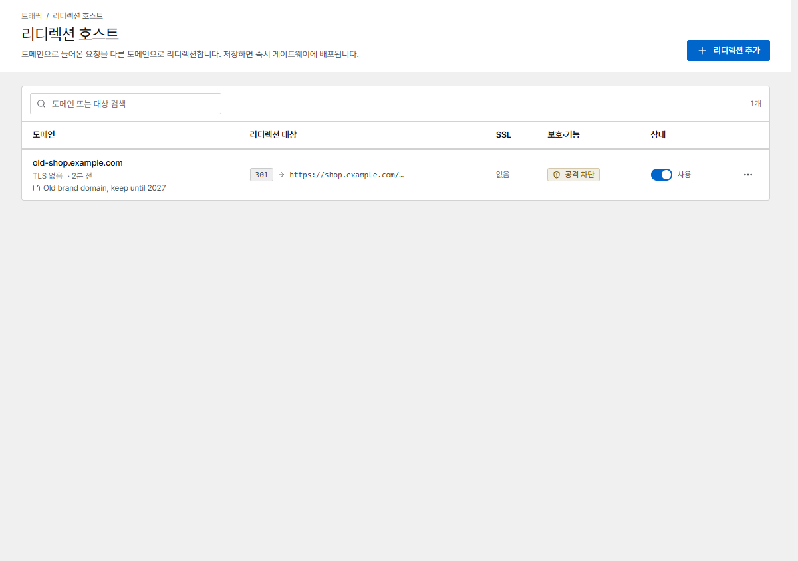

# 리디렉션 호스트

리디렉션 호스트는 한 도메인의 방문자를 다른 주소로 보냅니다. 예를 들어 옛 도메인을 새 도메인으로,
`example.com`을 `www.example.com`으로 보낼 수 있습니다.

{ .shot }

**리디렉션 추가**를 누르고 다음을 설정합니다.

| 필드 | 의미 |
|---|---|
| **도메인** | 응답할 도메인 |
| **스킴** | `auto`는 요청의 스킴(http 또는 https)을 유지합니다. 항상 `http` / `https`로 정할 수도 있습니다 |
| **대상 도메인** | 방문자를 보낼 곳(`http://` 없이). 포트와 경로를 붙일 수 있습니다: `example.com`, `example.com/blog` |
| **상태 코드** | `301` 영구(기본값), `302` 임시, `303`, `307` / `308`(요청 메서드 유지) |
| **경로 유지** | 요청 경로와 쿼리를 대상 뒤에 붙입니다: `old.example.com/a?b=1` → `new.example.com/a?b=1`. 끄면 모든 요청이 대상 주소로 갑니다 |
| **TLS** | 프록시 호스트와 같이 인증서, HTTPS로 강제 이동, HTTP/2 |
| **메모** | 선택 사항, 사람이 보는 용도([프록시 호스트와 같음](proxy-hosts.md#notes)) |

IP 차단, 모든 호스트에 적용되는 보안 규칙, 공격 경로 차단은 리디렉션 호스트도 보호합니다.

리디렉션 호스트도 [NPM에서 가져옵니다](../getting-started/migrate-npm.md).
