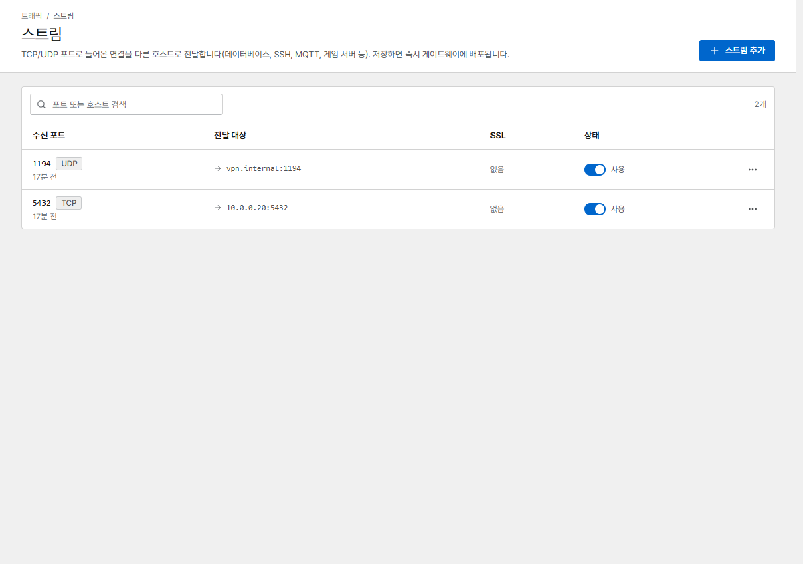
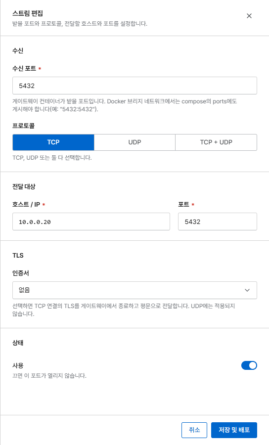

# 스트림 (TCP/UDP)

스트림은 HTTP를 쓰지 않는 서비스(데이터베이스, SSH, MQTT, VPN, 게임 서버)를 위해 TCP 또는 UDP
포트를 다른 호스트로 전달합니다.

{ .shot }

**스트림 추가**를 누르고 다음을 설정합니다.

{ .shot .panel }

| 필드 | 의미 |
|---|---|
| **수신 포트** | Corvus가 수신할 포트 |
| **프로토콜** | TCP, UDP 또는 둘 다 |
| **전달 대상** | 서비스의 호스트 / IP와 포트(프록시 호스트와 같은 [전달 대상](proxy-hosts.md#forward-targets)) |
| **인증서** | 선택 사항, TCP 전용: Corvus가 TLS를 종료하고 평문 TCP로 전달합니다. 인증서가 발급되면 TCP 포트가 열립니다 |
| **메모** | 선택 사항, 사람이 보는 용도([프록시 호스트와 같음](proxy-hosts.md#notes)) |

## 포트 공개 { #publish-the-port }

기본 브리지 네트워크에서는 Docker가 `docker-compose.yml`에 적힌 포트만 전달합니다. 스트림 포트를
모두 여기에 추가하고 `docker compose up -d`로 적용하세요.

```yaml hl_lines="6 7"
    ports:
      - '80:80'
      - '443:443'
      - '9443:9443'
      - '5432:5432'       # stream: PostgreSQL (TCP)
      - '1194:1194/udp'   # stream: OpenVPN (UDP)
```

`network_mode: host`라면 따로 할 일이 없습니다.

## 제한 사항

- Corvus가 직접 쓰는 포트(80, 443, 9443과 내부 포트)는 사용할 수 없고, 스트림을 Corvus 자신의 관리
  콘솔이나 내부 포트로 전달할 수도 없습니다.
- 사용 중인 두 스트림이 같은 포트와 프로토콜을 함께 쓸 수 없습니다.
- 트래픽이 없는 연결은 TCP는 1시간, UDP는 60초 뒤에 닫힙니다.
- 스트림에는 요청 로그가 없고, IP 차단과 보안 규칙도 아직 적용되지 않습니다. 필요하면 방화벽으로
  접근을 제한하세요.

스트림도 [NPM에서 가져옵니다](../getting-started/migrate-npm.md).
