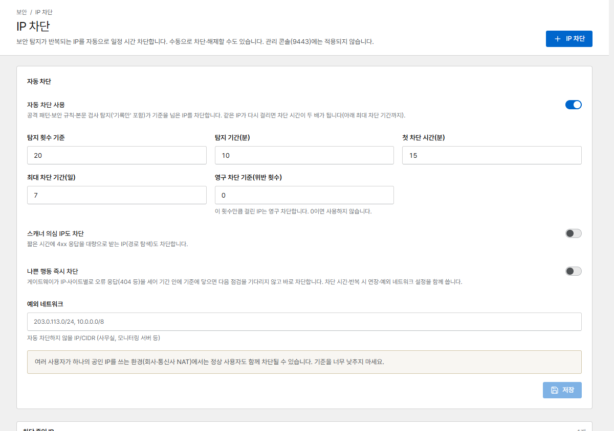

# 차단과 Rate Limit

## IP 차단

Corvus는 공격을 반복하는 IP를 사용자가 따로 손대지 않아도 일정 시간 차단합니다. 직접 차단하거나
해제할 수도 있습니다. 차단은 모든 프록시 호스트와 리디렉션 호스트에 적용되며, 관리 콘솔에는
적용되지 않습니다.

{ .shot }

### 자동 차단

| 설정 | 기본값 | 의미 |
|---|---|---|
| **자동 차단 사용** | 켜짐 | 탐지(공격 패턴과 본문 검사는 기록만 하는 모드 포함, 보안 규칙은 차단한 경우)가 기준을 넘은 IP를 차단합니다. **로그** 동작 규칙에 일치한 요청은 세지 않습니다 |
| **탐지 횟수 기준** / **탐지 기간(분)** | 10분에 20회 | 차단 기준 |
| **첫 차단 시간(분)** | 15분 | 다시 걸릴 때마다 차단 시간이 두 배가 됩니다 … |
| **최대 차단 기간(일)** | 7일 | … 이 기간까지(최대 30일) |
| **영구 차단 기준(위반 횟수)** | 0 (사용 안 함) | N번째 위반부터 영구 차단합니다 |
| **스캐너 의심 IP도 차단** | 꺼짐 | 짧은 시간에 4xx 응답을 많이 받는 IP(경로 탐색)도 차단합니다 |
| **나쁜 행동 즉시 차단** | 꺼짐 | 게이트웨이가 IP **및 사이트**별로 오류 응답(예: 404)을 세어, 기준에 닿으면 다음 점검을 기다리지 않고 바로 차단합니다 |
| **예외 네트워크** | – | 자동으로 차단하지 않을 IP/CIDR: 사무실, 모니터링 서버, 내 서버 등 |

!!! warning "공유 IP"
    여러 사람이 하나의 공인 IP를 쓰는 곳(회사나 통신사 NAT)에서는 함께 차단될 수 있습니다.
    기준을 너무 낮추지 말고, 알고 있는 공유 네트워크는 **예외 네트워크**에 추가하세요.

### 수동 차단

**IP 차단**은 주소를 15분부터 **직접 해제할 때까지** 차단합니다. 목록에서 **차단 해제**를 누르면
차단이 풀리고, **영구 차단**을 누르면 영구히 유지됩니다. 반복 공격 IP [알림](../operations/alerts.md)에서
한 번의 클릭으로 해당 IP를 24시간 차단할 수도 있습니다.

차단은 관리 콘솔(9443 포트)에는 적용되지 않습니다. 콘솔에 접속할 수 있는 곳을 제한하려면
**네트워크 → 관리 콘솔 접근 허용 네트워크**를 사용하세요([사용자와 로그인](../operations/users.md#protect-the-console) 참고).

## Rate Limit { #rate-limits }

Rate Limit 정책은 IP 하나가 호스트에 요청을 보낼 수 있는 속도를 제한합니다. **Rate Limit 정책**
페이지에서 정책을 만들고, 프록시 호스트 입력 화면(**보호 → Rate Limit 정책**)에서 연결합니다.

| 설정 | 의미 |
|---|---|
| **초당 요청 수** | IP당 허용하는 평균 속도 |
| **버스트** | 짧은 순간 몰릴 때 추가로 허용하는 요청 수 |
| **IP당 동시 연결** | 0이면 제한하지 않습니다 |
| **차단 시 상태 코드** | 보통 `429` |
| **관찰 모드** | 아무것도 막지 않고, 막혔을 요청만 트래픽 관제에 기록합니다 |
| **예외 대역** | 제한하지 않을 IP |

!!! tip
    새 정책은 **관찰 모드**로 시작해 며칠 동안 *트래픽 관제*를 지켜본 뒤 실제 차단을 켜세요.
