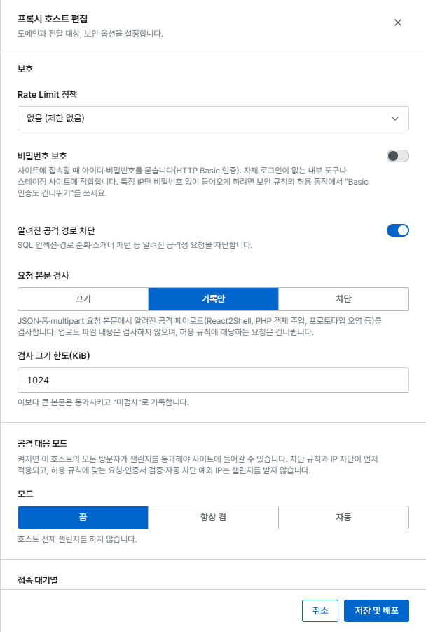

# 챌린지와 공격 대응 모드

**챌린지**는 브라우저가 사이트에 들어가기 전에 진짜 브라우저임을 증명하게 합니다. 외부 서비스
(CAPTCHA 업체)가 필요 없고, 서버에 아무것도 저장하지 않습니다.

## 챌린지 방식

| 방식 | 브라우저가 하는 일 | 막는 대상 |
|---|---|---|
| **JavaScript (작업 증명)** | 작은 계산을 풉니다. 보통 1초에서 몇 초 안에 끝납니다 | JavaScript를 실행하지 않는 봇. 대량 요청의 비용을 높입니다 |
| **쿠키 확인** | 쿠키를 받고 폼을 다시 보냅니다 | 단순한 스크립트와 HTTP 클라이언트 |

통과한 방문자는 IP(선택하면 브라우저까지)에 묶인 서명된 쿠키를 받고, 쿠키가 만료될 때까지
다시 챌린지를 받지 않습니다(**통과 유지 시간**, 규칙의 기본값은 24시간).

!!! warning "브라우저가 아닌 클라이언트는 통과할 수 없습니다"
    API 클라이언트, 모바일 앱, 피드 리더, 모니터링, 검색 엔진 크롤러는 챌린지를 풀 수 없습니다.
    챌린지보다 위에 이들을 위한 **허용** 규칙을 두거나, 사람이 브라우저로 쓰는 경로에만 챌린지를
    적용하세요.

## 규칙으로 챌린지 걸기

동작이 **챌린지**인 [보안 규칙](rules.md)을 만듭니다. 예를 들어 `/login`이나 악성 요청이 많은
국가에 적용할 수 있습니다. 통과한 방문자에게도 차단 규칙은 그대로 적용됩니다.

## 공격 대응 모드

공격 대응 모드는 **호스트의 모든 방문자**에게 챌린지를 겁니다. 프록시 호스트 입력 화면의
**보호 → 공격 대응 모드**에서 설정합니다.

{ .shot .panel }

| 모드 | 동작 |
|---|---|
| **끔** | 호스트 전체 챌린지를 하지 않습니다(기본값) |
| **항상 켬** | 통과 쿠키가 없는 모든 요청이 챌린지를 받습니다. 공격을 받는 동안 켜 두세요 |
| **자동** | 초당 요청 수나 차단된 요청의 비율이 기준을 넘으면 저절로 켜지고, 트래픽이 유지 시간 동안 기준 아래로 머물면 다시 꺼집니다 |

자동 모드 설정:

| 설정 | 기본값 |
|---|---|
| 초당 요청 기준 | 200 |
| 차단 비율 기준 | 50 % (0은 사용 안 함) |
| 측정 구간 | 30초 |
| 유지 시간 | 15분, 계속 기준을 넘으면 연장 |

켜지거나 꺼질 때 [알림](../operations/alerts.md)이 오고, 대시보드에 배너가 표시됩니다.
**지금 해제**를 누르면 자동으로 켜진 상태를 일찍 끝냅니다.

챌린지를 받지 않는 요청: 허용 규칙과 일치한 요청, 인증서 검증, 자동 차단 예외 네트워크의 IP.
