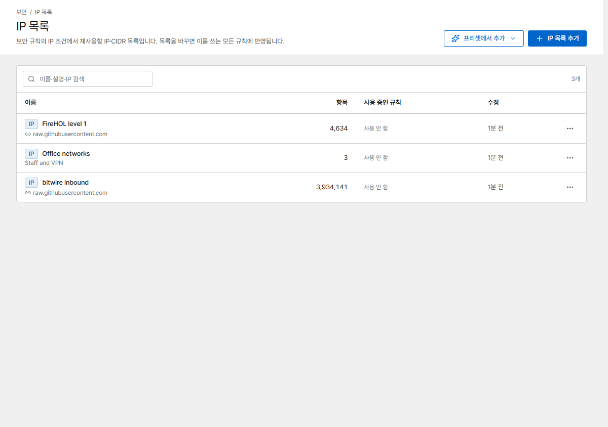

# IP 목록

목록은 IP 대역이나 User-Agent 문자열을 묶어 여러 [보안 규칙](rules.md)에서 함께 쓸 수 있게 합니다.
목록을 한 번 바꾸면 그 목록을 쓰는 모든 규칙에 반영됩니다.

{ .shot }

## IP 목록

한 줄에 IP 주소나 CIDR 하나씩 입력합니다(IPv4·IPv6, 직접 입력할 때 최대 50,000개.
[URL에서 가져오는 목록](#lists-from-a-url)은 수백만 개까지 가능). 흔히 사무실·VPN 대역,
모니터링 서버, 알려진 악성 네트워크 목록을 만듭니다.

저장된 목록에 어떤 주소가 들어 있는지 보려면 목록을 열고 **IP 주소 확인**을 사용하세요.

규칙에서는 **IP 주소** 조건에 **다음 중 하나**를 고르고 목록을 선택해 사용합니다.

## User-Agent 목록 { #user-agent-lists }

**종류 → User-Agent**를 고릅니다. 한 줄에 하나씩 입력하며, 요청의 User-Agent가 항목을 대소문자
구분 없이 **포함**하면 일치합니다. 와일드카드나 정규식은 쓸 수 없으므로 목록 때문에 게이트웨이가
느려지지 않습니다.

규칙에서는 **User-Agent 목록** 조건으로 사용합니다.

## URL에서 가져오는 목록 { #lists-from-a-url }

항목을 직접 입력하는 대신 **항목 출처 → URL에서 가져오기**를 고르면, Corvus가 백그라운드에서
목록을 최신으로 유지합니다(기본값은 1시간마다). **프리셋에서 추가**를 누르면 잘 알려진 피드를
채워 줍니다.

| 프리셋 | 종류 |
|---|---|
| Tor 출구 노드 | IP |
| 악성 봇 User-Agent | User-Agent |

- `https://` URL만 쓸 수 있으며, 내부·사설 주소는 거부합니다.
- 한 줄에 항목 하나. `#`이나 `;`로 시작하는 줄은 주석입니다. IP 목록은 최대 64 MB·500만
  항목(넘는 항목은 무시하고 경고에 개수를 표시), User-Agent 목록은 최대 5 MB·10,000 항목입니다.
- `0.0.0.0/0`처럼 `/8`(IPv4)이나 `/16`(IPv6)보다 넓은 범위는 무시하고 목록의 경고에 개수를
  표시합니다. 피드 한 줄로 모든 주소를 덮을 수 없게 하기 위해서입니다.
- 가져오기에 실패하면 이전 항목이 그대로 적용되고, 목록에 오류가 표시됩니다.
- 게이트웨이 설정은 항목이 실제로 바뀌었을 때만 다시 배포합니다.

!!! tip
    피드 목록은 범위가 넓을 수 있습니다. 먼저 **로그** 규칙으로 쓰면서 *규칙 이벤트*를 확인한 뒤
    차단하세요.

## 대형 차단 목록 { #large-blocklists }

URL에서 가져오는 IP 목록은 약 400만 개 주소의 커뮤니티 차단 목록처럼 수백만 항목을 담을 수
있습니다. Corvus는 이런 목록을 작게 유지합니다.

- 목록을 내려받는 동안 각 항목을 주소 범위로 바꾸고, 겹치거나 이어지는 항목은 합칩니다. 범위는
  설정 데이터베이스가 아니라 `./data/lists/`의 압축 파일(IPv4 범위당 8바이트, IPv6 범위당
  32바이트)에 저장하며, 파일 이름은 SHA-256 체크섬입니다.
- 게이트웨이는 이 파일을 읽기 전용으로 메모리에 한 번 매핑하고 모든 워커 프로세스가 함께 씁니다.
  조회는 범위에 대한 이진 탐색입니다. 워커마다 사본을 만들지 않습니다.
- 목록 화면에는 항목 수와 범위 수, 처음 100개 범위, **IP 주소 확인**이 표시되며 목록 전체를
  불러오지 않습니다.
- 어떤 목록도, 보관 중인 어떤 설정 버전도 쓰지 않는 파일은 자동으로 지웁니다.

390만 항목(내려받기 56 MB) 차단 목록으로 측정한 값:

| | |
|---|---|
| 저장된 파일 | 범위 355만 개, 28.5 MB |
| 내려받기와 변환(컨트롤 플레인) | 약 1초, 최대 약 35 MB 메모리 사용 후 반환 |
| 게이트웨이 메모리 | 모든 워커를 통틀어 파일 크기만큼 한 번(공유 페이지 캐시). 120만 항목 목록에서 컨테이너 전체 증가량 17 MiB |
| 설정을 불러올 때 파일 검사 | 약 80 ms |
| 조회 | CPU 코어당 초당 약 190만 회(범위 400만 개) |

이전 방식이라면 같은 목록이 **워커마다** 200 MB가 넘는 메모리를 쓰고, 다시 불러올 때마다
몇 초씩 걸렸을 것입니다.

설정을 불러올 때 게이트웨이가 목록 파일이 없거나 손상된 것을 발견하면 **설정을 거부합니다**.
배포는 이유와 함께 실패하고 실행 중인 설정은 그대로 유지됩니다. Corvus는 파일을 쓰기 전에 모두
검사하므로, 파일을 직접 바꾸지 않는 한 일어나지 않습니다.

!!! note "백업"
    URL에서 가져온 목록의 항목은 다시 내려받을 수 있으므로 백업에 포함하지 않습니다. 복원 후에는
    Corvus가 다시 내려받을 때까지(보통 1분 안에 자동으로) 해당 목록이 비어 있으며, 그동안 목록
    화면에 경고가 표시됩니다. 직접 입력한 목록은 백업에 포함됩니다.
