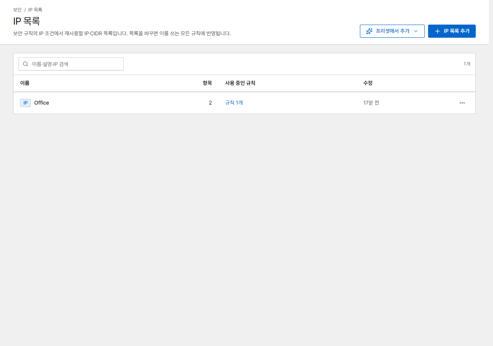

# IP 목록

목록은 IP 대역이나 User-Agent 문자열을 묶어 여러 [보안 규칙](rules.md)에서 함께 쓸 수 있게 합니다.
목록을 한 번 바꾸면 그 목록을 쓰는 모든 규칙에 반영됩니다.

{ .shot }

## IP 목록

한 줄에 IP 주소나 CIDR 하나씩 입력합니다(IPv4·IPv6, 최대 50,000개). 흔히 사무실·VPN 대역,
모니터링 서버, 알려진 악성 네트워크 목록을 만듭니다.

규칙에서는 **IP 주소** 조건에 **다음 중 하나**를 고르고 목록을 선택해 사용합니다.

## User-Agent 목록 { #user-agent-lists }

**종류 → User-Agent**를 고릅니다. 한 줄에 하나씩 입력하며, 요청의 User-Agent가 항목을 대소문자
구분 없이 **포함**하면 일치합니다. 와일드카드나 정규식은 쓸 수 없으므로 목록 때문에 게이트웨이가
느려지지 않습니다.

규칙에서는 **User-Agent 목록** 조건으로 사용합니다.

## URL에서 가져오는 목록

항목을 직접 입력하는 대신 **항목 출처 → URL에서 가져오기**를 고르면, Corvus가 백그라운드에서
목록을 최신으로 유지합니다(기본값은 1시간마다). **프리셋에서 추가**를 누르면 잘 알려진 피드를
채워 줍니다.

| 프리셋 | 종류 |
|---|---|
| Tor 출구 노드 | IP |
| 악성 봇 User-Agent | User-Agent |

- `https://` URL만 쓸 수 있으며, 내부·사설 주소는 거부합니다.
- 한 줄에 항목 하나. `#`이나 `;`로 시작하는 줄은 주석입니다. 최대 5 MB.
- `0.0.0.0/0`처럼 `/8`(IPv4)이나 `/16`(IPv6)보다 넓은 범위는 무시하고 목록의 경고에 개수를
  표시합니다. 피드 한 줄로 모든 주소를 덮을 수 없게 하기 위해서입니다.
- 가져오기에 실패하면 이전 항목이 그대로 적용되고, 목록에 오류가 표시됩니다.
- 게이트웨이 설정은 항목이 실제로 바뀌었을 때만 다시 배포합니다.

!!! tip
    피드 목록은 범위가 넓을 수 있습니다. 먼저 **로그** 규칙으로 쓰면서 *규칙 이벤트*를 확인한 뒤
    차단하세요.
