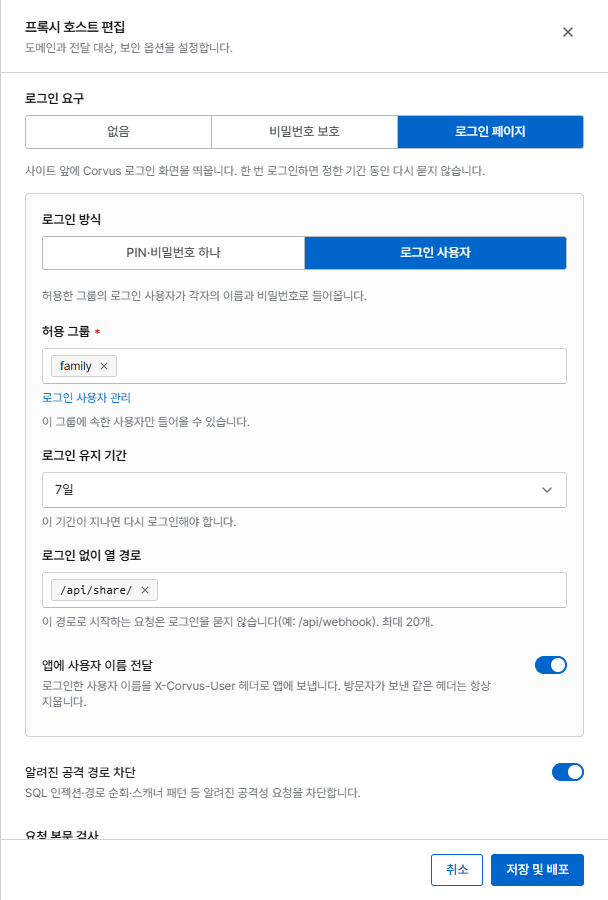
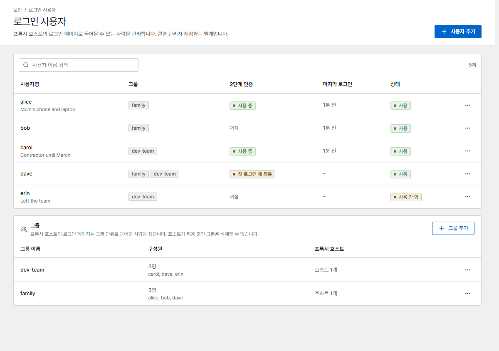
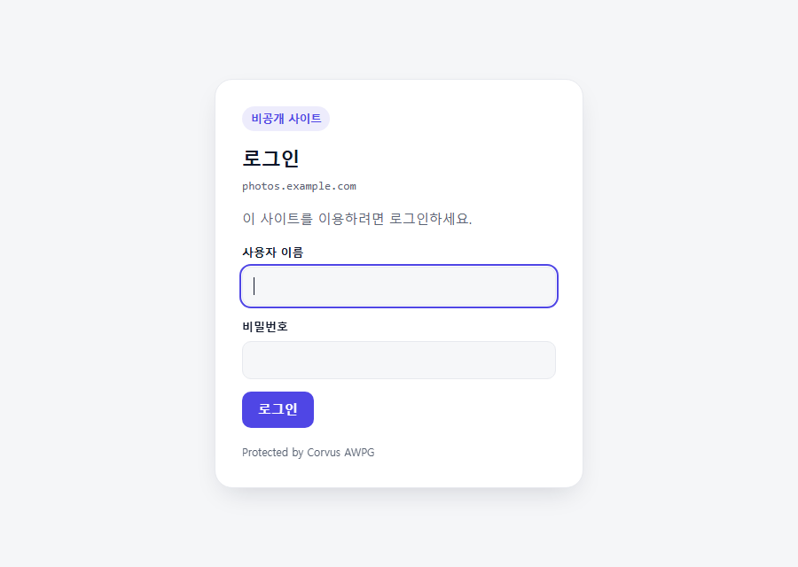

# 로그인 페이지

프록시 호스트는 사이트를 열기 전에 Corvus 로그인 페이지를 보여 줄 수 있습니다. 자체 로그인이 없거나
인터넷에 그대로 열어 두면 안 되는 앱에 씁니다. 가족 사진 앨범, 내부 도구, 스테이징 사이트, 대시보드
같은 것들입니다.

{ .shot .panel }

## 보호 방법 고르기

프록시 호스트 입력 화면의 **보호** 섹션에서 **로그인 요구**를 세 가지 중에서 고릅니다.

| 선택 | 방문자가 보는 것 | 알맞은 경우 |
|---|---|---|
| **없음** | 누구나 사이트에 들어옵니다 | 공개 사이트 |
| **비밀번호 보호** | 브라우저 자체의 사용자 이름·비밀번호 창(HTTP Basic 인증) | Basic 인증을 보내는 스크립트와 도구, 간단한 보호 |
| **로그인 페이지** | Corvus 로그인 화면. 한 번 로그인하면 정한 기간 동안 다시 묻지 않습니다 | 브라우저로 쓰는 사람(휴대폰 포함) |

한 호스트에는 비밀번호 보호와 로그인 페이지 중 하나만 쓸 수 있습니다.

로그인 페이지의 **로그인 방식**은 두 가지입니다.

| 방식 | 이럴 때 |
|---|---|
| **PIN·비밀번호 하나** | 가족처럼 몇 사람이 비밀 하나를 함께 씁니다. 관리할 계정은 없지만, 누가 로그인했는지 알 수 없고 한 사람만 막을 수도 없습니다. PIN을 바꾸면 모두 로그아웃됩니다 |
| **로그인 사용자** | 사람마다 자기 이름과 비밀번호를 쓰고, 2단계 인증도 요구할 수 있습니다. 누가 로그인했는지 보이고, 한 사람만 로그아웃시키거나 막을 수 있으며, 호스트마다 다른 그룹을 허용할 수 있습니다 |

## PIN으로 로그인 페이지 만들기

1. 프록시 호스트를 편집해 **보호**로 갑니다.
2. **로그인 요구**를 **로그인 페이지**로, **로그인 방식**을 **PIN·비밀번호 하나**로 정합니다.
3. **PIN 또는 비밀번호**를 입력합니다(4자 이상). 저장한 뒤에는 다시 볼 수 없고, 입력 화면에는
   **설정됨**과 **변경** 버튼이 보입니다. 편집할 때 비워 두면 현재 PIN을 유지합니다.
4. **로그인 유지 기간**(1시간~30일, 기본 7일)을 고르고 **저장 및 배포**를 누릅니다.

PIN을 바꾸면 이전 PIN으로 로그인한 방문자는 모두 로그아웃됩니다.

## 로그인 사용자 만들기

로그인 사용자는 콘솔의 [사용자](../operations/users.md)와 별개입니다. 허용한 사이트에만 들어갈 수
있고, 콘솔에는 로그인할 수 없습니다. 운영자와 관리자가 관리하며, 조회자는 목록을 읽기만 합니다.

{ .shot }

1. 메뉴의 *보안* 아래 **로그인 사용자**를 엽니다.
2. **그룹**에서 **그룹 추가**를 눌러 `가족`이나 `개발팀` 같은 그룹을 만듭니다.
3. **사용자**에서 **사용자 추가**를 누릅니다. 사용자 이름(영문 소문자, 숫자와 `. _ @ -`, 대소문자
   구분 없음), 비밀번호(8자 이상, **자동 생성**으로 만들 수 있음), 그룹을 정합니다. 필요하면
   **2단계 인증 요구**를 켭니다.
4. 프록시 호스트를 편집해 **보호**에서 **로그인 요구**를 **로그인 페이지**로, **로그인 방식**을
   **로그인 사용자**로 정하고 **허용 그룹**을 고릅니다.
5. **저장 및 배포**를 누르고, 각 사람에게 사용자 이름과 비밀번호를 알려 줍니다.

허용 그룹에 속한 사용자만 들어올 수 있습니다. 그룹은 호스트마다 허용하므로, 한 사용자가 어떤
사이트에는 들어가고 다른 사이트에는 못 들어가게 할 수 있습니다. 호스트가 허용 중인 그룹은 삭제할 수
없습니다. 로그인 페이지가 있는 호스트는 목록에 **로그인 · 사용자** 또는 **로그인 · PIN**으로
표시됩니다.

## 2단계 인증

**2단계 인증 요구**를 켜면, 사용자가 처음 로그인할 때 인증 앱(Google Authenticator, 1Password,
Aegis 등)을 직접 등록합니다. 비밀번호 다음에 로그인 화면이 QR 코드와 직접 입력용 키를 보여 주고,
확인용 6자리 코드를 묻습니다. 그다음부터는 비밀번호 뒤에 코드를 입력합니다. 관리자는 QR 코드나 키를
볼 수 없습니다.

**2단계 인증** 열에는 **사용 중** 또는 **첫 로그인 때 등록**이 표시됩니다. 사용자가 휴대폰을 잃어버리면
**2단계 인증 초기화**로 등록된 인증 앱을 지우고 로그아웃시킵니다. 사용자는 다음 로그인 때 새 인증 앱을
등록합니다. 복구 코드는 없습니다.

## 로그인 없이 열 경로

**로그인 없이 열 경로**에 적은 경로로 시작하는 요청은 로그인을 묻지 않습니다(최대 20개). 브라우저로
열지 않는 부분에 씁니다.

- 웹훅(`/api/webhook`, `/hooks/`)
- 자체 로그인이 있는 모바일 앱이나 동기화 클라이언트가 쓰는 API
- 공개 공유 링크 경로, 헬스 체크

경로 앞부분을 글자 그대로 비교합니다. `/api/`는 `/api/v1/items`에 맞고, `/api`는 `/apikeys`에도
맞으므로 폴더는 `/`로 끝내세요. `/`, `\`, `.`을 퍼센트 인코딩(`%2F`, `%5C`, `%2E`)으로 숨긴 경로는
통과시키지 않습니다. `/` 자체와 `/__corvus`는 쓸 수 없습니다. 이 경로에도 차단, 보안 규칙 등 다른
보호는 그대로 적용됩니다. [보안 규칙](rules.md)의 허용 동작에서 **Basic 인증도 건너뛰기**를 켜면
로그인 페이지도 건너뜁니다. 집 네트워크를 빼 줄 때 쓸 수 있습니다.

## 앱에 사용자 이름 전달

로그인 사용자 방식에서 **앱에 사용자 이름 전달**을 켜면, 로그인한 사용자 이름을 `X-Corvus-User`
헤더로 앱에 보냅니다. 리버스 프록시가 보낸 헤더를 믿는 앱은 이 값으로 사용자를 로그인시킬 수
있습니다(앱 설정에서 "header authentication", "trusted header" 같은 항목을 찾아보세요). 방문자가 보낸
`X-Corvus-User` 헤더는 로그인 페이지가 없는 호스트에서도 항상 지우므로, 앱이 Corvus를 거쳐서만
접속된다면 이 헤더를 믿어도 됩니다.

세션 쿠키(`__corvus_login`)는 앱에 전달하지 않습니다.

## 세션

- 로그인은 **로그인 유지 기간** 동안 유지되고, 그 뒤에는 다시 로그인해야 합니다.
- 세션은 호스트마다 따로입니다. `photos.example.com`에 로그인해도 `wiki.example.com`에는 로그인되지
  않습니다.
- 방문자 IP에 묶이지 않으므로, Wi-Fi와 모바일 데이터를 오가는 휴대폰도 로그인이 유지됩니다.
- 로그아웃하려면 사이트에서 `/__corvus/login`을 열고 **로그아웃**을 누릅니다.

다음 경우 그 사용자의 세션이 바로 끝납니다.

- 사용자를 끄거나 삭제했을 때, 새 비밀번호를 정했을 때
- **로그인 끊기** 또는 **2단계 인증 초기화**를 눌렀을 때
- 사용자를 호스트의 허용 그룹에서 뺐을 때(또는 호스트에서 그 그룹을 뺐을 때)
- 호스트의 PIN을 바꿨을 때(PIN 방식)

## 방문자와 앱이 받는 응답

세션이 없을 때, 페이지를 여는 브라우저(HTML을 받는 `GET`이나 `HEAD`)는 `/__corvus/login`으로 이동하고,
로그인하면 원래 페이지로 돌아갑니다. 그 밖의 요청(JavaScript가 부르는 API 등)은
`{"error":"login_required"}`와 함께 `401`을 받습니다. 그래서 백그라운드로 API를 부르는 싱글 페이지 앱은
세션이 끝나면 새로 고침해야 로그인 화면이 나옵니다.

로그인 화면은 방문자 브라우저의 언어(콘솔의 8개 언어)로, 밝은 테마와 어두운 테마로 보이며
JavaScript 없이도 동작합니다.

{ .shot }

## 로그인 실패

- 로그인 시도는 방문자 주소별, 사용자 이름별로 제한됩니다. 10번 실패하면 잠시 기다리라고 안내합니다.
  없는 사용자 이름, 틀린 비밀번호, 다른 그룹의 사용자, 꺼진 사용자 모두 같은 메시지를 받습니다.
- 로그인 실패는 공격 패턴과 마찬가지로 [자동 차단](bans.md#automatic-bans)과 **반복 공격 IP**
  [알림](../operations/alerts.md)의 탐지로 셉니다.
- [트래픽 관제 → 이벤트](../operations/traffic.md#events)에 **로그인 실패**로 표시되며, **로그인
  성공**, **로그인 화면으로 보냄**, **로그인 시도 제한**도 함께 보입니다.

## 한계

- **HTTPS를 쓰세요.** 인증서가 없으면 PIN이나 비밀번호가 암호화되지 않고 전송되며, 입력 화면에도 경고가
  나옵니다. 인증서를 연결하고 **HTTPS로 강제 이동**을 켜세요.
- **통합 로그인(SSO)이 아닙니다.** 로그인 사용자는 Corvus 안에만 있습니다. OpenID Connect, LDAP,
  ID 공급자로의 forward-auth는 없고, 호스트마다 따로 로그인합니다. 여러 앱에 걸친 SSO가 필요하면
  Authelia, Authentik, Pangolin을 쓰세요.
- 사용자가 자기 비밀번호를 바꾸거나 재설정할 수 없습니다. 운영자가 콘솔에서 새 비밀번호를 정합니다.
- 로그인에는 컨트롤 플레인(`corvus-control`)이 필요합니다. 멈춰 있으면 이미 로그인한 방문자는 계속
  쓸 수 있지만, 다시 살아날 때까지 새로 로그인할 수는 없습니다.
- API와 브라우저가 아닌 클라이언트에는 **로그인 없이 열 경로**(와 앱 자체 인증)나 **비밀번호 보호**를
  쓰세요.

[HTTP API](../reference/api.md)에서는 호스트 필드 `login`, 로그인 사용자와 그룹은
`/api/signin-users`, `/api/signin-groups`입니다.
