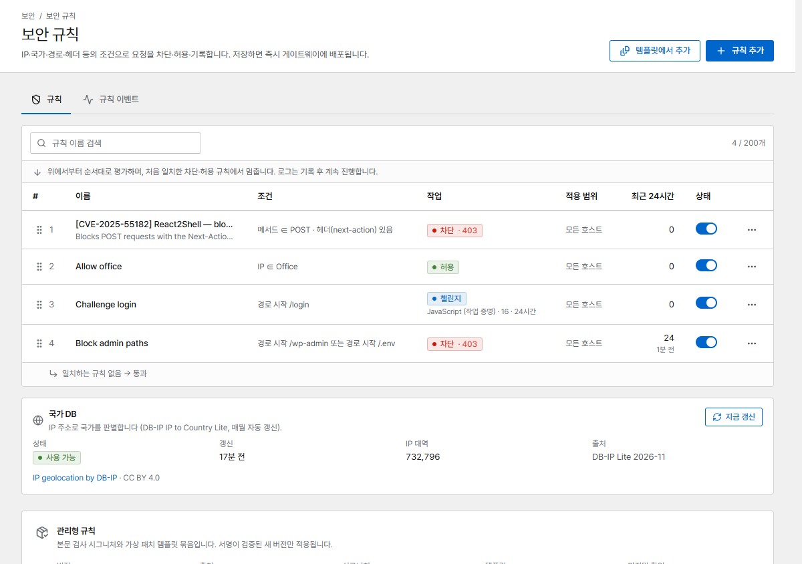
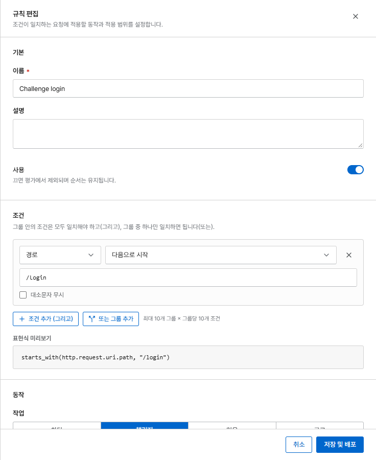

# 보안 규칙

보안 규칙은 지정한 조건과 일치하는 요청을 어떻게 처리할지 정합니다. 차단하거나, 허용하거나,
기록만 하거나, 브라우저에 챌린지를 통과하게 할 수 있습니다.

{ .shot }

규칙은 **위에서부터 순서대로** 검사합니다. 처음 일치한 **차단** 또는 **허용** 규칙에서 멈추고,
**로그** 규칙은 기록한 뒤 계속 진행하며, **챌린지** 규칙은 아직 통과하지 않은 방문자에게 챌린지를
보여 줍니다. 규칙을 끌어서(또는 화살표로) 순서를 바꿀 수 있습니다. 일치하는 규칙이 없으면 요청은
통과합니다.

## 규칙 만들기

**규칙 추가**를 누릅니다.

{ .shot .panel }

### 조건

그룹 안의 조건은 모두 일치해야 하고(**그리고**), 그룹 중 하나만 일치하면 됩니다(**또는**).

| 필드 | 예 |
|---|---|
| IP 주소 | `203.0.113.0/24` 또는 [IP 목록](ip-lists.md) |
| 국가 | `CN`, `RU` (내장 국가 DB 사용) |
| 호스트, 경로, 쿼리 문자열 | 경로 *다음으로 시작* `/admin` |
| 메서드 | `POST` |
| 요청 헤더, Referer, User-Agent | User-Agent *포함* `curl` |
| User-Agent 목록 | 악성 봇 같은 [User-Agent 목록](ip-lists.md#user-agent-lists) |
| 요청 본문 | 본문 *포함* 문자열 (호스트에서 본문 검사를 켜야 합니다) |

텍스트 조건에는 *같음*, *포함*, *다음으로 시작*, *다음으로 끝남*, 정규식을 쓸 수 있고, 대소문자를
무시하도록 할 수도 있습니다.

### 동작

| 동작 | 효과 |
|---|---|
| **차단** | 상태 코드(기본 `403`, 또는 `401`, `404`, `410`, `429`, `444` = 연결 끊기)와 [차단 페이지](../operations/pages.md)로 거부합니다 |
| **허용** | 요청을 통과시키고 이후 규칙, 공격 차단, Rate Limit을 건너뜁니다. **Basic 인증도 건너뛰기**를 켜면 비밀번호 보호도 건너뜁니다 |
| **로그** | 일치한 것만 기록합니다. 차단하기 전에 새 규칙을 시험해 볼 때 씁니다. 일치해도 [자동 차단](bans.md)으로 이어지지 않습니다 |
| **챌린지** | 먼저 브라우저 챌린지를 보여 줍니다. [챌린지와 공격 대응 모드](challenge.md)를 참고하세요 |

### 적용 범위

**모든 호스트** 또는 **선택한 호스트**.

## 자주 쓰는 예

??? example "관리자 영역은 사무실에서만"
    1. 사무실 대역으로 [IP 목록](ip-lists.md) *사무실*을 만듭니다.
    2. 규칙 *사무실 허용*: IP 주소가 목록 *사무실* **중 하나** → **허용**.
    3. 그 아래에 규칙 *관리자 차단*: 경로가 `/admin`**으로 시작** → **차단**.

??? example "특정 국가 차단"
    국가가 `XX` **중 하나** → **차단** (상태 `403`). 하루 동안은 **로그**로 시작해 *규칙 이벤트*에서
    누가 차단될지 확인하세요.

??? example "로그인 페이지의 봇 속도 늦추기"
    경로가 `/login`**으로 시작** → **챌린지** (JavaScript). 실제 브라우저는 1초 만에 통과하지만
    단순한 봇은 통과하지 못합니다.

??? example "모니터링 통과시키기"
    IP 주소가 `198.51.100.10` **중 하나** → **허용**. 맨 위에 두면 헬스 체크가 챌린지나 Rate Limit에
    걸리지 않습니다.

## 규칙이 하는 일 확인하기

**규칙 이벤트**(같은 페이지의 탭)에는 규칙과 일치한 모든 요청이 최신순으로 IP, 국가, 호스트,
경로와 함께 표시됩니다. 새 규칙은 **로그**로 시작해 이벤트를 확인한 뒤 **차단**으로 바꾸세요.
